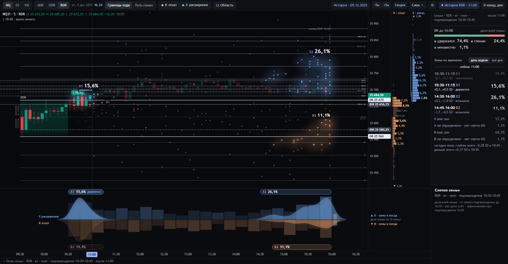

# DR Lab — второй экран трейдера DR/IDR

**27.10.2026 · Основной экран — 23.5** (решение оператора): `http://127.0.0.1:8767/` открывает `/23-5/`, экран 24
остаётся на `/24/`. Базовые созвездия 23.5 — одна таблица «15 минут × 0,1 SD» итоговых R и X семьи
([смысл](meaning/22-time-price-constellation-reset.md), [реализация, действия и проверки](docs/DR-LAB-23-5-MATRIX.md)):
у цены и времени в покое — сильнейшая клетка, наведение раскрывает всю строку или весь столбец одного события; на
созвездии — доля его сильнейшей клетки. Рисунок прежней 23.5 сохранён. Отсюда идёт дальнейшая работа.

**ИСТОРИЯ, ЗАМЕНЕНО 26–27.10 — не текущая основа.** **23.10.2026 · [23.5: время × SD, формулы и фасеты](docs/DR-LAB-23-5-TIME-SD.md):** локальные ядра
15 минут × 0,3 SD, пиковые проекции совместных ячеек, связанные пути после отката в прежнем интерфейсе.
23.5 находится отдельно в `/23-5/` (ярлык `start-dr-lab-23-5.cmd`, 8735); обычная 24 на 8767 сохранена.
[Паспорт и снимки](spec/ekran-23-5/README.md) · [карта привязок](integration/profile235-bindings.json) ·
[квитанция проверок](integration/23-5-time-sd-checks.json).

**21.10.2026 · [Кандидат «Откаты до обновления»](spec/ekran-24/15-otkaty.md):** где у похожих сессий кончался откат,
после которого прежняя вершина была обновлена; каждая звезда — настоящий эпизод H → L → B своей сессии. Включается в
«⚙ → Испытание кандидатов»; принятые R/X не меняются.

**15.10.2026 · [Единая работающая сцена и режим «Продолжения»](integration/DELIVERY.md):** исходные R/X сохранены;
закреплённая область/окно получает новый условный исторический ответ на каждой закрытой M5, с реальными путями
его опоры и переходом к факту. Здесь же — смысловой итог всех 12 PR, происхождение решений и границы проверки.

DR Lab показывает для текущей сессии NQ, ES или YM, **как вели себя похожие сессии 2006–2025**: уровни DR/IDR как в
индикаторе автора метода (TheMas7er, M7DR) и, по семье похожих сессий, где и когда у каждой из них был окончательный
откат R и окончательное расширение X, как часто держался DR и что обычно оставалось впереди к этому часу. Это локальный
инструмент одного трейдера (оператора); этот репозиторий — его смысл, дизайн, исследования и код, и общее место работы
для агентов.

*English: a local second screen for a DR/IDR futures trader. Today's session with the author's DR/IDR levels and, from
the family of similar sessions of 2006–2025, where and when each one's final retracement and extension lay, as zones
with their share and today's status. Every number is checked against a machine-readable semantic contract
(DR-LAB-SC-1.1). The semantic layer is in Russian; start at [`meaning/README.md`](meaning/README.md) (no code needed)
or [`AGENTS.md`](AGENTS.md) (to work on the code).*

## С чего начать

| Кто вы | Куда идти |
|---|---|
| **Смысловой агент** — хотите понять и обсуждать смысл, не открывая код | [`meaning/README.md`](meaning/README.md) |
| **Агент-исполнитель** — будете менять код, данные, экран | [`AGENTS.md`](AGENTS.md), затем [`contract/README.md`](contract/README.md) |
| Хотите разобрать рабочий экран по элементам | [`spec/ekran-24/`](spec/ekran-24/README.md), смысл процентов — [`meaning/10-dizajn-24.md`](meaning/10-dizajn-24.md) |
| Хотите увидеть все варианты дизайна 1–24 | [`design/README.md`](design/README.md) |

## Где мы (07.10.2026)

- **С 27.10 основной экран — 23.5** (`/23-5/`, корень открывает его; см. блок вверху). Ниже — экран 24, основной
  с 01.10 по 27.10.
- **Экран 24 «Границы хода»** (`http://127.0.0.1:8767/24/`). Семья похожих
  сессий фиксируется при сегодняшнем подтверждении. У каждой её сессии одна точка R (самый глубокий откат до конца
  блока) и одна точка X (самое дальнее расширение). Зоны R и X показаны с долей семьи и статусом на сегодня: держится,
  возможна или уже невозможна. Рядом исход DR семьи, «Путь семьи» по пятиминуткам, вопросы уровня и области и слой
  «Сейчас»: что оставалось впереди у сопоставимых сессий к этому часу. Любой день 2006–2025 открывается как
  сегодняшний. Подробно: [`meaning/10-dizajn-24.md`](meaning/10-dizajn-24.md), карта зон —
  [`meaning/12-karta-zon.md`](meaning/12-karta-zon.md), «Сейчас» — [`meaning/15-sloj-seichas.md`](meaning/15-sloj-seichas.md).
- **Смысловой контракт DR-LAB-SC-1.1** принят оператором 07.10 как нормативный для профилей экрана 24 (BASE-24 и
  NOW-1.0) и их дальнейших изменений: [`spec/DR-LAB-Semantic-Contract-1.1-(patched).md`](spec/DR-LAB-Semantic-Contract-1.1-(patched).md).
  Его машинная форма — [`contract/`](contract/README.md). Каждое число экрана — зарегистрированная величина с явным
  утверждением. Сервер пересчитывает её перед выдачей, экран показывает только зарегистрированные слова. Нарушение
  видно вверху панели.
- **Прежние экраны** — дизайн 22 на `/22/`, классический на `/classic.html`, дизайн 23 на `/sem-v1/` — сохранены
  без изменений и пока вне контракта. Их смысл — в ранних разделах [`docs/SEMANTICS.md`](docs/SEMANTICS.md).
- **Как мы сюда пришли** — [`docs/DECISIONS.md`](docs/DECISIONS.md) и
  [`meaning/07-cepochka-reshenij.md`](meaning/07-cepochka-reshenij.md). Открытые вопросы —
  [`meaning/05-otkrytye-voprosy.md`](meaning/05-otkrytye-voprosy.md).

## Жёсткие правила

Рыночные данные (лента, свечи по дням, результаты по отдельным датам) сюда никогда не попадают — репозиторий публичный,
здесь только агрегаты и синтетические макеты. 2026 год в базе истории скрыт. Без Volume. Сервер только локальный. Ордеров
и торговых решений нет: ни одно число инструмента не является прогнозом или сигналом. Полный список — в
[`AGENTS.md`](AGENTS.md).
