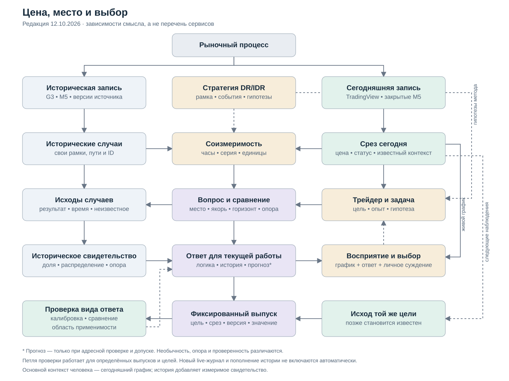

# Цена, место и выбор: что исторический прибор добавляет трейдеру

**Редакция 12.10.2026.** Личный пересмотр Codex после линз «Путь, место и решение» и «Линейка, а не оракул», схемы оператора, SEON/COM/RSMO и статьи о gUFO. Читать вместе с [полностью пересобранной спецификацией](02-semanticheskaya-specifikaciya.md). Это итоговое предложение для рецензирования, не принятие нового рабочего профиля и не доказательство прогнозного преимущества. [Предыдущая редакция 10.10](https://github.com/FARTOFALOS/dr-idr/blob/ed5c7a2b1c7095ec30eb33f3f72fc110841c267e/meaning/lens/2026-10-10-rynok-i-veroyatnost/01-esse.md) сохранена в истории.

## Сначала — человек перед сегодняшним графиком

Трейдер видит сегодняшнюю цену непосредственно в TradingView. Он уже знает уровни, время, наблюдаемые события и свой предполагаемый риск. Второй экран нужен, чтобы сопоставить эту сцену с тем, что невозможно удержать в памяти по тысячам сессий: обычным масштабом и временем движения, разнообразием продолжений, частотой интересующего события и границами применимости сравнения.

Это важная поправка к моему прежнему эссе. Исторический прибор не является единственным источником гипотез человека. Текущий график, метод, опыт, заранее известные обстоятельства и собственные намерения входят в его рассуждение напрямую. История дополняет это рассуждение, а не создаёт всю картину с нуля.

Если после подтверждения цена пришла к midpoint, поднялась до +1 SD и позднее ушла в retirement, человек мог интересоваться ранним ходом. Окончательный минимум его не отменяет. Но из самого факта такого пути ещё не следует, что вход был распознаваем и исполним до движения. Поэтому прибор должен сохранять одновременно **что произошло**, **когда это стало известно** и **что ещё оставалось после доступного момента решения**.

Цель остаётся практической: более обоснованно предполагать дальнейшее положение и развитие цены, соотносить движение с риском и выбирать действие либо ожидание. Чувство обычного масштаба полезно этой цели. Я не заменяю её единственным назначением «быть линейкой» — это была бы новая подмена слов оператора.

## Рынок, запись и метод — три разных основания

На рынке действуют правила и взаимодействуют участники. Однако знание устройства механизма не предоставляет нам полного состояния, из которого можно точно вывести следующую цену. Наша задача не требует провозгласить рынок ни хаосом, ни раскрытым детерминированным алгоритмом.

Доступен конечный архив записей и растущая сегодняшняя запись. Сессии — выделенные интервалы, а не независимые повторения одного лабораторного опыта. Зависимость между днями и инструментами, смена условий и различие источников должны учитываться там, где мы делаем переносимый вывод.

M5 OHLC ограничивает множество возможных внутрисвечных путей. Известны начальная и конечная цены, high и low данного источника; порядок промежуточных событий часто не установлен. Перекрытие области диапазоном является вычислимым свойством записи и не требует утверждать непрерывность цены. Превращение его в «здесь прошли реальные сделки по каждой цене» уже потребовало бы дополнительного основания.

Шкала DR/IDR задаёт начало, направление, единицу и часы сравнения. **SD здесь — ширина IDR, а не статистическое стандартное отклонение.** Ширина коробки может быть связана с последующим масштабом движения, но полезность такой связи проверяется. Нормирование само по себе не делает разные источники данных или эпохи эквивалентными.

У стратегии есть ещё две роли. Она выделяет наблюдаемые события и ситуации — сформирована коробка, есть подтверждение, произошёл слом. И она предлагает рабочие гипотезы — где ждать откат, что считать достаточным движением, как интерпретировать retirement. Гипотеза «откат сделан» не становится наблюдаемой фазой оттого, что получила имя или цвет.

## Что я беру из SEON и gUFO

В COM потребность в информации связана с целью, а определение меры, процедура, измерение и полученное значение различаются; индикатор имеет отношение к цели. RSMO показывает предметное применение этой дисциплины. Для DR Lab отсюда следует необходимость объяснять, **зачем нужен конкретный ответ и каким измерением он получен**, а не выводить нужность из наличия числа. [COM](https://dev.nemo.inf.ufes.br/seon/COM.html), [RSMO](https://dev.nemo.inf.ufes.br/seon/RSMO.html).

gUFO полезен различением событий, ситуаций, свойств и ролей. Его роль зависит от отношения, а фаза — от состояния носителя; временная последовательность сама по себе не является причинностью. Эти различия помогают не смешивать сегодняшний случай, членство в семье, наблюдаемый статус и убеждение трейдера. Они не доказывают вероятности рынка. [Статья gUFO](https://arxiv.org/html/2603.20948v1).

SEON организует основание, ядро и предметные онтологии. Мы используем идею явных зависимостей между смыслами, не переносим всю сеть программной инженерии в торговлю. Здесь не внедряются OWL, SHACL или новая глобальная система управления. [Архитектура SEON](https://dev.nemo.inf.ufes.br/seon/SEON.html).

Моя адаптация этих идей конкретна:

- рыночная сессия и запись о ней не тождественны;
- «сегодняшний объект оценки», «исторический аналог» и «случай проверки» — роли относительно запроса;
- подтверждение и слом — события по правилу; состояние на срезе — конфигурация известных фактов;
- ширина IDR и её числовое значение с единицей — разные смысловые роли;
- ожидание человека, оценка модели и уже наблюдённый исход могут относиться к одной цели, но не взаимозаменяемы.

Я не объявляю сессию автоматически UFO Kind: интервал процесса, информационная запись и объект программного реестра требуют разного моделирования. В данном проекте достаточно явной идентичности и связей; красивое онтологическое имя не создаёт правильного предмета.

## Нужность ограничивает прибор, но не свободу человека

В прежнем эссе «система вопросов к траекториям» описывала выразительную возможность механизма. Этого недостаточно как направления продукта: математически корректных вопросов бесконечно много.

Я предлагаю ограничивать постоянный показ тремя задачами:

1. **Ориентация.** Что уже случилось, что ещё возможно в точном смысле выбранного события, как текущий ход соотносится с историческими масштабами и временем.
2. **Сопоставление продолжений и риска.** Где цена оказывалась дальше; что происходило при взаимодействии с местом; какой ход против стороны сопровождал движение по стороне.
3. **Проверка основания ожидания.** На какой истории держится ответ, насколько нынешняя сцена покрыта ею и каким проверкам подвергался именно этот вид вывода.

Это критерий приоритета и форма разговора об интерфейсе, а не запрет оператора смотреть иной интересующий набор. Обучение, спокойная ориентация и возможность проверить собственную гипотезу также являются полезной работой; ответ не обязан немедленно менять сделку. Существующие запрошенные уровни нельзя убрать только потому, что они уже есть в TradingView.

У каждого нового постоянного элемента должна быть понятная связь: задача человека → необходимое различие → вопрос → мера → представление. Если связи нет, элемент остаётся доступной исследовательской деталью, а не получает постоянное внимание просто потому, что его удалось вычислить.

## Логика, геометрия и особенности — разные основания ответа

Принимаю предложение поставить геометрию ближе к центру. Расстояния, ширина коробки, текущая цена и оставшееся время действительно содержательны для трейдера. Однако здесь нельзя одним словом «геометрия» объединять три силы утверждения.

**Логическое ограничение** следует из определения и известного пути. Если сегодняшний максимум уже выше области, более низкая область не может содержать окончательный максимум. Цена всё ещё может вернуться туда. Это определённое исключение конечного исхода, не прогноз запрета посещения.

**Геометрический ориентир** — описание или модель при данных расстояниях и времени. Ближний барьер может достигаться раньше чаще дальнего. Но конкретный процент зависит от процесса, горизонта, масштаба движения и выбранного набора; он не является геометрической теоремой о сегодняшнем рынке.

**Дополнительный признак** — гипотеза об улучшении ответа сверх подходящего простого сравнения. Окно активации, день недели, посещение области или форма пути оцениваются относительно конкретного исхода.

В репозитории R²≈0,99 относится к объяснению удержания DR через отношение коробки к **реализованному будущему** размаху. Будущий размах недоступен на исходном срезе. Отдельно исследована заранее оценённая величина. Поэтому первый результат нельзя использовать как готовую входную переменную прогноза. Аналогично Brier лучше монеты не доказывает выигрыш над частотой исхода или хорошим геометрическим ориентиром. [Границы исследовательского результата](../../../docs/RESEARCH.md).

Предлагаемое расширение семьи также заслуживает проверки, но ещё не замены рабочего правила. Для конечного описания всей выбранной истории равные веса не требуют стационарности: мы просто описываем эту историю. Для переноса на новые дни уже нужны основания применимости такого объединения. Результат карты зон на ранее просмотренных годах не удостоверяет другой прогнозный исход автоматически.

## Места для мысли, пути для свидетельства

Трейдер мыслит местами: midpoint, retirement, следующий SD, собственный уровень входа или отказа. История свидетельствует путями: один и тот же случай прошёл через эти места в определённой последовательности.

Поэтому место — не просто прямоугольник интерфейса. У него есть пространственный якорь: рамка каждой сессии, собственное состояние исторического случая, замороженный сегодняшний уровень или явно выбранный человеком ориентир. И временной якорь: общие часы, активация или событие. Замена якоря меняет вопрос.

Мы используем положение, посещение, конечный предел, последовательность и пребывание как удобный перечень отношений. Это не доказательство полноты всей торговли. Непрерывное пребывание по M5 не становится известным из распределения закрытий. Локальный откат от максимума также требует правил начала, обновления максимума, повторов и окончания; «естественное определение» не устраняет эти развилки.

Одно место может быть часто посещаемым без того, чтобы быть местом разворота. Один путь может сначала дать ход вверх, а затем уйти глубже. Быстрый проход внутри контактной M5 остаётся в истории взаимодействия, даже когда от её закрытия прежний вопрос U/D уже неприменим.

## Срез включает и заранее известные обстоятельства

Доступная информация — не только уже закрытая цена. Расписание объявления, праздничный календарь или запланированное изменение торговых часов могут быть известны до наступления события.

Но «расписание известно заранее» не означает, что сегодня скачанный календарь был известен историческому трейдеру в той же версии. Нужны источник, время публикации, изменения и правило выбора версии на срезе. Известное время будущего события допустимо как контекст; ещё не опубликованный результат события — нет.

В новой спецификации календарь входит в информационный набор с собственным временем доступности. При отсутствии проверяемого источника он имеет статус неизвестного покрытия, а не «новостей нет». Это не запускает фильтрацию истории, загрузку внешнего календаря или новый тест FOMC: гипотеза из линзы остаётся гипотезой.

Так же различаются история и сегодняшний источник. Совпадение нормированных координат ещё не удостоверяет одинаковые часы, склейку контрактов, пропуски или агрегацию G3 и TradingView. Соизмеримость должна относиться к конкретной процедуре и области применения.

## Обычность и доверие нельзя свести к одному признаку

Полезно знать, например, что текущий откат глубже большинства случаев выбранного набора на том же часу. Это характеристика положения сегодня относительно истории.

Однако хвост одного распределения не равен отсутствию аналогов, а редкость не равна ошибке прогноза. Редкое состояние может быть хорошо изучено; обычное по одному признаку — плохо покрыто по другим. Поэтому я разделяю:

- описательную обычность конкретного свойства;
- опору и применимость сравнения к сегодняшнему состоянию;
- качество проверок данного способа оценки;
- сопоставимость источников наблюдения.

Универсальный знак «необычный день — всем процентам не доверять» из одного перцентиля не следует. Прибор должен показать, что именно редко или не покрыто и какого ответа это касается.

## Процент о будущем замыкается на исходе той же цели

Историческая доля описывает набор. Прогноз оценивает неизвестный исход сегодняшнего случая. Позже появляется результат того же вопроса: стало ли известно событие, когда и с какой неопределённостью.

Этот третий участник в моей прежней схеме действительно был недостаточно явным. Новая схема связывает выпуск ответа с последующим исходом по идентичности цели, горизонту, срезу и версии. Воспроизведённый ответ по закрытиям и фактически показанный live-ответ не называются одним видом доказательства.

Проверка может идти на воспроизводимых исторических выпусках. Отдельная запись новых live-ответов и тем более добавление живых сессий в историческую базу не запускаются этим документом: действующие ограничения и О23/О24 сохраняются.

Калибровка и точный смысл нужны вместе. Хорошо откалиброванное число о другом событии всё равно отвечает не на тот вопрос. Правильная подпись не делает неверную оценку калиброванной. Поэтому принимаю желание уменьшить словесную нагрузку, но не замену семантики «воротами калибровки». C2 предусмотрен SC как тип; действующие BASE/NOW не имеют его продуктового допуска.

Более того, новые сведения не обязаны каждый раз сужать неопределённость или повышать процент выбранной стороны. Они могут разрушить прежнее ожидание. Адаптивный прибор должен уметь честно сделать ответ менее уверенным.

## Что пересмотрено окончательно для этого пакета

Сохраняются идентичность случая, доступность знания, разные якоря, знаменатели, быстрые проходы, совместное время исхода и различение нового среза от новой цели. Перестроена внешняя логика: **живой график и задача человека → нужное свидетельство → измерение → допустимый ответ → восприятие → последующая проверка**.

Принимаю из линз сегодняшний случай как явный узел, три роли стратегии, значимость геометрии, критерий нужности и заранее известный контекст. Не принимаю без отдельного основания замену семьи широким классом, приравнивание редкости к ненадёжности, перенос старых проверок на новые цели, причинное прочтение исторической последовательности и отмену точного смысла ради краткой подписи.

Наше движение в разговоре стало конкретнее: от вопроса «не потеряли ли агенты интенцию» — к обнаруженным подменам, затем к ранним движениям внутри сессии, к уточняемым продолжениям и наконец к ограниченному набору ответов для реальной работы. Инженер получает не поручение построить всю онтологию рынка, а определённый профиль с ясными входами, выходами и границами.

## Источники и статус проверки

Линзы сохранены как входы: [«Путь, место и решение»](sources/01-put-mesto-i-reshenie.md), [«Линейка, а не оракул»](sources/02-linejka-a-ne-orakul.md), [переданная схема](sources/input-schema.svg). Второе эссе пересматривает часть первого по заявлению его автора. Это не автоматическое изменение решений оператора. Аудитор намеренно не читал прежнюю инженерную спецификацию, поэтому его замечания о рисунке не объявлены отсутствием всех соответствующих объектов в коде и контракте.

Использованы [SC-1.1](../../../spec/DR-LAB-Semantic-Contract-1.1-(patched).md), [назначение](../../01-zachem.md), [семья](../../08-semantika-klasterov.md), [экран 24](../../10-dizajn-24.md), [исследование зон](../../12-karta-zon.md), [NOW](../../15-sloj-seichas.md), [работа трейдера](../../17-rabota-treidera.md), [стратегия](../../../docs/STRATEGY.md), [открытые вопросы](../../05-otkrytye-voprosy.md). Числа прежних исследований прочитаны с их ограничениями, не пересчитаны и не объявлены независимым подтверждением.

В этой работе изменён аналитический пакет и его проверки. Нормативные SC/SWPC, рабочий backend/frontend, данные и настройки не менялись. Полные определения, таблица решений для реализации и проверка новых различий — в [спецификации](02-semanticheskaya-specifikaciya.md).
