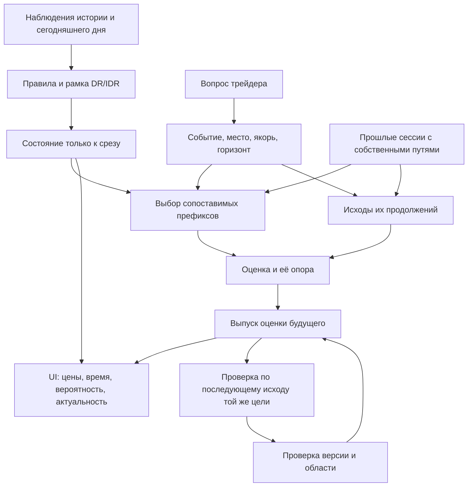

# DR Lab: SRS вероятностной системы продолжения цены

**Идентификатор:** DR-LAB-FUTURE-SRS-0.2. **Дата:** 12.10.2026. **Автор:** Codex, лично, без субагентов.

**Статус:** независимый проект требований для обсуждения и последующей инженерной передачи. Слова «должна» и «запрещено» ниже определяют соответствие предлагаемому результату; создание этого файла не делает их принятыми правилами работающего продукта.

**Прямое основание:** оператор в текущем чате попросил глубоко разобрать смысл стратегии, сущности и взаимосвязи и создать самостоятельный SRS. Он уточнил, что цель — оценка будущего движения по повторяемости истории в координатах DR/IDR и времени. Существующие спецификации используются как источники и линзы, а не как предел назначения системы.

**Совместимость:** действующие BASE-24, NOW-1.0, SC-1.1, SWPC-1.1 и интерфейсные решения сохраняются. Новый прогнозный профиль требует адресного принятия и предусмотренного изменения контракта/проверок. Реальные ордера, автоматический выбор сделки, размер позиции и публичное развёртывание не входят в эту SRS.

Основания и состояние репозитория — в [независимом разборе](01-semantic-audit.md). Он различает личную проверку кода, сохранённые измерения, выводы и рекомендации.

**Уточнение 0.2 — прямое принятие в текущем чате.** Оператор принял три уточнения о раздельных согласованности/сопоставимости/переносимости, узком прочтении D и историческом пилоте Q1 до допуска C2; добавил область применимости в паспорт. Ближайшая постановка — [короткий договор Q1](03-q1-historical-pilot.md). Остальная SRS остаётся целевым предложением, а не перечнем обязательств первого релиза. D1, D2, N5 и PR #2 этим принятием не разрешены. Подробное происхождение и границы принятия — в договоре.

## 1. Назначение и критерий успеха

Система должна помогать трейдеру видеть **возможные продолжения текущей сессии, их относительную вероятность, ценовой масштаб и время** по историческим случаям, сопоставимым с доступным сегодня состоянием.

Её результат — вероятности определённых будущих событий и распределения определённых будущих величин. «Куда пойдёт цена» раскрывается через уровень/область, вид события и срок. Самый большой процент на экране не является самостоятельной целью оптимизации: увеличение области, удлинение горизонта и исключение неблагоприятных случаев могут повышать процент без улучшения знания.

Успех имеет три самостоятельных основания:

1. Процент отвечает тому вопросу о будущем, который задаёт трейдер.
2. Оценка воспроизводима и переносится на следующие случаи с установленной точностью и областью применения.
3. Трейдер различает событие, его место/время и актуальность в текущей сцене без самостоятельного восстановления спрятанной математики.

Для вероятностного прогноза правильный отдельный день не доказывает качество: событие с вероятностью 70% иногда не происходит. Проверяется вся серия выпусков и исходов. Прибыльность собственной торговой политики человека — отдельный последующий вопрос.

## 2. Рабочая гипотеза и модель будущего

**Гипотеза H1:** распределения продолжений достаточно похожи между историей и следующими сессиями, если сравнивать нужные для данного события условия в собственных координатах DR/IDR и времени.

H1 не требует одинаковых путей. Она требует, чтобы выпуски, например около 70%, соответствовали примерно такой доле наступивших событий в проверяемой области. Нужные условия определяются измерением: чрезмерно грубая группа смешивает разные положения; чрезмерно узкая оставляет мало независимых случаев.

На срезе t обозначим доступную информацию I(t), конец блока H, вопрос Q и его событие E(Q). Прогнозная цель:

    p(Q,t) = P(E(Q) после t и до H | I(t), версия модели).

Простая эмпирическая оценка для полностью известных исходов выбранного набора M(Q,t):

    p_hat(Q,t) = число случаев E(Q) / |M(Q,t)|.

Первая формула определяет неизвестный будущий исход; вторая — один возможный оцениватель по аналогам. Их связь является проверяемой гипотезой переноса. Честная частота может быть непосредственным оценивателем вероятности; обязательного сложного преобразования между ними нет. Но название «вероятность» само не устанавливает пригодность переноса.

**Предмет системы шире одной цифры:** распределение продолжений, из которого получают согласованные ответы о достижении, положении, времени, границах и порядке. В первой реализации допустим ограниченный перечень вопросов с отдельными проверенными оценивателями; универсальная генеративная модель всего рынка не требуется.

## 3. Смысловое ядро: сущности и связи

Это логические роли, преимущественно уже представленные в SC. Таблица не требует новой базы, ORM, онтологического движка или копии действующего реестра.

| Сущность | Что обозначает | Главная связь и сохраняемый смысл |
|---|---|---|
| Наблюдение | M5 с OHLC, источником, интервалом и известностью | Из него выводятся факты; порядок всех сделок внутри M5 не задан |
| Сессия | Инструмент, торговая дата, ADR/ODR/RDR, версия правил | Один исторический случай сохраняет собственные уровни и полный упорядоченный путь |
| Рамка DR/IDR | Коробка, направление анализа, начало и единица цены, часы | Делает случаи соизмеримыми; не создаёт сама по себе вероятность |
| Событие стратегии | Подтверждение, слом и другие отдельно определённые условия | Имеет свечу-свидетельство и момент, когда его можно знать |
| Состояние на срезе | Известный префикс, текущий close, сделанные экстремумы, статусы | Служит входом сравнения; будущий остаток сюда не входит |
| Исторический набор | Правило включения и фактические уникальные случаи | Даёт знаменатель; BASE-семья и динамический набор имеют разные роли |
| Продолжение случая | Собственные свечи после сопоставляемого якоря до горизонта | Несёт совместные исходы, а не независимые голоса по каждому рисунку |
| Вопрос и цель | Вид события, место/пороги, якорь, горизонт, целевая сессия | Определяют, что именно прогнозируется и когда вопрос разрешён |
| Проекция пути | Окончательный экстремум, close, посещение, достижение, первое событие | Один путь даёт разные ответы; потерянная последовательность не дорисовывается |
| Модель и оцениватель | Отбор/веса, признаки, обучение, обработка неизвестного | Из допустимых входов получают число; версия меняет способ оценки |
| Выпуск оценки | Цель, срез, модель, результат, опора и состояние публикации | Не переписывается после исхода; новая M5 создаёт новый выпуск |
| Проверка и представление | Выпуск → исход; вопрос → читаемый визуальный носитель | Проверяют перенос и понимание раздельно |

Стрелка «исход → проверка» не означает автоматического добавления live-данных в историческую базу. Исход одного дня не возвращается в уже выпущенную ему оценку. Обновление версии модели имеет собственную процедуру и временную границу обучения.

## 4. Рамка измерений и наблюдаемые состояния

**FR01. Единое измерение.** Исторические и сегодняшние записи должны проходить одну объявленную версию правил построения коробки, подтверждения, слома и шкалы. Существенные различия источников/серий и неизвестные метаданные сохраняются. Для нового live-прогноза проверяется совместимость именно нужных этому прогнозу измерений; историческое описание своего корпуса от этого не исчезает.

**FR02. Цена.** Сохраняется действующая шкала:

    u(p) = d * (p - e) / w;    p(u) = e + d * w * u.

Здесь w — собственная ширина IDR, d — сторона анализа, e — её край IDR. Для шорта направленные low/high меняются физическими ролями. SD означает ширину IDR. Результат сделки в единицах риска имеет другое имя и не смешивается с R-откатом. Сравнения производятся в тиках или точных рациональных координатах; округлённая подпись не определяет событие.

**FR03. Время.** Сохраняются часы America/New_York с DST и торговая дата ADR. Метка свечи — её открытие, доступность закрытой M5 — её конец. Общий час, возраст от подтверждения и возраст от конкретного контакта различаются. По умолчанию новый ответ «отсюда» выравнивает исторические случаи по общим часам блока и одинаковому H; иное выравнивание создаёт отдельный вопрос/профиль.

**FR04. Граница знания.** Сегодняшнее статистическое состояние меняется только по закрытой M5. Свечи позже среза в повторе и формирующаяся цена не участвуют в отборе. Подмена будущего хвоста целевого или исторического дня не меняет его состояние/членство на прежнем срезе; она может изменить только метку исхода.

Для теста утечки различаются хвост цели и хвост аналога: хвост цели не участвует в оценке, тогда как историческая метка аналога — законный вход оценивателя. Поэтому изменение её может менять новый пересчёт доли при прежнем отборе. Оно не меняет уже сохранённый выпуск; новая версия данных сохраняется отдельно.

**FR05. Состояния сессии.** Минимум: формирование коробки; коробка завершена без подтверждения; подтверждение установлено и DR цел; слом установлен; блок завершён; необходимые сведения неизвестны. Гипотезы «откат закончен» и «дальше тренд» имеют отдельные предмет и критерий опровержения. Срабатывание принятой эвристики фазы показывается как срабатывание этого правила.

**FR06. Собственный горизонт.** У каждого исторического случая постактивационные исходы начинаются после закрытия собственной активирующей M5; сама она исключена, закрытие в H включено. Close активации допустим как исходное положение. Текущее BASE-описание ранних колонок «Пути семьи» сохраняется отдельно. Не активированные на общем часу случаи не становятся аналогами уже активированного состояния.

## 5. Какие будущие вопросы система должна уметь различать

Каждая строка задаёт отдельный смысл. Она является требованием к предмету системы, а не заявлением, что её прогнозный оцениватель уже проверен.

| ID | Вопрос трейдера | Формальный результат | Главное условие |
|---|---|---|---|
| Q1 | Дойдём ли отсюда до выбранного места до конца блока? | Достижение порога в (t,H], вероятность/границы | Сторона определяется положением места относительно текущего close; первый и повторный приход различены |
| Q2 | Когда впервые дойдём до этого места? | Распределение первой M5 достижения вместе с массой «не дошли до H» | Не медиана только успешных случаев без вероятности события |
| Q3 | Где окажется цена к определённому часу? | Распределение close на будущей M5 j | Не распределение конечного X и не коридор всей траектории |
| Q4 | Будем ли в выбранной полосе в выбранном окне? | Посещение K×J хотя бы одной M5 | Одна сессия учитывается один раз; посещения разных полос могут пересекаться |
| Q5 | Обновится ли этот минимум/максимум, насколько? | Новый экстремум относительно фиксированного на выпуске якоря; распределение добавки | Собственный экстремум аналога и общая координата места не подменяются |
| Q6 | Что достигнем первым: нижнее или верхнее место? | U_FIRST / D_FIRST / NO_EVENT_BY_H, совместно с временем | Пара выбрана/названа; один набор, один срез, один горизонт |
| Q7 | Что бывает после прихода или определённой реакции? | Продолжение от объявленного контакта/его закрытия/текущего часа | Разные якоря и условные наборы; реакция требует своего распознавания |
| Q8 | Где останутся окончательные границы хода? | Распределение финального R/X до H с учётом прожитого | Исходная BASE-карта остаётся описанием фиксированной семьи |
| Q9 | До подтверждения: какая сторона, когда и что после неё? | Совместная ветка первого подтверждения/времени и последующего пути | Будущая сторона — метка исхода, а не условие живого отбора |

Первый новый прогнозный кандидат — Q1 к ещё не посещённым местам 0, −0,5, −0,7 против подтверждения в ODR/RDR при целом DR: вниз по направленной шкале, для шорта физические цены зеркальны. Другие строки не приобретают его статус проверки автоматически. Они остаются частью целевого продукта и следующих предметных исследований.

«Сколько цена простоит» раскрывается отдельно: доля закрытий в области, серия последовательных close, время до выхода или непрерывное пребывание. M5 не позволяет измерить непрерывное стояние по тикам. Существующий «Путь семьи» может быть полезной опорой без переименования его в это измерение.

Для Q9 оператор может не хотеть отдельной строки «не подтвердилось». Но такие случаи обязаны сохраняться в знаменателе/неизвестности. Если вероятности сторон показаны только среди будущих подтверждений, это условие прямо доступно в смысле ответа. Две стороны не создают ложную сотню всех сессий при наличии «без подтверждения до H».

## 6. Отбор истории и алгоритмический цикл

**FR07. Разные роли наборов.** Принятая семья BASE фиксируется по своему ключу и не меняется. Новый прогнозный набор имеет свой родитель, предикат, опору и версию. Он не может скрыто заменить BASE или расширить её день недели/окно. Прогнозный родитель фиксируется на выбранном начальном срезе по принятому профилю; дальнейшие M5 меняют только отбор/веса внутри него.

**FR08. Временной доступ.** Аналоги берутся строго из дат раньше целевой, до конца 2025 в существующем корпусе. У сопоставляемого дня входом служат только его сведения до собственного сопоставляемого среза. DR-true в конце, окончательные экстремумы и успешность посещения после среза не являются условиями отбора для сегодняшнего неизвестного будущего.

**FR09. Малое исходное состояние.** Для первого Q1 сравниваются: инструмент/блок, общие часы, известное подтверждение, целый DR, close в собственной шкале, факт «место ещё не достигнуто». Это конкретный кандидат, а не доказанная достаточная статистика для всех вопросов. Сделанные экстремумы и отход от них необходимы для определения Q5. Модель дня, реакции, межсессионные уровни и порядок прожитого могут добавляться по своим проверкам.

**FR10. Признак относительно вопроса.** Роль признака определяется якорем события. Для прихода к L ключевое расстояние — от close до L; для нового R — от close до собственного r_seen; для первого из U/D — обе дистанции. Нельзя объявлять один matcher по абсолютной глубине R пригодным для всех этих задач. Детерминированно связанные расстояния не считаются независимыми подтверждениями и не перемножают «уверенность».

**FR11. Первый кандидат отбора.** Сохранённое исследование даёт основание сравнить три родителя для Q1: принятую семью дня недели; тот же ключ без дня недели; все прошлые подтверждённые сессии того же инструмента/блока. В каждом: активация состоялась до t, нужный префикс полон, DR к t цел, свой минимум ещё выше L, отличие close от сегодняшнего ≤1/4 IDR. Предпочтение третьему — рекомендация этого SRS для проверки и принятия, не смена текущего default.

Допуск 1/4 наследует существующий исследовательский кандидат, а не объявляется оптимальным. Объединение сторон допускается только в собственных направленных шкалах и проверенной области. Параметры/веса нельзя менять в текущей сцене ради более привлекательного процента.

**FR12. Нехватка истории.** Не допускаются скрытое расширение допуска, родителя, дней или времени, отбор по будущему и выдуманный процент. Начальный порог n=20 — предлагаемый минимум, совместимый с исследованной веткой; это не гарантия точности. Иной простой проверенный оцениватель может существовать как заранее объявленная база с явно различимым основанием. При отсутствии такого правила зависимый ответ отсутствует с причиной; исправные BASE-данные остаются.

**FR13. Сложность должна улучшать задачу.** Память пути, модели дня и более подробные эпизоды сравниваются с простым состоянием на одинаковых целевых выпусках. Слабость M1–M3 не запрещает новые гипотезы. Дополнительные параметры принимаются при подтверждённой добавке, устойчивости и достаточном покрытии, а не потому, что с ними описание выглядит глубже.

Цикл нового ответа на закрытии M5:

1. Зафиксировать контекст, рамку и доступный сегодняшний префикс.
2. Установить наблюдаемые события и статус выбранной цели.
3. Сохранить BASE-снимок; выбрать допустимый родитель прогнозного ответа.
4. Сопоставить исторические префиксы по замороженному правилу.
5. Из остатков выбранных случаев вычислить определённые исходы и неизвестность.
6. Получить оценку, опору, временные/ценовые распределения и ограничения применимости.
7. Выпустить атомарный ответ по сцене/цели/срезу; показать его в связанных координатах.
8. После разрешения цели сопоставить выпуск с её исходом в предусмотренном режиме проверки.

## 7. Достижение, контакт, порядок и время

**FR14. Пороговое достижение.** Для места ниже направленного close: существует будущая M5 с low_u ≤ L. Для места выше: high_u ≥ L. Open уже за порогом удовлетворяет достижению, но не доказывает сделку по цене L. Равенство считается достижением; строгое обновление экстремума требует выхода хотя бы на свой тик.

**FR15. Посещение и буквальное перекрытие.** Для K=[lo,hi): диапазон M5 перекрывает K при low_u < hi и high_u ≥ lo. Для буквального включения уровня диапазоном: low_u ≤ L ≤ high_u. Гэп за область, перекрытие диапазоном и пороговое достижение хранят разные факты. Из OHLC не восстанавливается непрерывное прохождение каждой промежуточной цены.

**FR16. Якорь продолжения.** Различаются: общий текущий срез; собственное физическое касание исторического случая; закрытие его контактной M5; новые контакты на данном общем часу. Пример: касания 11:05 и 11:20, оба не решены к 11:20, входят в общий остаток 11:20; только второе входит в группу новых контактов 11:20. Распределение возраста от собственного контакта не переименовывается в ответ «отсюда».

**FR17. Быстрые проходы.** Случаи, которые посетили место и прошли его насквозь в контактной M5, сохраняются в истории контактов. Если новый вопрос начинается после close контакта, уже решённые на этом close случаи выделяются отдельно. Из 20 случаев и 17 контактов, пять из которых уже за нижним ориентиром, остаточная группа 12 не заменяет число контактов 17. Результат 12 оставшихся не назначается до чтения их продолжений.

**FR18. Совместный первый исход.** Для Q6 на закрытом срезе с D < close_u < U:

- open следующей известной M5 уже за одной границей устанавливает её пороговое достижение в начале интервала, если до него нет неопределённого промежутка;
- open между границами и достижение только одной дают известный тип и интервал времени этой M5;
- обе достигнуты при open между ними — порядок неизвестен;
- пропуск до первого наблюдённого достижения может скрыть противоположное событие;
- пропуск после уже установленного первого события его не отменяет;
- полный остаток без обоих достижений даёт «ничего до H».

Контактная свеча для Q7 обрабатывается по собственному правилу: положение на open, результаты к close и доступность якоря не смешиваются. Произвольные вопросы не обслуживаются догадкой о внутреннем пути; неподдержанный предикат имеет явную границу.

**FR19. Совместное время.** Первое событие сохраняет свой тип и интервал M5. Для Q2 требуется накопленная вероятность достижения к j и масса отсутствия до H; условное время среди достигших допускается дополнительно. Для Q5 окончательная добавка и время первого обновления различаются. Две медианы разных переменных не образуют прогноз «эта цена через столько минут».

## 8. Проценты, плотности и согласованность

**FR20. Единица вклада.** У одного запроса одна сессия даёт один итоговый исход либо одну принадлежность событию. Повторы касаний и множество M5 одного дня не увеличивают его голос. У поля посещений объединение клеток пересчитывается по уникальным ID; доли свечей не складываются вместо доли сессий.

**FR21. Опора и неизвестность.** Сохраняется цепочка родитель → пригодные префиксы → сопоставленные → применимые этому вопросу. Будущие неизвестные исходы не исключаются из объявленного набора ради повышения процента. Для бинарного события с n случаями:

    yes + no + unknown = n;
    идентифицируемая историческая доля лежит в [yes/n, (yes+unknown)/n].

Эти границы не являются доверительным интервалом вероятности будущего. Точка среди известных, статистическая ошибка, ширина распределения исходов и ошибка калибровки имеют отдельные значения. Если модель выдаёт точку при неизвестных метках, её допущение/метод обработки и проверка должны быть названы.

**FR22. Где существует сотня.** В одном распределении close по непересекающимся полосам на j; в отдельном R или X; в физическом разделении первого U/D/ничего. Неизвестность — ограничение знания о физическом исходе, а не четвёртое направление рынка. Посещения соседних мест, R и X, U_REACHED и D_REACHED не образуют одну сотню автоматически. Совместные исходы считаются по связанным путям; независимость не предполагается из раздельных строк.

**FR23. Плотность и масса.** Процент принадлежит точно названной клетке/области и её событию. Плотность на единицу цены/времени, доля области, положение пика и графическое свечение различаются. Более широкая область может иметь больший процент без более вероятного точного места. Сглаживание и изменение viewport не создают наблюдения и не меняют счёт. Автоматические зоны посещений не наследуют определение зон окончательного R/X молча.

**FR24. Согласованный прогноз.** В рамках одного прогнозного выпуска и одинакового состояния/модели:

- достижение более дальнего вложенного порога не вероятнее обязательного ближнего;
- достижение к более раннему сроку не вероятнее достижения к более позднему;
- вероятность пересечения событий не больше каждой из их вероятностей;
- совместные альтернативы и масса «ничего» согласуются с одной вероятностной мерой;
- сегодняшний наблюдённый факт не остаётся открытым будущим исходом.

Разные исторические наборы могут законно давать иные частоты, но не объявляются одной согласованной картиной сегодняшнего будущего. Если Q1 оценивается по отдельной группе каждого места, до общей лесенки требуется проверка совместной согласованности. Предпочтительное простое средство — общий набор связанных продолжений для совместно предъявляемых событий; иная согласованная модель допустима после своей проверки. Простая сортировка противоречивых процентов запрещена.

Логическая согласованность, историческая сопоставимость и прогностическая переносимость проверяются раздельно. Общий набор связанных путей помогает прежде всего с первым свойством и не устанавливает два других. Одиночный исторический Q1 не требует реализации всего совместного поля. Требование FR24 обязательно для нескольких величин, предъявленных как единый прогноз одного будущего при одинаковых условиях. Неизвестные исходы остаются в наборе и ограничивают определённость, а не получают вымышленные метки ради согласованности.

**FR25. Поле времени и цены.** POSITION_AT_CLOCK показывает распределение close к каждому будущему часу. RANGE_VISIT показывает частоту посещения в окне. FINAL_EXTREME показывает финальную точку. Название и визуальная связь позволяют отличить эти проекции. Соединение мод разных часов линией не становится «самым вероятным маршрутом»; квантили по отдельным часам не обещают одновременного покрытия всего пути.

## 9. Динамика: новая информация и новая цель

**FR26. Три идентичности.** Различаются цель, модель/набор и выпуск. Новая закрытая M5 при прежнем уровне и абсолютном H создаёт новый выпуск той же пока не разрешённой цели. Новый уровень/пара/эпизод/будущий час или изменённый абсолютный H создаёт другую цель. Изменение отбора/параметров/обучения — смена модели. Исправление исходных данных имеет отдельное происхождение.

Для первого прихода к ещё не посещённому фиксированному L новая M5 не меняет предмет, пока L не достигнут. После достижения показан факт; повторный возврат — новый вопрос с новым началом/эпизодом. «В следующие 30 минут» на каждой M5 имеет другой абсолютный конец и не ведётся как одна цель.

**FR27. Обновление экстремума.** Порог Q5 фиксируется при выпуске вопроса. Новое строгое значение разрешает вопрос «обновится ли этот экстремум»; при необходимости создаётся следующий. При неизменном пороге новая M5 обновляет прежнюю оценку. У исторических случаев пороги задаются по объявленному правилу: собственный r_seen/x_seen либо общая фиксированная координата; одно не подменяет другое.

**FR28. Слом и окончание.** Слом исходного DR создаёт другую сцену анализа и ориентацию; прежние выпуски/семья доступны явно. Если событие Q предписывает прекращение до слома, это часть его определения. Если горизонт до H включает будущий слом, он не вырезается задним числом. Закончившийся H разрешает открытые события по их фактам/неизвестности.

**FR29. Атомарность.** Число, контекст, границы, опора и графическая связь публикуются одной согласованной сценой/целью/срезом. Поздний ответ другой даты или уже заменённой цели не попадает на экран. Отозванное число забирает зависимую утверждающую графику и сохраняет доступную причину; нарушение остаётся привязанным к своей сцене.

## 10. Представление для трейдера

**FR30. Общая сцена.** Главный объект — сегодняшние свечи и принятые DR/IDR, уровни и часы. BASE-карта даёт исходный масштаб. Динамический ответ «отсюда» связан с выбранным местом, сегодняшней ценой и своим горизонтом; он не перекрашивает историю в новые частоты той же семьи.

**FR31. Непосредственное чтение.** Для показанной вероятности трейдер должен различить: какое событие; где его границы; до какого времени; вопрос ещё открыт или уже решён. Например, для принятого прогнозного профиля возможен смысл «до середины к 16:00 — 55%»; точная форма/носитель принимаются внутри существующих правил UI. Субъект оценки будущего не маскируется словами истории, и историческая доля не маскируется словом «шанс».

Полный паспорт с набором, n, неизвестностью, методом и проверкой доступен в существующем инспекторе/подсказке. Не требуется выводить контрактные термины, длинные оговорки или счётчики поверх свечей. Действующие ограничения количества текста и правила hover/pin сохраняются; это SRS смысловых связей, а не новый макет.

**FR32. Альтернатива и отсутствие.** Большая вероятность одной альтернативы не скрывает другую и «ничего до H», когда они относятся к одному вопросу. Отсутствие зоны, отсутствие пригодной истории, нулевой счёт события, неизвестный исход и логическая невозможность различаются. Редкость сегодняшнего состояния не является автоматически ни ошибкой данных, ни недопуском применимой модели. Размер опоры, обычность и проверенность не сжимаются в один цвет «доверия».

**FR33. Время и цена связаны тем же событием.** Подсветка области несёт процент этой области; широкая полоса не передаёт свой процент меньшему ядру. Временное окно финального R не означает длительность боковика. Для совместного прогноза цены и времени используется измеренная совместная величина либо явно раздельные ответы.

**FR34. Гипотеза человека.** Человек может выбрать зону как собственную цель или использовать вероятность для сделки. Его намерение не меняет определения системного числа. Принятая эвристика «откат сделан» остаётся различимой от доказательства окончательного минимума и от прогноза вероятности его сохранения. C2 не требует автоматического C3: система может прогнозировать события, оставляя выбор действий человеку.

## 11. Требования к проверке вероятностей

**VR01. Отдельная проверка каждого предмета.** Известны Q, предикат, срезы выпуска, горизонт, область инструментов/блоков/фаз, отбор, параметры, обучение, обработка пропусков и критерий результата. Положительный тест достижения не удостоверяет время, величину добавки, другой уровень, повторный приход, ADR, слом или PRE.

**VR02. Разделение выбора и проверки.** Аналоги/обучение для исторической цели только из прошлого. Отдельно фиксируется, какие данные исследователь уже видел при выборе идеи. Повтор на 2006–2025 полезен для разведки, сравнения и воспроизводимости; он не стирает историю подбора. Для независимой приёмки нужен не использованный в выборе период либо будущая серия после заморозки. Название «2026» само не доказывает чистоту; уже прочитанные live-сцены учитываются как экспозиция.

**VR03. Содержательные базы.** База частоты исхода и простая модель часа/расстояния оцениваются из доступного прошлого. База «монета 50/50» не подменяет их. Константа, рассчитанная по исходам самой проверки, допускается отдельно как ретроспективный сильный контроль. Простая откалиброванная базовая модель может стать прогнозным продуктом; чтобы предпочесть ей усложнение, нужна подтверждённая добавка.

**VR04. Качество и охват.** Проверяются раздельно:

- калибровка: средние оценки против частот исхода, с неопределённостью и достаточной опорой;
- ошибка вероятности: Brier для бинарного события, многокатегориальный Brier для совместных альтернатив;
- распределения величин: подходящая proper score, например CRPS; время — с массой отсутствия события и определённым разрешением;
- способность различать случаи, а не только повторять общую частоту;
- доля сцен с доступной оценкой и результат при недоступности;
- устойчивость по инструментам, сессиям, времени, эпохам и близким параметрам;
- чувствительность к неизвестным целевым исходам и неизвестным меткам аналогов.

Разные оценки сравниваются на одинаковых целевых выпусках и отдельно по охвату всего объявленного применения. Улучшение Brier на редком удобном подмножестве не скрывает отказы в остальных сценах. Предлагается также отчёт с равным вкладом целевой сессии: длительный день не должен незаметно перевешивать короткий множеством срезов.

**VR05. Зависимость.** M5 одного дня и индексы одного торгового периода зависимы. Интервалы/пересэмплирование сохраняют эти связи; начальный доступный вариант — блоки целых недель совместно по инструментам. Проверяется чувствительность к более длинной временной зависимости. Количество строк «сессия × срез × место» не называется числом независимых дней.

**VR06. Предлагаемый пилотный допуск.** Для дополнительного Q1-кандидата: опора ≥20 на не менее 50% заранее объявленных подходящих сцен; положительное улучшение proper score к уместной простой базе с 95%-м блочным интервалом в его пользу; отсутствие существенного систематического расхождения в поддержанных корзинах/областях; устойчивость к близким параметрам. Покрытие 50% наследует стартовую дисциплину NOW как предложение, не заменяет её и не является конечным требованием ко всему продукту.

До независимой проверки фиксируется численный допуск ошибки калибровки и существенного ухудшения в отдельных областях. Его нельзя выбрать после результата. Эта SRS не выдаёт несуществующую человеческую приёмку такого допуска. Значимое среднее улучшение без этой проверки не считается полным допуском.

Для простой базовой модели критерий «улучшить себя» неприменим: она проходит свою калибровку, устойчивость, охват и человеческую проверку полезности. Если усложнение не выигрывает, это основание предпочесть базу, а не закрыть прогнозную задачу.

**VR07. Выпуск → исход.** Каждая оценка проверяется по той же цели, уровню, срезу и горизонту. Изменённая цель не подставляется вместо прежней после результата. Воспроизведённый сегодняшним кодом исторический выпуск и фактически показанный тогда выпуск различаются. В неизменяемый паспорт выпуска входит область применения: инструмент, блок, подтверждение, целостность DR, отношение места к цене, факт прежнего достижения, часы/расписание срезов и горизонт. Размер набора и число известных меток различаются; неизвестные исходы сохранены. Новый live-журнал и использование закрытой ленты запускаются только в существующих пределах доступа и после предусмотренного решения; в этой работе они не запускаются.

Технические инварианты опубликованной передачи конкретизированы Q1-PILOT-0.2: физически неизменяемый payload, отдельная связанная запись исхода и раздельные issue/model ID нескольких оценивателей общей цели/cut. Родитель/модель не меняют математический предмет цели.

**VR08. Прогнозный профиль.** Исследовательский кандидат, проверенный прогноз конкретной области и исторический ответ имеют разные статусы. После предметной проверки новый C2-профиль адресно связывает точное событие/набор/область с моделью и свидетельством проверки. Общая надпись «валидировано» или переименование старого процента не активируют прогноз.

## 12. Проверочные примеры для инженера и смыслового аудита

Все численные примеры этого раздела синтетические. Они задают ожидаемое различение, а не рыночный результат.

| ID | Ситуация | Обязательный результат | Требования |
|---|---|---|---|
| A01 | Будущий хвост целевого дня заменён, префикс прежний | Состояние/отбор/выпуск на старом t прежние; будущий исход может другой | FR04, FR08 |
| A02 | Один случай дошёл до +1,0, потом закончил у +0,2; другой имел X=+1,0 поздно | Достижение и финальная координата не перепутаны; времена приходов читаются по путям | Q1–Q4, FR25 |
| A03 | Цена +1,4, выбран +0,5; будущий low +1,3/high +1,6 | Возврата вниз к +0,5 нет; high≥+0,5 не становится ответом | FR10, FR14 |
| A04 | У аналога минимум −0,1, затем −0,2; сегодня минимум −0,7 | Собственный минимум обновлён; достижения общей −0,7 этим не доказано | Q5, FR27 |
| A05 | Первое обновление минимума через одну M5, окончательная добавка через час | Цена конечной добавки не приписана первой M5 | FR19, FR33 |
| A06 | 17 из 20 пришли; пять уже за нижним ориентиром на контактном close | 17 контактов сохранены; отдельная после-close группа 12, её исходы измерены | FR16–FR17 |
| A07 | Контакты 11:05 и 11:20, оба ещё не разрешены в 11:20 | Общий срез включает оба; новые контакты 11:20 только второй | FR16 |
| A08 | Open между U/D; high≥U и low≤D одной M5 | Порядок неизвестен; цвет свечи его не восстанавливает | FR18 |
| A09 | Open за L, но диапазон не включает L | Порог достигнут; буквальное перекрытие/исполнение на L не придуманы | FR14–FR15 |
| A10 | Событие видно, другая M5 отсутствует | YES может быть известен; окончательная величина/первое время могут неизвестны | FR19, FR21 |
| A11 | 100 связанных полных продолжений: U первая 35, D первая 40, ничего 25; ещё 20 после D достигают U, 15 после U достигают D | Первые альтернативы 35/40/25%; достижение каждого 55%; оба 35%; суммы достижений 110% допустимы | FR22–FR24 |
| A12 | Для ближнего уровня один набор даёт 8/20, для дальнего другой 12/20 | Частоты сохранены как разные исторические ответы; один согласованный прогноз не объявлен | FR24 |
| A13 | Ближний/дальний пороги и ранний/поздний срок в общей модели | Выполняются вложенные вероятностные ограничения без перестановки чисел | FR24 |
| A14 | Новая M5, L/H прежние, L ещё не достигнут | Новый выпуск прежней цели; старая оценка сохранена | FR26 |
| A15 | L достигнут, или горизонт следующих 30 минут сдвинут | Первый вопрос разрешён; повторный приход/новый абсолютный H — новая цель | FR26–FR27 |
| A16 | До подтверждения известно только положение/цвет/модель дня | Будущая сторона не входит в отбор; неподтверждённые случаи не исчезают | Q9, FR08 |
| A17 | Зона логически невозможна для финального R, но цена может вернуться в её полосу | Невозможность финального события не названа невозможностью посещения | FR05, Q4/Q8 |
| A18 | Размер окна/яркость/сглаживание изменены | Счётчики, область и прогнозная цель неизменны | FR23, FR29 |
| A19 | Ответ старой даты пришёл позднее нового | Новая сцена не подменяется; сообщение нарушения относится к своему ответу | FR29 |
| A20 | Большой score-эффект только на 1% сцен | Видны эффект и покрытие; общий допуск не присваивается | VR04–VR06 |

Для реально изменённого экрана сохраняются обязательные проверки AGENTS: smoke, соответствующие semantic/contract/NOW/SWPC-тесты, браузерные проверки и человеческая приёмка по затронутым различиям. Эта SRS не выдаёт написанные примеры за уже реализованные тесты всего нового профиля.

## 13. Эксплуатационные и инженерные ограничения

- Локальная работа на 127.0.0.1; существующий ярлык запускает систему после холодного старта без действий оператора в терминале.
- Рыночные пути и производные записи остаются локальными. История до 2025, live отдельно, синтетика отдельно, Volume не вводится.
- Сохранены существующие UI-механика, наблюдаемые интерфейсы и нормативная цепочка. Изменение значения API обновляет обе стороны и соответствующую документацию/реестр.
- Кэш не смешивает сцену, цель, срез, рамку, исходные версии и модель. Проверка значения не сводится к равенству хешей.
- Новый цикл должен завершаться в принятом бюджете обновления закрытой M5. Для реализации измеряются задержка публикации и поведение при запоздании; конкретный новый бюджет не придумывается без замера существующего пути.
- Вычисления детерминированы для объявленных входов; случайные процедуры имеют версию и seed. Онлайновый LLM не требуется для арифметики или распознавания зарегистрированных событий.
- Ошибка конкретного нового прогноза не удаляет исправные свечи, уровни и независимые исторические ответы.

## 14. Что передавать инженеру первым

Ближайшая постановка исторического Q1 закрыта в [договоре](03-q1-historical-pilot.md). Действующие ограничения продукта сохраняются; выбор D1, размещение D2, период N5 и приёмка PR #2 остаются самостоятельными решениями оператора.

1. **Исторический пилот C1.** Первый приход к ещё не посещённому месту после общего среза до H; три исследованных места против подтверждения, NQ/ES/YM × ODR/RDR, DR цел. Предъявить событие, уровень, срок, набор, известные/неизвестные исходы и статус сегодня. Получить воспроизводимый расчёт на принятых определениях и сверку A/D; сохранить неизменяемые воспроизведённые выпуски. GEO исследовать первым как явно названный кандидат, не как уже выбранный пользователем D1.
2. **Проверка чтения.** Показать один исторический ответ в согласованной изолированной сцене. Проверить, что человек различает предмет и историческую долю. Для изменения принятой лесенки нужен D2; человеческое понимание не является тестом переноса.
3. **Замороженный оцениватель.** Зафиксировать модель, область, параметры, расписание выпусков, правила обработки неизвестного, базовые сравнения и критерии проверки до независимого испытания. Объяснение механизма выигрыша GEO, память пути и всё совместное поле не являются предварительными условиями Q1.
4. **Испытание переноса.** Сопоставить сохранённые выпуски с исходами тех же целей на разрешённых новых данных; проверить ошибку, калибровку и охват. Закрытая лента и live-журнал требуют предусмотренного решения о доступе; они не открываются принятием постановки.
5. **Адресный допуск C2.** После предметного результата и решения оператора связать точную модель/область с проверкой, намеренно обновить соответствующий профиль, gate и тесты. Дальнейшие вопросы не наследуют этот допуск автоматически.
6. **Развитие полной системы.** Проверить верхние места отдельно; связать Q1/Q2 с временным распределением; построить согласованные Q3/Q4 и совместный Q6; Q5 и PRE валидировать своими протоколами. Память/реакции добавлять при доказанной пользе.

Исправления прежних NOW/лесенки ведутся по их реальным зависимостям. Для изолированного Q1 не требуется добавление open ради внутрисвечного порядка, поскольку его событие определяется low/high. N5 не меняет определение Q1: здесь исторические случаи уже активированы к t, поэтому max(t, act)=t. Он становится зависимостью при изменении/объединении старой лесенки. Не следует делать все N1–N5 или приёмку всех прочих модулей условием первого отдельного расчёта.

### Что уже достаточно определено

Предмет будущей системы; минимальные сущности; связи между шкалой, состоянием, аналогами, продолжениями и вероятностью; смысл вопросов; динамика целей; ограничения знания M5; согласованность; требования к проверке и UI. Инженер может выбирать структуры хранения, индексы, кэш и компоненты в рамках этих требований.

### Что ещё нельзя объявить закрытым

Независимый перенос новых кандидатов; окончательный прогнозный родитель и параметры; численные допуски калибровки; качество зеркальных/повторных/послеконтактных событий; совместное поле и его времена; предикаты локальных реакций; применимость к другим источникам/фазам; человеческая приёмка нового ответа. Разрешить эти неизвестности должен эксперимент либо соответствующее продуктовое решение, а не свободная догадка инженера.

**Рекомендация автора:** опираться на найденную повторяемость и постепенно делать её точнее относительно нынешнего положения цены. Сохранять связь с одним наблюдаемым путём, одним определённым событием и его будущим исходом. Именно эта связь превращает историю в проверяемое знание о продолжении и удерживает продукт от смыслового дрейфа.

**Приоритеты по ответам оператора в grilling 12.10:** для конечной системы необходимы время и порядок; после готового Q1 первым исследуется «место отката L или верхний ориентир U раньше» с U, выбранным человеком. Оператор предпочитает более редкий ответ с сильным основанием; качество основания отделяет от величины процента, поэтому обоснованная маловероятная альтернатива не скрывается. Эти ответы не меняют порог первого C1-пилота и не включают следующий вопрос в его обязательства.
