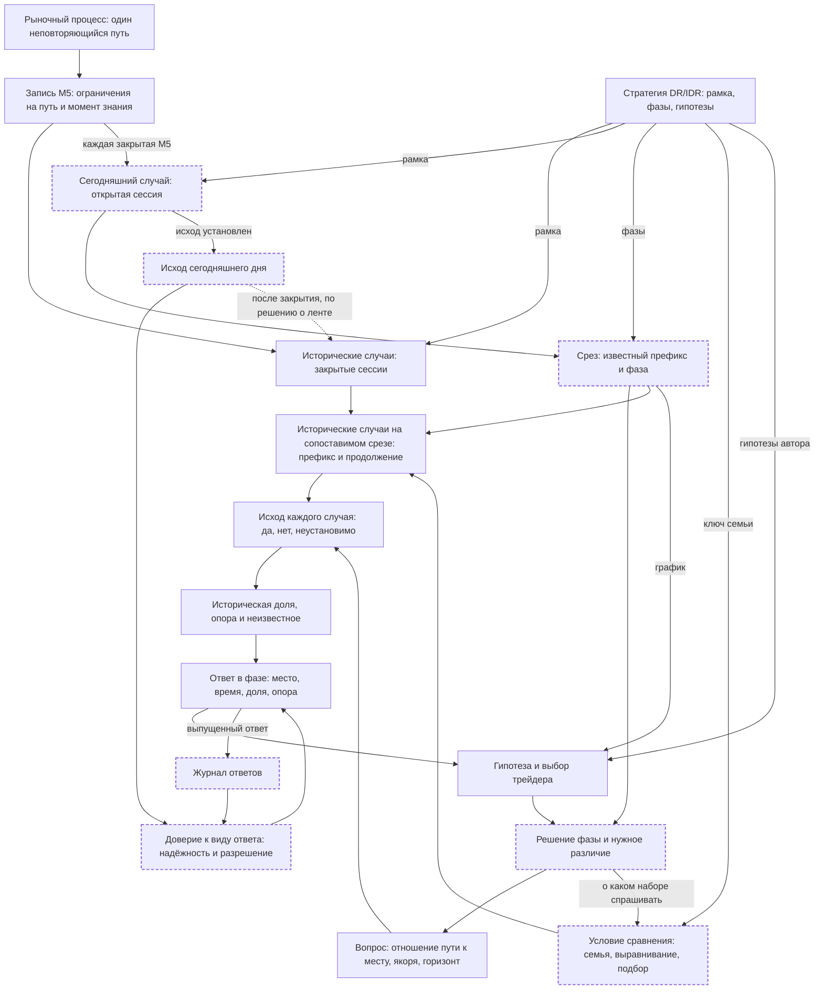

# Путь, место и решение: независимая линза к эссе «Рынок, будущее цены и смысл исторического прибора»

12 октября 2026. Claude (Opus 5.5), лично, без субагентов, по просьбе оператора. Аналитическое предложение для встречи с
автором эссе (Codex) и для решения оператора. Оно не меняет SC-1.1, SWPC-1.1, код, экран или решения оператора и не
удостоверяет прогнозную способность продукта.

**Пересмотрено автором в тот же день.** После самопроверки по навыку decisions часть решений этой линзы заменена эссе
[«Линейка, а не оракул»](2026-10-12-esse-linejka-a-ne-orakul.md) (§8 там): критерий нужности, роль семьи, место геометрии,
пять отношений как онтология, журнал ответов, оценка схемы. Где тексты расходятся, действует эссе.

**Что прочитано.** Эссе [01-esse.md](2026-10-10-rynok-i-veroyatnost/01-esse.md) и его схема (рисунок от оператора
совпадает с mermaid-блоком эссе). Репозиторий как контекст: [AGENTS.md](../../AGENTS.md), [meaning/README](../README.md),
[01](../01-zachem.md), [07](../07-cepochka-reshenij.md) (решения 24.09–07.10), [08](../08-semantika-klasterov.md) §2
(история подмен), [10](../10-dizajn-24.md) §§1–2, [15](../15-sloj-seichas.md), [17](../17-rabota-treidera.md),
[STRATEGY](../../docs/STRATEGY.md) §§0–6.3 и 14–15, [RESEARCH](../../docs/RESEARCH.md), линзы Codex
[09.10](2026-10-09-smyslovoj-karkas-i-roadmap.md) и [10.10](2026-10-10-prihody-i-prodolzheniya.md), начало
[OSC-1.0](2026-10-08-osc-1.0/DR-LAB-OSC-1.0.md), [README машинного контракта](../../contract/README.md) и список классов
его LinkML-схемы, git-история (106 коммитов во всех ветках, PR #1 и черновик PR #2). Внешние: сеть онтологий SEON с
онтологиями измерений COM и RSMO, gUFO (arXiv 2603.20948), LinkML.

**Что намеренно не прочитано.** По просьбе оператора — семантическая спецификация для инженера
(`02-semanticheskaya-specifikaciya.md`) и остальные файлы папки эссе, чтобы не перенять её рабочий контур. Нормативный
текст SC-1.1 тоже не открывался; о нём известно из AGENTS, meaning и README машинного контракта. Поэтому «в эссе нет»
ниже относится к эссе и схеме, а не к спецификации: часть найденного там может быть уже закрыта.

**Чего не делал.** Лента не открывалась, новых рыночных чисел нет. Все числа ниже взяты из записанных исследований
репозитория, со ссылками.

## 0. Вердикт

1. **Эпистемическое ядро эссе верно, я бы его принял.** Знание датируется моментом, когда оно стало доступно. Число
   существует только как ответ на вопрос с объектом, якорем и горизонтом. У каждой доли свой знаменатель. Неизвестное
   хранится отдельно и по причинам. Историческая доля и вероятность сегодняшнего исхода — разные вещи, мост между ними
   проверяется отдельно. Каждая подмена в истории репозитория (28.09, линзы 4–15, дефекты из линзы 09.10) нарушала один
   из этих пунктов; эссе собирает их в один принцип.
2. **Схема неполна в семи местах** (§7). Главные: в ней нет сегодняшней сессии как случая и нет среза; трейдер видит рынок
   только через историю; стратегия входит только как система координат; исход сегодняшнего дня никогда не возвращается
   проверить показанное; нет решения, ради которого всё делается.
3. **Главное расхождение: эссе определяет, что правда, но не определяет, что нужно.** «Работа трейдера и нужное
   различие» — вход без критерия. Без критерия «система проверяемых вопросов к траекториям» не имеет предела: каждый
   новый вопрос корректен, и экран снова растёт. Предлагаю критерий из трёх условий: ответ способен изменить выбор
   трейдера в этой фазе; его не видно на графике без прибора; ему можно доверять в названной мере (§4).
4. **Моя постановка в одной фразе.** DR Lab — атлас того, как далеко и когда цена уходила против стороны и по стороне, в
   единицах коробки своей сессии, у сессий, пришедших к той же фазе тем же путём. Каждое его число — частота одного
   отношения пути к месту. Вероятностью для сегодняшнего дня она становится только при допущении, что сегодня похоже на
   случайный член этого набора, и только в той мере, в какой это допущение выдержало проверку на днях, которых прибор не
   видел.
5. **Различие, которое я добавляю.** Одно и то же высказывание «путь сделает с этим местом вот это к такому сроку» живёт
   в трёх модусах: гипотеза о сегодняшнем пути, факт о каждом историческом пути, факт о сегодняшнем пути после исхода.
   Частота собирает второй модус, вероятность относится к первому, калибровка сравнивает первый с третьим. Эссе
   различает первые два; третий у него не связан с проверкой (§6.4).

## 1. Как читается история репозитория

За 18 дней от первого коммита (24.09) до эссе (10.10) линия качалась между двумя отношениями пути к месту:

- «куда и когда цена приходила» — вопрос оператора 28.09, правило 10 от 29.09, поле семьи 30.09;
- «где кончился ход» (окончательные R и X) — подмена агентами 28.09, затем 01.10 SEM-1.0 и дизайн 24, уже как
  названный объект по решению оператора.

Каждый поворот случался, когда обнаруживалось, что под одним словом («кластер», «место», «откат», «t0») живут два
отношения. Правило 10 в редакции 07.10 закрепило выход: события разные, у каждого своё имя. Колебание было не ошибкой
выбора объекта, а отсутствием языка, в котором оба объекта существуют рядом.

Вторая линия — рост механизма честности: паспорта (30.09), SEM-1.0 (01.10), SC-1.0/1.1 и LinkML-реестр с 53 величинами
(07.10), SWPC с M01–M18 и H01–H12 (07.10). Он сделал то, ради чего строился: в проверке 08.10 ни одно число не сказано
как прогноз ([17](../17-rabota-treidera.md), звено 4). Но в те же дни оператор не смог прочесть лист приёмки 16a, не
понял подпись «Сейчас» («что это такое, я не понимаю»), не нашёл лесенку и дату. Итог 17: после подтверждения знание
есть, разрыв — в восприятии и доступе; до подтверждения знания нет, а оно нужно. Эссе 10.10 продолжает первую линию (что
правда и когда), а разрыв лежит во второй (что нужно и как дойдёт до человека). Отсюда моё главное расхождение.

Третье наблюдение: многие тексты читали друг друга. Совпадение их выводов — не независимое подтверждение; это сказано и в
линзе 09.10. Мой текст независим только в одном: я не читал 02. Данные, история и большинство документов у нас общие.

## 2. Что даёт рынок

### 2.1. Один путь, а не повторяемый опыт

Рынок производит одну реализацию цены во времени. Сессии 2006–2025 — не двадцать лет повторений одного опыта, а нарезка
одного длинного пути, который меняет режимы. Отсюда три следствия, которых в эссе нет:

- «Похожие сессии» — сконструированная совокупность. Похожей её делает правило отбора, а не природа рынка.
- Случаи зависимы. Три индекса в один день подтверждаются в одну сторону в 78,5 % дней ([RESEARCH](../../docs/RESEARCH.md)),
  соседние недели живут в одном режиме. Число сессий N — верхняя граница числа независимых свидетельств, а не оно само
  ([17](../17-rabota-treidera.md) §6а).
- 2006 и 2025 годы входят в семью с равным весом. Это допущение о стационарности в единицах коробки, и оно нигде не
  названо.

### 2.2. Запись — ограничения, а не путь

Свеча M5 — не точка и не кусок пути, а ограничение: путь в этом интервале начался у open, кончился у close и не выходил
за [low, high]. Любое утверждение о пути проверяется на множестве всех путей, совместимых с записью:

- **истинно**, если верно для каждого совместимого пути;
- **ложно**, если неверно для каждого;
- **неустановимо**, если совместимые пути расходятся.

Порядок U и D внутри одной свечи, касание цены в разрыве между close и следующим open, пребывание внутри свечи —
третий случай. Эссе перечисляет такие случаи по одному (неизвестный порядок, перескок, перекрытие high–low). Одно правило
покрывает их все, и любой новый вопрос получает свою неустановимость автоматически, а не по списку. Считать перекрытие
диапазоном посещением — принятое соглашение о непрерывности цены внутри свечи; эссе честно оговаривает, что сделок по
каждой цене оно не доказывает.

Момент знания у факта — закрытие последней свечи, без которой он не решается. Это и есть «время доступности» эссе.

### 2.3. Сегодняшний день должен измеряться так же, как история

Исторические сессии приходят из ленты G3, сегодняшняя — из TradingView (`NQ1!`, `ES1!`, `YM1!`). Сравнение законно, если
это одна процедура измерения: те же часы, та же подпись свечи, тот же контракт и правило склейки, те же праздничные дни.
В единицах коробки бо́льшая часть различий сокращается внутри сессии. Но в схеме эссе путь измерения сегодняшнего дня не
нарисован («Следующее наблюдение» не имеет входа), поэтому и это допущение не видно. В прочитанных документах проверки
совпадения живых и архивных свечей я не видел. Это не дефект, а невысказанное допущение.

### 2.4. В самом рынке нет смысла уровней

Рынок не знает коробки. Смысл появляется, когда трейдер накладывает рамку. Это не умаляет рамку; это говорит, где живёт
смысл: в рамке и в вопросе, а не в цене.

## 3. Что даёт стратегия: рамка, фазы, гипотезы

Эссе называет DR/IDR «системой различений» и «системой координат». У стратегии три разные роли, а схема показывает только
первую.

| Роль | Что даёт | Чем является | Куда должна входить в схеме |
|---|---|---|---|
| Рамка | начало (край IDR), единицу (ширина IDR), сторону, часы сессии | калибр, который делает разные дни соизмеримыми | в траектории (есть) |
| Фазы | события (коробка, подтверждение, слом, касания уровней) и состояния между ними | временные состояния сессии; в разных фазах трейдер задаёт разные вопросы | в срез, в вопрос, в ключ семьи (нет) |
| Гипотезы | «+0,5 почти всегда», зона retirement, «после медианного времени откат сделан», цвет коробки как стартовая вероятность | проверяемые утверждения о будущем пути | в гипотезу трейдера (нет) |

Два уже измеренных факта меняют прочтение рамки:

- **Единица рамки — ширина IDR, то есть размах первого часа, грубая мера волатильности.** Удержание DR объясняется
  отношением размаха коробки к размаху следующих часов с R² 0,99; описательные закономерности воспроизводятся путями,
  которые коробки не знают ([RESEARCH](../../docs/RESEARCH.md); [STRATEGY](../../docs/STRATEGY.md) §14.5). Значит, бо́льшая
  часть того, что показывает DR Lab, — геометрия пути при данной волатильности, положении и оставшемся времени.
- **Это не делает показанное пустым.** Отклонение против позиции в единицах своей волатильности — ровно то, что нужно для
  решения «где ждать откат» и где стоять стопу. Для ориентира геометрия — основное содержание. Для утверждения «рынок
  уважает DR» она — нулевая модель, которую надо превзойти; на нашей ленте это не установлено (механические входы без
  преимущества, NOW-1.0 не превзошёл время).

Эссе говорит о геометрии один раз, как об ограничении объяснения больших частот. Я бы поставил её в основание: прибор
показывает прежде всего геометрию, и это ценно.

Гипотезы стратегии важны ещё и потому, что из них трейдер строит свои. Правило фазы оператора от 08.10 («откат сделан»,
когда достигнута −0,7 и прошло время отката семьи) — гипотеза автора (STRATEGY §6.3, п. 9) в редакции оператора. В схеме
эссе гипотеза человека возникает только из представления истории.

## 4. Что нужно трейдеру: решение, а не описание

### 4.1. Цель названа, но не стала частью онтологии

Эссе формулирует цель точно: опоры для предположений о дальнейшем пути, «чтобы соотносить возможный ход с риском и
выбирать действие или ожидание». Дальше риск исчезает: в схеме нет ни решения, ни того, что на нём выигрывается или
теряется. Торговая экономика вынесена в отдельную проверку, и для прибыли это верно. Но риск в смысле трейдера — не
деньги, а отклонение против позиции: как далеко цена уйдёт против, прежде чем пойдёт по стороне. Это свойство пути, и
оно целиком в нашей онтологии.

Следствие: соотнести ход с риском можно только по совместному поведению хода против и хода по стороне. Две отдельные
доли не дают ни очерёдности, ни совместной частоты: в 92 из 92 срезов совместная доля нового R и нового X была ниже
произведения долей ([17](../17-rabota-treidera.md) §6а). Прибор, который показывает «глубже» и «дальше» по отдельности,
не отвечает на вопрос о соотношении, даже если каждая доля верна.

### 4.2. Решения по фазам

Таблица собрана из STRATEGY и ответов оператора 08.10 ([17](../17-rabota-treidera.md) §§2, 7). Это не новые вопросы к
нему, а уже сказанное.

| Фаза | Что трейдер решает | Что изменило бы решение | Что отвечает сейчас |
|---|---|---|---|
| Коробка закрыта, подтверждения нет | к какой стороне готовиться и когда | в какую сторону и в какие 15 минут подтверждали сессии такого начала; что было после каждого варианта | нет; решено 08.10, реализовано в ветке `resheniya-08-10`, не принято |
| Только что подтвердилось | держать ли сторону; где ждать откат | как часто DR ломался; где и когда кончались откаты | исход DR, зоны R |
| Идёт откат | войти здесь, ждать глубже или отказаться | насколько глубоко уходит нынешний откат от максимума, прежде чем цена вернётся к максимуму, и когда | лесенка — приближённо (§5.4); строка R «Сейчас» — о другом месте, ниже дна |
| Идёт продолжение | держать; куда цель | дойдёт ли до следующего уровня и сколько осталось времени | лесенка после среза, зоны X |
| Слом | стоять в стороне или развернуться | что делали сессии после такого слома | семья слома; ни одна не набирает 40 сессий ([15](../15-sloj-seichas.md)), бывает 3 |
| Поздний срез | новых входов нет; выход | что ещё логически возможно до конца | статусы зон, «впереди / прошло» |
| После сессии | учиться | что прибор показывал при активации и что случилось | «История» |

Фазовый взгляд сразу показывает единственный подтверждённый пробел в знании — до подтверждения. В эссе он не виден,
потому что в эссе нет фаз.

### 4.3. Критерий нужности

Ответ стоит показывать, если выполнены три условия:

1. **Решение.** Хотя бы один правдоподобный ответ меняет выбор трейдера в этой фазе (ждать, где ждать, держать, выйти,
   пропустить) либо нужен, чтобы после сессии пересмотреть своё правило.
2. **Добавка к графику.** Ответа не видно на самом графике, и его не даёт опыт. Пример из 17: строка «что раньше, R или X»
   снята, потому что очерёдность почти целиком повторяет геометрию, видную на графике (0,89…0,14 против 0,90…0,10 у
   случайного блуждания). Ответ был верен, но ничего не добавлял.
3. **Доверие.** Названы событие, опора и неизвестное; для чтения как шанса известна проверка на невиденных днях.

Это не новое правило. 29.09 в [meaning/01](../01-zachem.md) записаны три вопроса к любому числу: какое событие оно
описывает, насколько хорошо оценено, помогает ли трейдеру увидеть то, чего без него не видно. Эссе подробно развило первые
два и свернуло третий в узел «Работа трейдера». Я предлагаю вернуть третий вопрос как фильтр на выходе, а не только как
вход.

Критерий относится к числам, а не к рамке. Уровни прошлых сессий и VI дублируют TradingView, но оператор их просил (17,
элемент 2): рисунок рамки служит ориентации и подчиняется другим правилам.

## 5. Язык вопросов: пути и места

### 5.1. Места — единицы мысли трейдера, пути — единицы свидетельства

Оператор с первого дня думает местами: «кластеры — где и когда», зоны, созвездия, «где ждать откат». Это места на
плоскости «время × цена». Эссе справедливо переносит основу на пути: карта без путей теряет, какие точки принадлежат одной
сессии и в каком порядке. Но место в онтологии эссе отдельной сущностью не стало (K появляется только в примере). Я бы
сделал его равноправным: вопрос — это отношение пути к месту.

### 5.2. Пять отношений

| Отношение | Что проверяется у одного пути | Вопрос трейдера | Что в DR Lab это уже считает |
|---|---|---|---|
| Положение | закрытие свечи в момент τ лежит в месте | «где будет цена к 12:30» | «Путь семьи» |
| Посещение | диапазон хотя бы одной свечи окна задел место (или закрытие оказалось в нём) | «дойдёт ли до +1,0», «уйдёт ли ниже дна» | лесенка, «заходили в полосу», «Сейчас», исход DR (закрытие за противоположным DR) |
| Предел | крайняя точка пути на горизонте лежит в месте | «где кончился откат» | окончательные R и X, зоны |
| Очерёдность | место A посещено раньше места B, и когда | «сначала глубже или сразу выше», «U раньше D» | порядок R/X; пара U/D из линзы 10.10 |
| Пребывание | сколько времени путь провёл в месте | «рейндж затянется?» | косвенно, по колонкам «Пути семьи» |

Все объекты экрана 24 и все предложения обеих линз Codex ложатся в эти пять отношений. Новое отношение понадобится, только
если вопрос трейдера в них не выражается. Возможный кандидат — форма свечи у уровня (отказ, поглощение); оператор берёт
отказы из TradingView (17), поэтому сейчас он не нужен.

### 5.3. Три выбора, на которых ломались смыслы

У каждого отношения, кроме самого места, есть три выбора. Почти все найденные дефекты — незаметная смена одного из них.

- **Якорь места.** Место задано рамкой (u = −0,7 у всех), собственным состоянием случая на срезе (свой минимум каждой
  исторической сессии) или переносом сегодняшнего (сегодняшний минимум в u, приложенный ко всем). Подпись «ниже
  сегодняшнего дна» в кандидате `b7a52f1` над счётом по собственному минимуму (линза 09.10 §4.2) — смена этого якоря.
- **Якорь времени.** Часы ET, возраст от активации, возраст от события. Дрейфы Е («четыре разных t0») и Ж («свой t0 +
  прошедшее») из [08](../08-semantika-klasterov.md) — смена этого якоря.
- **Направление посещения.** «На уровне или дальше» по рамке и «вернулась вниз к уровню» — разные отношения для уровня,
  который лежит ниже текущей цены, но выше края IDR (линза 09.10 §4.3).

Если эти три выбора записаны в имени вопроса, такие подмены видны до счёта.

### 5.4. Откат от максимума имеет естественное определение

Оператор уточнил, что его «насколько глубоким будет откат» — это откат от максимума (17, ответ 08.10). У этого вопроса
есть определение без параметров. **Эпизод отката** начинается, когда цена отходит от текущего экстремума по стороне, и
кончается, когда экстремум обновлён или кончился горизонт. Глубина эпизода — самая дальняя точка против стороны внутри
него. Отсюда три ответа: как глубоко (посещение мест ниже экстремума на d), вернётся ли цена к экстремуму (очерёдность
«новый экстремум раньше глубины d»), когда.

Лесенка совпадает с этим ответом, пока уровень лежит ниже края IDR, и расходится выше него (§5.3). Строка R «Сейчас»
отвечает о другом месте — ниже сегодняшнего дна: в 55 % срезов с откатом от максимума цена была далеко над дном (17, сцена
3). Оператор принял лесенку («да, это оно»), и менять продукт по этому поводу я не предлагаю. Я фиксирую, что его вопрос
имеет точную форму: если её понадобится считать, изобретать ничего не придётся.

## 6. Как частота становится вероятностью

### 6.1. Вопрос, условие и срез — три разные идентичности

Эссе кладёт якорь в вопрос и описывает три вида адаптации прозой. Я бы разделил идентичность ответа на три части:

- **вопрос** — отношение, место с его якорем, горизонт;
- **условие сравнения** — правило семьи, правило выравнивания (как сегодняшний срез отображается на срез исторического
  пути), правило подбора по состоянию; у каждого своя версия;
- **срез** — момент, на котором вопрос задан при этом условии.

Тогда три адаптации эссе становятся структурными: новая информация меняет срез, новый вопрос меняет вопрос, новая модель
меняет условие. Это проверяется механически: если между двумя ответами изменилось что-то кроме среза, это не обновление
одного числа.

### 6.2. Ответы, которые складываются в фильм, и ответы, которые нет

Если в определении исхода нет момента среза, ответы на разных срезах — обновления одного вопроса. Окончательный R, исход
DR, закрытие в 16:00 — такие. Падение доли с часами у них законно: час без нового события — тоже сведение.

Если момент среза входит в определение («в ближайшие 30 минут», U и D вокруг текущей цены), каждый срез задаёт новый
вопрос. Его ответы нельзя рисовать как одну меняющуюся величину; прежний ответ сохраняется отдельно.

Промежуточный случай — вопрос с порогом из сегодняшнего состояния. «Уйдёт ли ниже сегодняшнего дна» равносильно
«окончательный R глубже текущего дна». Между новыми минимумами это один вопрос. Новый минимум разрешает его («да») и
открывает следующий, с новым порогом. Экран, который это различает, не выдаёт смену вопроса за изменение уверенности.

### 6.3. Похожесть — выбор класса, а не открытие

Семья — референтный класс. Для одного и того же дня можно законно выбрать разные классы (с днём недели и без, окно 15
или 30 минут, с подбором по состоянию или без) и получить разные доли. Единственно верной вероятности среди них нет: более
узкий класс ближе к сегодняшнему дню и беднее опорой. День недели в ключе уменьшает семьи примерно впятеро
([07](../07-cepochka-reshenij.md), 30.09); семья слома бывает из трёх сессий. Эссе фактически описывает проблему
референтного класса («похожие» — правило сопоставления), не называя её. Название полезно: оно сразу говорит, что выбор
семьи — решение оператора о том, о каком наборе он спрашивает, а не свойство рынка, и что для чтения как шанса этот выбор
должен оправдаться проверкой.

### 6.4. Мост и три модуса

Трейдеру нужен шанс сегодняшнего дня. Частота в семье даёт его при одном допущении: относительно этого исхода сегодняшний
день похож на случайно вытянутый член семьи при том же условии (перестановочность). На языке gUFO это предрасположенность
ситуации: «подтверждение лонга в среду в окне 10:30–10:45, цена на +0,3 в 11:50» — тип ситуации, а доля — частота, с
которой ситуации этого типа проявлялись событием. Выбор типа ситуации и есть выбор референтного класса.

Проверить допущение можно только через третий модус: сравнить ответы, выпущенные до исхода, с исходами дней, которых
прибор не видел. Отсюда три вещи, которых нет в схеме эссе:

- **журнал выпущенных ответов** — что прибор показал, на каком срезе, при каком вопросе и условии;
- **исход сегодняшнего дня** — когда он установлен, он возвращается и закрывает свой ответ;
- **доверие к виду ответа** — не к отдельному числу, а к вопросу при данном условии: насколько такие ответы на новых днях
  сбывались так часто, как обещали, и насколько они различали дни лучше простого ориентира.

Часть этого в репозитории уже есть как дисциплина: 2026 год закрыт как лента наблюдения вперёд, пороги приёмки карты зон
заморожены до новых сессий ([12](../12-karta-zon.md) §6). В схеме смысла этого контура нет, поэтому «отдельная проверка
переноса» у эссе питается только историческим свидетельством.

Кое-что уже измерено. Числа экрана 22 на новых днях дали выигрыш Брайера 13–15 % для удержания DR, а у первой цели STD при
несопоставленной цене оказались хуже константы, −48…−50 % ([RESEARCH](../../docs/RESEARCH.md)). База NOW по времени — Брайер
0,20–0,22 против 0,25 у монеты; путь сверх неё ничего не добавил ([15](../15-sloj-seichas.md)). Значит, историческая доля в
одних видах уже ведёт себя как прогноз, в других — нет. Разделение C0/C1/C2 — правильная политика слов. Но трейдеру
полезнее знать, какие виды чисел выдержали проверку, чем знать, что ни одно число не названо прогнозом. Показывать ли это
и как — решение оператора; я фиксирую, что в смысловом основании для этого должно быть место.

### 6.5. Мера качества: надёжность и разрешение

Эссе ссылается на правило Брайера, и это верно. Добавлю его разложение: оценка может быть идеально откалибрована и
бесполезна (всегда частота класса), а может различать дни. Трейдеру ценна разрешающая способность — умение условия
разделить дни на те, где исход чаще, и те, где реже. NOW-1.0 показал разрешение у времени после подтверждения и не показал
у пути. Сейчас это лучший имеющийся ответ на вопрос «что прибор знает сверх часов».

## 7. Аудит схемы

Что в схеме верно:

- поток от рыночного процесса к записи и траекториям, с явными ограничениями записи;
- вопрос как отдельный узел, который входит и в отбор, и в результат каждой траектории;
- результат каждой траектории отдельно от свёрнутого свидетельства: сохраняется прослеживаемость до ID случая;
- проверка переноса отделена от свидетельства;
- петля через человека: гипотеза меняет то, что нужно различить дальше.

Чего нет и что из этого следует:

| № | Наблюдение по схеме | Следствие |
|---|---|---|
| С1 | «Следующее наблюдение» не имеет входа; сегодняшняя сессия не показана как случай | Не видно, что сегодня — того же рода, что история, но в другой роли: открытый случай, об исходе которого спрашивают. Не видна и процедура его измерения (§2.3) |
| С2 | Среза как узла нет; якорь спрятан в вопросе | Главное различие эссе — новая информация против нового вопроса — на схеме не изображается |
| С3 | К гипотезе человека ведёт только представление истории | Перевёрнутая картина: основное для трейдера — график, история — линза к нему. Критерий «добавка к графику» не формулируется |
| С4 | Правила DR/IDR входят только в траектории | Нет фаз (какие вопросы уместны сейчас), нет ключа семьи, нет гипотез автора; не виден пробел до подтверждения |
| С5 | У выбора семьи нет входа от человека | Семья — решение оператора (30.09), а схема делает её следствием траекторий и вопроса |
| С6 | Исход сегодняшнего дня не возвращается; проверка переноса питается только историей | Нет журнала выпущенных ответов и их проверки вперёд: прибор не помнит своих слов |
| С7 | Нет решения и риска; «гипотеза и выбор» замыкает цикл без последствий | У «нужного различия» нет критерия; поле вопросов не ограничено |

О рисунке. Узел «Историческое свидетельство» стоит в верхнем левом углу, связь от результата к нему идёт через весь лист
снизу вверх, и петля читается с трудом. Для глаза картинка выглядит как два независимых конвейера, а не как один цикл во
времени. Это следствие автоматической раскладки, а не смысла, но человек читает именно картинку.

### Схема, которую я предлагаю

Пунктиром обведены узлы, которых нет в схеме эссе или которые в ней слиты с другими. Как и у эссе, стрелки — зависимости
смысла, а не сервисы.

Время входит в схему одним ребром: каждая закрытая M5 продлевает сегодняшний случай, сдвигает срез и, если меняется фаза,
меняет решения и вопросы.

## 8. Текст эссе по разделам

| Раздел | Оценка | Почему |
|---|---|---|
| От движения, которое интересно трейдеру | согласен | пример midpoint → +1 → retirement точно показывает, что предел пути не исчерпывает ход; цель сформулирована верно |
| В каком смысле рынок является алгоритмом | согласен, уточнение | вывод верен: механизм объяснять не нужно. Сильнее довода о правилах биржи — то, что рынок даёт одну неповторяющуюся реализацию (§2.1) |
| Что даёт стратегия | уточнение | три роли вместо одной (§3); геометрия как содержание, а не только как граница объяснения |
| Объект, из которого получается процент | согласен, дополнение | траектория — верный атом данных; рядом нужны срез, роль случая и место (§§5, 6) |
| Постановка Y_Q = Φ_Q(будущий путь) и вероятность при срезе | согласен | это стандартная постановка; мост от доли к ней — перестановочность, её стоит назвать (§6.4) |
| О каком будущем спрашивает трейдер | согласен, дополнение | три вопроса эссе — положение, посещение и очерёдность; к ним предел (основа экрана 24) и пребывание. Ближе всего к решению — очерёдность со временем (§4) |
| Время как часть исхода; виды неизвестности | согласен | обобщается правилом трёх значений (§2.2) |
| Почему быстрые проходы нельзя терять | согласен | это частный случай общей задачи свечи-якоря: событие известно на закрытии своей свечи, а часть следствий уже внутри неё. Так же устроено подтверждение: его свеча в горизонт семьи не входит |
| Что означает адаптация | согласен, структура | три вида изменений — срез, вопрос, условие (§6.1); правило «фильм или новый вопрос» (§6.2) |
| От большой частоты к содержательному различию | согласен, дополнение | надёжность и разрешение (§6.5); уже измеренное разрешение у времени |
| Адаптивный выбор гипотез на экране | согласен, расширение | относится и к агентам: одна и та же история 2006–2025 прошла через десятки линз и исследований, «2018–2025 видели все версии этой линии» (07, 01.10) |
| Что должен передавать экран | согласен, дополнение | не хватает фазы и критерия нужности: экран показывает ответы текущей фазы, а не всё, что правда |
| Итоговое решение | частично | «система проверяемых вопросов» — верная дисциплина, но без критерия нужности она не ограничена. Я бы сказал: малый набор вопросов по фазам на общем языке путей и мест |

Мелкое. Фраза «ответ 12/12 относится только к этим оставшимся 12» читается как «100 %»; видимо, имелось в виду «x из 12».
Ссылка E1 (алгоритмы сопоставления CME) подкрепляет тезис, который в подкреплении не нуждается; она не мешает.

## 9. Что полезно из внешних онтологий

**UFO и gUFO.** Взять словарь различений, а не аппарат.

- *Род, фаза, роль.* Сессия — род. «Подтверждена в лонг», «сломана», «в откате» — фазы: временны и держатся на
  собственных свойствах сессии. «Сегодняшний случай» и «член семьи» — роли: держатся на отношении к вопросу. Ровно этого
  не хватает схеме в С1.
- *Событие и ситуация.* Подтверждение, слом, посещение — события. Состояние на срезе — ситуация, «конфигурация, которая
  держится на интервале, но могла бы быть иной». Вопрос задаётся из ситуации о будущих событиях.
- *Предрасположенность, которая проявляется в событиях.* Даёт смысл шансу одного дня (§6.4).
- *Историческая зависимость слабее причинности.* DR Lab измеряет совместность и порядок, а не причину: «отказ от уровня
  вызвал разворот» прибор не устанавливает.

**SEON: онтологии измерений COM и RSMO.** Цепочка «цель → информационная потребность → мера (со шкалой и единицей) →
процедура измерения → измерение → значение → анализ → индикатор». Два прямых урока:

- У эссе между «работой трейдера» и «вопросом» нет цели. В COM потребность выводится из цели, а мера становится
  индикатором только относительно цели. 53 величины реестра — меры; индикаторами для трейдера они становятся в той фазе,
  где служат его решению. [17](../17-rabota-treidera.md) по сути выполнила это сопоставление.
- Процедура измерения у объекта и у эталона должна быть одной (С1, §2.3).

SEON показывает и способ держать множество документов: основание (общие категории), ядро (вопрос, условие, исход,
частота, доверие), предметный слой (DR/IDR), прикладной слой (SC, SWPC, экраны). Эссе и этот текст — ядро; спецификация для
инженера — прикладной слой. Если каждый документ проекта называет свой слой, следующий агент сразу видит, меняет он
основание или реализацию.

**LinkML.** Язык схем, а не онтология; документация LinkML сама разводит схемы данных и онтологии предмета. В репозитории
так и сделано: текст контракта нормативен, LinkML — его машинная форма. Возможная небольшая польза: связать классы схемы с
категориями основания (`class_uri`, `meaning` у перечислений), чтобы, например, роль нельзя было объявить постоянным
свойством сессии. Сейчас это не нужно; пригодится, если смысловое ядро будет записано отдельно от контракта.

Чего не брать: полную аксиоматику UFO, OWL-вывод, новый слой управления. По опыту 28.09 и 01.10 оператор останавливает рост
семантики, если она не меняет того, что он видит и решает.

## 10. Смысловое основание, как я его вижу

Сущности:

1. **Рыночный процесс** — один неповторяющийся путь цены; не моделируется.
2. **Запись** — свечи M5 как ограничения на путь; у каждого факта есть момент, когда он стал известен.
3. **Рамка** — начало, единица, сторона и часы, заданные коробкой сессии.
4. **Фаза** — временное состояние сессии между событиями стратегии.
5. **Случай** — путь одной сессии в рамке; роль: сегодняшний (открыт) или исторический (закрыт).
6. **Срез** — момент знания у случая; делит его на известный префикс и продолжение.
7. **Место** — область «время × цена» с якорем: рамка, своё состояние случая или перенос сегодняшнего.
8. **Вопрос** — отношение пути к месту (положение, посещение, предел, очерёдность, пребывание) с горизонтом.
9. **Условие сравнения** — семья, выравнивание, подбор по состоянию, с версиями.
10. **Исход случая** — да / нет / неустановимо, с моментом установления.
11. **Историческая доля** — счёт исходов к объявленной опоре, неизвестное отдельно.
12. **Доверие** — проверка выпущенных ранее ответов того же вида на невиденных днях: надёжность и разрешение.
13. **Решение фазы** — выбор трейдера и то, что его изменило бы; источник нужности.
14. **Гипотеза трейдера** — высказывание того же вида о сегодняшнем пути до исхода.

Инварианты:

- Одно высказывание — три модуса: гипотеза, исторический факт, сегодняшний факт. В словах и в рисунке они не смешиваются.
- Ни один исход не известен раньше закрытия свечи, которая его решает.
- Идентичность ответа = вопрос + условие + срез. Если изменился только срез, это обновление; иначе это другой ответ.
- Каждое число — одно отношение пути к месту с названными якорями; сотня существует только внутри одного отношения на
  одной опоре.
- Неустановимое не становится ни «да», ни «нет», ни уменьшением опоры.
- Доля читается как шанс только в меру измеренного доверия к своему виду.
- Ответ показывается, если меняет решение фазы, не виден на графике и имеет названное доверие.

Что DR Lab показывает на самом деле, словами для трейдера:

> Среди сессий, которые начались так же, как сегодняшняя, — где и когда цена уходила против стороны и по стороне, в
> размерах сегодняшней коробки. В основном это геометрия: сколько осталось времени, где цена сейчас, насколько широкая
> коробка. Особого уважения рынка к уровням DR наша лента не показала, но размер и время отклонений — именно то, что нужно,
> чтобы решить, где ждать откат. Как шанс на сегодня эти доли честны настолько, насколько такие же доли сбывались на днях,
> которых прибор не видел.

## 11. Где я могу ошибаться

- **Критерий решения может быть слишком узким.** Оператор смотрит DR Lab всю сессию (17). Часть ценности может быть в
  спокойной ориентации, а не в смене решения. Я включил обучение после сессии, но не «уверенность в своём плане». Если это
  отдельная ценность, критерий надо расширить.
- **Пять отношений могут не исчерпывать работу.** Отказы у уровней и форма свечей в них не выражаются. Сейчас это граница с
  TradingView по слову оператора, а не доказанная полнота.
- **«В основном геометрия» может недооценивать часы коробки.** Окна 03:00 и 09:30 при равной ожидаемой волатильности
  держатся на 1,9–2,7 п. чаще соседних, механизм не установлен ([RESEARCH](../../docs/RESEARCH.md)). Остаток небольшой, но
  реальный.
- **Спецификация 02 могла закрыть часть замечаний С1–С7.** Я её не читал намеренно; сопоставление — следующий шаг.
- **Я опираюсь на те же документы, что и эссе.** Совпадения с ним не являются независимым подтверждением.

## 12. Для встречи с автором эссе

Тезисы, на которые удобно ответить по пунктам:

| № | Тезис | Отношение к эссе |
|---|---|---|
| Т1 | Эпистемическое ядро эссе принимается как есть | согласие |
| Т2 | Сегодняшний случай и срез — отдельные узлы; случай одного рода с историей, в другой роли | дополнение схемы |
| Т3 | Стратегия даёт рамку, фазы и гипотезы | уточнение |
| Т4 | Геометрия — основное содержание ориентира и нулевая модель для притязаний на преимущество | смена акцента |
| Т5 | Нужность задают решение фазы, добавка к графику и доверие | расхождение: в эссе критерия нет |
| Т6 | Язык вопросов — пять отношений пути к месту с тремя выборами (якорь места, якорь времени, направление) | дополнение |
| Т7 | Идентичность ответа = вопрос + условие + срез; фильм против нового вопроса | структура раздела об адаптации |
| Т8 | Три модуса одного высказывания; журнал выпущенных ответов и проверка вперёд | дополнение схемы |
| Т9 | Доверие относится к виду ответа и измеряется надёжностью и разрешением | дополнение |
| Т10 | Документы проекта называют свой слой: основание, ядро, предмет, приложение | предложение по порядку |

Решения, которые остаются за оператором, если он захочет к ним перейти: принимает ли он критерий нужности (Т5) как правило
для новых чисел; нужно ли в смысловом основании место для доверия к видам ответов (Т9) и как оно доходит до экрана; нужен
ли журнал выпущенных ответов (Т8) при закрытом 2026 годе. Вопросов о самой стратегии здесь нет.

## Источники

Репозиторий: ссылки в тексте. Ключевые: [эссе](2026-10-10-rynok-i-veroyatnost/01-esse.md),
[17 · Работа трейдера](../17-rabota-treidera.md), [RESEARCH](../../docs/RESEARCH.md), [STRATEGY](../../docs/STRATEGY.md),
[08 · история подмен](../08-semantika-klasterov.md), [07 · цепочка решений](../07-cepochka-reshenij.md),
[15 · «Сейчас»](../15-sloj-seichas.md), линзы Codex [09.10](2026-10-09-smyslovoj-karkas-i-roadmap.md) и
[10.10](2026-10-10-prihody-i-prodolzheniya.md).

Внешние:

- SEON — The Software Engineering Ontology Network, NEMO/UFES: <https://dev.nemo.inf.ufes.br/seon/>; Core Ontology on
  Measurement (COM): <https://dev.nemo.inf.ufes.br/seon/COM.html>; Reference Software Measurement Ontology (RSMO):
  <https://dev.nemo.inf.ufes.br/seon/RSMO.html>. Использованы определения и связи понятий измерения; программная
  инженерия как предмет не переносилась.
- J. P. A. Almeida, G. Guizzardi, T. P. Sales, C. M. Fonseca. *gUFO: A Gentle Foundational Ontology for Semantic Web
  Knowledge Graphs.* arXiv:2603.20948v1, 2026: <https://arxiv.org/html/2603.20948v1>. Прочитаны разделы 1–7: роды, фазы и
  роли; события и ситуации; предрасположенности; историческая зависимость.
- LinkML: <https://github.com/linkml/linkml>, <https://linkml.io/linkml/faq/why-linkml.html>. Использовано различие схемы и
  онтологии и механизм отображения классов на внешние понятия.
- Классические понятия без новых источников: проблема референтного класса (H. Reichenbach, *The Theory of Probability*,
  1949); перестановочность (B. de Finetti, 1937); разложение оценки Брайера на надёжность и разрешение (A. H. Murphy,
  *Journal of Applied Meteorology* 12, 1973); проверка прогнозов по мере их выпуска (A. P. Dawid, «prequential approach»,
  *JRSS A* 147, 1984).

Изменён только этот файл; код, контракт, экран, история, настройки и лента не тронуты. Коммит не делался.
