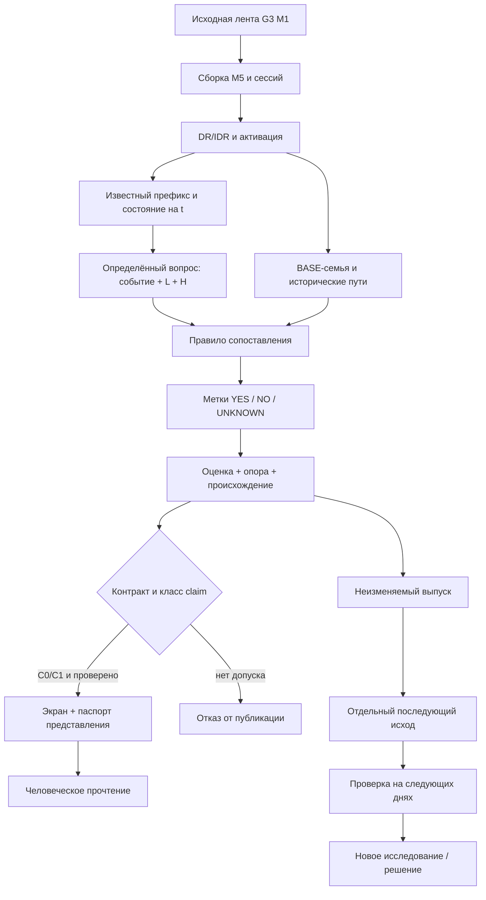

# DR Lab — единая спецификация смыслового устройства

**Идентификатор:** `DR-LAB-SEMANTIC-ARCHITECTURE-0.1`  
**Тип:** интеграционная семантическая карта / спецификация прослеживаемости, **предложение для проверки**, а не новая редакция SC-1.1  
**Снимок:** 13.10.2026; рабочая основа `main` (по принятой документации от 07.10), отдельная цепочка PR #3 → #4 → #5 → #6; реализация Q1 прочитана на `q1-pilot-c1@e9b5bc68cbfe11cc529f11502876cfd748bdba57`  
**Язык предмета:** DR/IDR, время America/New_York, M1/M5, NQ/ES/YM.  
**Адресаты:** трейдер-оператор, инженер, независимый семантический и технический аудитор.

> **Предмет:** явно задать все существенные переходы `рыночное наблюдение → известное на срезе состояние → определённый вопрос → набор исторических случаев → измеримый исход → оценка и её доказательства → допустимое утверждение → визуальный носитель → понимание трейдера`. «Замкнутый контур» означает проверенную прослеживаемость в **заявленной области**, а не обещание полноты знания о рынке или способности прогнозировать будущий день.

## 0. Правило чтения и граница авторитета

Эта спецификация **систематизирует** существующие договоры, код и исследования, но **не принимает** за оператора новые правила, не изменяет данные, реестр, API, экран, исходы, ветки или GitHub PR. Все нормативные расхождения разрешаются по источнику принятия, а не по удобству автора этого текста.

**Статусы записываются по независимым осям:**

- **Решение:** `ПРИНЯТО` (прямое решение оператора или уже принятый профиль), `ЗАДАНИЕ` (разрешено разработать, продуктовая приёмка не состоялась), `ПРЕДЛОЖЕНО`, `ОТКРЫТО`, `ВНЕ ОБЛАСТИ`.
- **Реализация:** `MAIN` (имеется в работающей линии), `PR6` (есть в отдельной цепочке PR, не слито), `ЧАСТИЧНО`, `НЕТ`, `НЕ УСТАНОВЛЕНО`.
- **Доказательство:** `TEST-MAIN` (существующие проверки), `TEST-PR6-REPORTED` (результаты инженера в PR #6; независимо здесь не пересчитывались на локальной ленте), `РЕВЬЮ КОДА`, `H-PENDING` (человеческое прочтение не принято), `C2-PENDING` (перенос на новые случаи не доказан), `НЕТ`.

`ПРИНЯТО` не означает «реализовано»; `TEST-MAIN` не означает «человек понял»; `C1` не означает `C2`; открытый PR не является фактом слияния. Если источник документа назван «автором стратегии», это означает происхождение идеи, а не доказанную рыночную закономерность. Содержательные правила `docs/STRATEGY.md` маркируют происхождение как `[П]` правило автора, `[Э]` эвристику, `[Ч]` утверждённое им число, `[Л]` собственный замер, `[В]` операционализацию и `[Р]` нерешённую развилку.

**Порядок источников в пределах действующих профилей:** непосредственное решение оператора → нормативный `DR-LAB-SC-1.1` → действующие определения BASE-24 / NOW-1.0 и реестр `contract/` → принятые UI-правила → реализация, которая обязана им соответствовать. `SWPC-1.1` имеет статус *задания на реализацию*, но не принятого результата H01–H12. Для **изолированного Q1 C1** действует отдельный обязательный договор `Q1-PILOT-0.2` поверх неизменённой рабочей базы; KADR-1.1 ред. 2 и SRS 0.2 дают соответственно уточнения и направление, но не автоматическую замену SC-1.1. [S01–S11]

## 1. Назначение системы и критерий смысловой завершённости

**DR Lab как продукт:** локальный второй экран трейдера DR/IDR с историей сопоставимых сессий, их наблюдаемыми путями, диапазонами, статусами и условными историческими продолжениями. [S01,S02]

**DR Lab как исследовательская система:** инфраструктура для преобразования наблюдений и вопросов о будущем в точно определённые, воспроизводимые исторические оценки и — после отдельных испытаний — в проверяемые вероятностные утверждения. Это **интеграционная формулировка**, а не новый нормативный профиль. [S09,S10]

**Критерий замкнутого участка**: для каждого показанного утверждения можно восстановить (1) исходные наблюдения и их доступность по времени; (2) правила формирования случая/рамки; (3) исходный вопрос и событие; (4) включённые и исключённые случаи; (5) способ работы с пропусками; (6) вычисление и знаменатель; (7) допустимый класс утверждения; (8) экземпляр экранного представления; (9) независимые проверки; (10) доказательство того, что человек может не перепутать предмет числа с другим событием. Последний пункт требует наблюдаемой человеческой приёмки, его не выводят из успешных модульных тестов.

**Техническая модель не тождественна онтологическому движку:** сущности и связи существуют в `meaning/`, `docs/`, `spec/`, LinkML/YAML-реестре, Python и коде UI; централизованной графовой БД или универсального механизма логического вывода нет. Git — носитель версий и происхождения решений, но не вычислительная «семантическая машина». [S01–S04]

## 2. Реестр источников и их полномочий

Ссылки на код и документы ниже привязаны к конкретной ветке/снимку по возможности. Отсылки на содержимое открытых PR описывают **кандидатов**, а не часть уже выпущенного `main`.

| Код | Источник | Что именно обосновывает | Авторитет / область |
|---|---|---|---|
| S01 | [`AGENTS.md`](https://github.com/FARTOFALOS/dr-idr/blob/main/AGENTS.md) и [`docs/ARCHITECTURE.md`](https://github.com/FARTOFALOS/dr-idr/blob/main/docs/ARCHITECTURE.md) | карта процессов, хранилищ, границ, портов, рабочего экрана | эксплуатационный контракт рабочей линии; может отставать по описанию открытых PR |
| S02 | [`docs/STRATEGY.md`](https://github.com/FARTOFALOS/dr-idr/blob/main/docs/STRATEGY.md), [`docs/SEMANTICS.md`](https://github.com/FARTOFALOS/dr-idr/blob/main/docs/SEMANTICS.md) | DR/IDR автора, операционализация свечей/сессий, событий и времени | источник определения; авторские эмпирические числа не принимаются без собственного замера |
| S03 | [`docs/DECISIONS.md`](https://github.com/FARTOFALOS/dr-idr/blob/main/docs/DECISIONS.md), [`meaning/07`](https://github.com/FARTOFALOS/dr-idr/blob/main/meaning/07-cepochka-reshenij.md) | кто решил, когда и с какой границей | журнал свидетельств; прямое решение человека первично |
| S04 | [`DR-LAB-SC-1.1`](https://github.com/FARTOFALOS/dr-idr/blob/main/spec/DR-LAB-Semantic-Contract-1.1-(patched).md), [`contract/README.md`](https://github.com/FARTOFALOS/dr-idr/blob/main/contract/README.md) | принятые профили, estimands, C0–C3, допустимые claims, gate, источники истины | **принято** для BASE-24/NOW-1.0; не автоматически для Q1 |
| S05 | [`DR-LAB-SWPC-1.1`](https://github.com/FARTOFALOS/dr-idr/blob/main/spec/DR-LAB-SWPC-1.1.md), [`docs/UI_RULES.md`](https://github.com/FARTOFALOS/dr-idr/blob/main/docs/UI_RULES.md), [`meaning/13`](https://github.com/FARTOFALOS/dr-idr/blob/main/meaning/13-zhurnal-vizualizacii.md) | связь утверждений с визуальными носителями, задачи восприятия | SWPC — `IMPLEMENTATION_TARGET`; H01–H12 не приняты заранее |
| S06 | [`lab/build_market.py`](https://github.com/FARTOFALOS/dr-idr/blob/main/lab/build_market.py), [`lab/build_boxes.py`](https://github.com/FARTOFALOS/dr-idr/blob/main/lab/build_boxes.py), [`lab/scene24.py`](https://github.com/FARTOFALOS/dr-idr/blob/main/lab/scene24.py) | фактическая сборка и чтение цен, M5, коробок и семей | `MAIN` реализация; должно сверяться с S02/S04 |
| S07 | [`lab/now24.py`](https://github.com/FARTOFALOS/dr-idr/blob/main/lab/now24.py), [`lab/contract.py`](https://github.com/FARTOFALOS/dr-idr/blob/main/lab/contract.py) | условное NOW, reference и защита публикации | `MAIN`; тесты `now24`, `contract_sc11` |
| S08 | [`meaning/lens/2026-10-12-kurator/02-specifikaciya.md`](https://github.com/FARTOFALOS/dr-idr/blob/47e2fd0c9fd1a6df31380044c638fdc766ca57e6/meaning/lens/2026-10-12-kurator/02-specifikaciya.md), [PR #4](https://github.com/FARTOFALOS/dr-idr/pull/4) | KADR-1.1 ред. 2, уточнение «отсюда», N1–N5 | **предложение**, N5/D1/D2 открыты |
| S09 | [`Q1-PILOT-0.2`](https://github.com/FARTOFALOS/dr-idr/blob/3dac91357ceb4c66dda3a8554138df360b4be9d9/meaning/lens/2026-10-12-independent-srs/03-q1-historical-pilot.md), [`roadmap`](https://github.com/FARTOFALOS/dr-idr/blob/3dac91357ceb4c66dda3a8554138df360b4be9d9/meaning/lens/2026-10-12-independent-srs/04-engineer-roadmap.md), [PR #5](https://github.com/FARTOFALOS/dr-idr/pull/5) | точная область исторического Q1 и обязательные инварианты | принято как **передача изолированного C1**, не как новый режим экрана 24 |
| S10 | [`SRS 0.2`](https://github.com/FARTOFALOS/dr-idr/blob/3dac91357ceb4c66dda3a8554138df360b4be9d9/meaning/lens/2026-10-12-independent-srs/02-srs.md) | целевая вероятностная система, дальнейшие FR/VR | **целевая спецификация**, не весь объём ближайшего релиза |
| S11 | [`Q1 code`](https://github.com/FARTOFALOS/dr-idr/tree/e9b5bc68cbfe11cc529f11502876cfd748bdba57/lab/q1), [`Q1 evidence`](https://github.com/FARTOFALOS/dr-idr/blob/e9b5bc68cbfe11cc529f11502876cfd748bdba57/studies/q1_pilot_2026_10_12/README.md), [PR #6](https://github.com/FARTOFALOS/dr-idr/pull/6) | реализация пилота, локальное хранение, отчёт тестов и ограничения | **PR6, не слито**; результаты прогонов заявлены инженером; независимой локальной репликации здесь нет |
| S12 | [`G3 README`](https://github.com/FARTOFALOS/g3-market-research/blob/main/README.md), [`SOURCE_DATA.json`](https://github.com/FARTOFALOS/g3-market-research/blob/main/SOURCE_DATA.json) | каноническая минутная лента, внешняя исследовательская среда, происхождение | внешний источник DR Lab; полноценный аудит качества G3 вне этого документа |

## 3. Физические носители: что и где существует

| ID | Хранилище / модуль | Роль и граница | Статус | Проверка |
|---|---|---|---|---|
| PHY-01 | `g3-market-research/data/market/{NQ,ES,YM}/{close_ts_utc_ns,open,high,low,close}.npy` | каноническая M1-лента: UTC-время закрытия (целые наносекунды), OHLC `float64`; **не** база embeddings | внешний локальный корпус; данные не в Git | `SOURCE_DATA.json`, статус G3, контроль входных диапазонов [S12] |
| PHY-02 | `lab/build_market.py → lab/.runtime/market_*.npz` + `*_meta.json` | эпизоды после подтверждения, метаданные сессии; M1 и их показатели | MAIN | `tests/smoke.py`, исходный код [S01,S06] |
| PHY-03 | `lab/build_boxes.py → lab/.runtime/boxes_*.npz` + `*_meta.json` | полный M5-путь коробки и сессии, включая неподтверждённые экземпляры; `bars` и `offsets`; цены в целых тиках | MAIN, общий источник экрана 24 и Q1 | `tests/sem24.py`, `tests/now24.py`, сверка Q1 [S06,S11] |
| PHY-04 | `lab/.runtime/live/<inst>.json` | текущие свечи TradingView; не добавляются в исторические частоты | MAIN | `smoke`, live-канал, исходный код [S01] |
| PHY-05 | `contract/schema/*.yaml`, `contract/registry/*.yaml` → `contract/build/*.json` | схема LinkML и машиночитаемые определения/классы утверждений; **не** рыночная БД | MAIN | `contract/tools/build.py --check`, `tests/contract_sc11.py` [S04] |
| PHY-06 | `lab/.q1-pilot/issues/*.json`, `outcomes/*.json` | изолированные, отдельно созданные выпуски и исходы; локальные файлы, не SQL и не live-журнал | PR6 | `tests/q1_pilot.py`, `Store.verify()`, демонстрация [S11] |
| PHY-07 | `design/sozvezdiya-24/src/* → lab/dist/24/` | HTML/CSS/vanilla JS, Canvas/SVG; экран, не источник истинности процента | MAIN | `tests/ui_check24.js`, SWPC M/H приёмка пока отдельно [S05] |
| PHY-08 | `lab/server.py` (127.0.0.1:8767), `lab/q1/server.py` (127.0.0.1:8771) | локальные HTTP+JSON API; два разных профиля проверки | MAIN / PR6 | smoke/contract/UI page checks [S01,S11] |
| PHY-09 | `meaning/`, `docs/`, `spec/`, `studies/`, `tests/`, Git/PR | определения, история решений, доказательства, тесты и версии | частично MAIN / PR | ревью SHA, links, tests; наличие файла ≠ принятие его содержания [S01,S03] |

**Временные границы корпуса:** M1 2006-01-01…2025-12-31 по времени Нью-Йорка, 2026 исключён из обучения/исторических ответов. Размер тика NQ/ES 0,25; YM 1. В реальном окне новые свечи берутся через `TradingView Desktop → Chrome DevTools 9222 → Node.js tv_fetch.mjs → Python backend → браузер`; сама LLM при отображении и пересчёте не исполняется. [S01,S06]

## 4. Предметная онтология: сущности и их происхождение

В каждой строке: **значение → источник определения → реализующий объект → способ проверки → статус**. Если имя встречается в коде и документах, важен не текст имени, а равенство измеряемого объекта, времени и знаменателя.

### 4.1. Рынок, часы и рамка

| ID / сущность | Строгое значение и связи | Основание | Реализация | Проверка и статус |
|---|---|---|---|---|
| ENT-01 `ObservationM1` | OHLC одной минуты с временной меткой; порядок high/low внутри минуты не восстановлен | S02,S06,S12 | G3 `.npy`, `load_minutes()` | входы/преобразования; внешний корпус, MAIN-reader |
| ENT-02 `ObservationM5` | закрытая M5, собранная по часовому календарю; атом измерения экрана 24; дыра = отсутствующая M5 целиком | S02,S03 (решение 01.10), S06 | `m5()`, `build_boxes.py` | `sem24`, `now24`; ПРИНЯТО/MAIN |
| ENT-03 `TradingSession` | инструмент × торговая дата × блок ADR/ODR/RDR × идентичность; ADR после полуночи относится к следующему торговому дню | S02,S06 | `instances()`, `scene24` | smoke/sem24; MAIN |
| ENT-04 `BoxDR/IDR` | DR = экстремумы фитилей часа; IDR = экстремумы тел M5; собственные edge `e`, ширина `w>0` | S02 (рабочая операционализация), S04 | `build_market.py`, `scene24.py` | `sem24`, contract; ПРИНЯТО/MAIN; варианты автора не смешиваются |
| ENT-05 `Confirmation` | первое закрытие M5 за DR; сторона `d` и момент известности определяются закрытием; семейное 15-мин окно — по *метке открытия* активирующей M5 | S02,S03,S04 | `build_market.py`, `scene24.window_of()` | `sem24`, regression; ПРИНЯТО/MAIN |
| ENT-06 `DRBreak` | закрытие M5 за противоположным DR после подтверждения; смена рамки/семьи рабочего экрана, но не переписывание старого снимка | S02,S03,S04 | `scene24`, `now24` | `sem24/contract`; MAIN |
| ENT-07 `MeasurementFrame` | направленная шкала `u=d·(p−e)/w`, где собственные `e,w` каждой сессии; шорт зеркалит low/high | S02,S04,S09 | `scene24.directed`, `q1.engine` | `sem24`, Q1 synthetics; MAIN/PR6 |
| ENT-08 `Clock/Cut` | время ET/DST; метка M5 = открытие, знание закрытой M5 = её конец; срез `t` после завершения M5; горизонт `H` абсолютен для блока | S02,S04,S09 | `scene24`, `now24`, `q1.engine` | тесты границ; MAIN/PR6 |
| ENT-09 `ObservedPrefix` | префикс собственной сессии только из известных к `t` свечей; отсутствие M5 может запретить ответ | S04,S09 | `now24.series`, `q1.Table.target_state()` | NOW tests, target-tail mutation; MAIN/PR6 |
| ENT-10 `CurrentState` | состояние на `t`: фаза, side, close, сделанные R/X, статус уровня, остаток времени; не финальный R/X будущего | S04,S08,S09 | `scene24`, `now24`, Q1 | префиксные тесты; MAIN/PR6 |

### 4.2. История, вопросы и вычислительные объекты

| ID / сущность | Строгое значение и связи | Основание | Реализация | Проверка и статус |
|---|---|---|---|---|
| ENT-11 `BASEFamily` | семейство F: инструмент × блок × день недели × направление × 15-мин окно подтверждения; только предыдущие даты; фиксируется при активации, один N | S03,S04 | `scene24._snapshot`, `contract` | sem24/contract; ПРИНЯТО/MAIN |
| ENT-12 `HistoryPath` | упорядоченный путь одной исторической сессии; сохраняет связи всех её событий; один день не превращается в независимые голоса разных разрезов | S04,S09,S10 | `boxes_*`, `members.path`, Q1 provider | tests sem24/Q1; MAIN/PR6 |
| ENT-13 `ProjectionR/X` | окончательные постактивационные экстремумы и их времена; R ≠ первое посещение полосы; X ≠ текущий close | S02,S04 | `scene24.measure`, `contract` | sem24, passports; ПРИНЯТО/MAIN |
| ENT-14 `ZoneMap` | зоны R/X как геометрические области цена × время, собственные статистики и статус достижимости сегодня; доля зоны = исторический объект, не сегодняшняя вероятность | S03,S04 | `zonemap24.py`, `scene24`, UI | sem24/contract; ПРИНЯТО/MAIN |
| ENT-15 `NOWCaseSet` | подписанный выбор сопоставимых **по известному на общем часу** префиксов, не переписывающий F/N; конкретный B0/модель из NOW-1.0 | S04,S07 | `now24.py` | walk-forward/now24/contract; ПРИНЯТО/MAIN |
| ENT-16 `Question` | тип интересующего будущего события, ценовой якорь/уровень, срез и горизонт; без них «процент» лишён предмета | S04,S08,S09 | estimand registry; Q1 `QUESTION` | contract / Q1 tests; MAIN/PR6 |
| ENT-17 `Target` | конкретная сессия + версия вопроса/рамки + L/сторона + H; смена среза при открытом L **не меняет** цель | S09 | Q1 `target_id()` | Q1 tests; PR6 |
| ENT-18 `Estimator/Matcher` | объявленное правило выбора аналогов и подсчёта метки; версия и допуск входят в происхождение оценки | S04,S09 | NOW `_near`; Q1 GEO/NODEPOS_ALL/NODEPOS_WD | A/D recon, scalar check; PR6 |
| ENT-19 `Q1Parent` | родительский пул для одного оценивателя: семья weekday, ключ без weekday или все прежние подтверждённые в инструменте×блоке; **не равен** F по умолчанию | S09 | `q1.Table.parent` | reconciliation; PR6, D1 ОТКРЫТО |
| ENT-20 `Q1MatchSet` | из родителя пригодные на t, ещё не посетившие L, стоявшие сопоставимо по close; `n_match` — знаменатель границ | S09 | `q1.Table.select` | recon/member-by-member; PR6 |
| ENT-21 `OutcomeLabel` | точно определённое событие YES/NO/UNKNOWN на остатке `(t,H]`; пропуск не превращают в NO, достижение не равно исполнению заявки | S04,S09 | `q1.Table`, scalar raw rows | Q1 tests; PR6 |
| ENT-22 `Support` | N_parent, N_prefix_eligible, n_match, yes/no/unknown, n_known; каждая величина имеет собственный набор | S04,S09 | Q1 answer payload, MAIN passports | reconciliation/contract; PR6/MAIN |
| ENT-23 `Estimate` | численный исторический результат с правилом, статусом, составом, знаменателем, неизвестностью, версией; без обещания переноса | S04,S09 | Q1 engine, registry bundles | contract/Q1 tests; MAIN/PR6 |
| ENT-24 `Claim` | разрешённая форма человеческого утверждения, включая C0/C1; C2/C3 требуют другого допуска | S04,S09 | `contract/registry/40-claims.yaml`, `passport.py` Q1 | contract gate / pilot passport; MAIN/PR6 |
| ENT-25 `Issue` | выпуск ответа на конкретный cut/estimator/input_snapshot; даже «мало сессий» сохраняется как попытка; состояние immutable | S09 | `q1.Store.put_issue` | idempotence/collision/reproduce; PR6 |
| ENT-26 `ObservedOutcome` | последующий исход **той же** цели/выпуска, отдельная запись; ревизия не переписывает выпуск | S09 | `q1.Store.put_outcome` | issue bytes test / invariant; PR6 |
| ENT-27 `Evidence/Validation` | отдельное свидетельство арифметики, членства, исхода, переноса, визуального чтения; виды доказательств не взаимозаменяемы | S04,S05,S09,S10 | `tests/`, `studies/`, паспорта | разные TEST и H/C2 gates; частично |

### 4.3. Представление, управление, институт решений

| ID / сущность | Строгое значение и связи | Основание | Реализация | Проверка и статус |
|---|---|---|---|---|
| ENT-28 `PresentationBinding` | соответствие `вывод/факт → точный экранный элемент → текст/цвет/позиция/реакция`; носитель не может менять значение показателя | S04,S05 | существующая привязка паспортов экрана 24, SWPC B01–B16 как задание | contract/UI main; SWPC M01–M18 и H01–H12 PENDING |
| ENT-29 `ScreenState` | согласованный контекст инструмент/дата/блок/view/cut, hover/pin; старые ответы другой сцены не имеют права её переписать | S04,S05 | `design/sozvezdiya-24/src/` | UI checks; SWPC pending |
| ENT-30 `OperatorReading` | фактически различённые человеком вопрос, место, временной горизонт, условие и роль числа; не тождественно тому, что написано в коде | S05,S09 | задачник H01–H12, `reading_check.md` Q1 | **H-PENDING**; нельзя выдать за пройденное |
| ENT-31 `OperatorDecision` | первичное разрешение на изменение смысла/режима/интерфейса; агентские предложения не становятся решениями из-за коммита | S03,S04 | decisions/meaning/07/Git PR | ручная проверка источника; D1/D2/N5 открыты |
| ENT-32 `ContractRegistry/Gate` | машина допустимости claims для принятых профилей: fail-closed при stale/mismatch, API envelope и проверка чисел | S04 | LinkML/YAML build + `lab/contract.py` | contract_sc11/UI24; MAIN; Q1 вне gate |

**Невзаимозаменяемые понятия (контроль моносемии):** `семья F` ≠ `условный набор`; `историческая доля` ≠ `вероятность следующего дня`; `финальный R` ≠ `приход к уровню`; `достижение low_u≤L` ≠ `первое касание с известным временем` ≠ `лимитная сделка`; `DR true` на конце ≠ известное состояние DR к cut; `неизвестно` ≠ `не было`; `факт цели` ≠ `выпуск оценки`; `выпуск` ≠ `исход`; `проверенная арифметика` ≠ `проверенная переносимость` ≠ `восприятие трейдером`; `PR есть` ≠ `код принят в MAIN`.

## 5. Формальные отношения и граф зависимостей

### 5.1. Типизированные связи

| Ребро | Домен → отношение → диапазон | Ограничение |
|---|---|---|
| R01 | `ObservationM1 → aggregates_to → ObservationM5` | расписание и OHLC сохраняются; отсутствие баров не подделывается |
| R02 | `ObservationM5 → belongs_to → TradingSession` | идентичная торговая дата и блок; DST/ADR нормализованы |
| R03 | `TradingSession → defines → BoxDR/IDR` | по завершённому формирующему часу; не из будущего |
| R04 | `BoxDR/IDR + postbox M5 → yields → Confirmation/DRBreak` | событие становится известным только по закрытию M5 |
| R05 | `Confirmation → fixes → MeasurementFrame` | d,e,w принадлежат собственной сессии |
| R06 | `Confirmation + key → freezes → BASEFamily` | одно F/N на снимок, отдельная семья слома |
| R07 | `Session + Cut → reveals → ObservedPrefix/CurrentState` | только свечи, доступные к t; никакой окончательный R/X цели |
| R08 | `Question + Target + Frame + Cut → defines → EventPredicate` | тип события, L, H и направленность определены до счёта |
| R09 | `HistoricalCases + permitted Prefix → selects → Q1MatchSet/NOWCaseSet` | метка исхода аналога не выбирает его в группу |
| R10 | `HistoricalPath + EventPredicate → produces → OutcomeLabel` | метка после среза; дыры учитываются отдельно |
| R11 | `CaseSet + Labels + UnknownPolicy → produces → Estimate/Support` | уникальные случаи, точный знаменатель, статус публикации |
| R12 | `Estimate + Validation + ClaimPolicy → authorizes → Claim` | C0/C1 доступны в оговорённой области; C2/C3 не выводятся автоматически |
| R13 | `Claim + Context + PresentationBinding → renders_as → ScreenElement` | подпись не утверждает сильнее источника, тот же cut/набор |
| R14 | `ScreenElement + H-test → establishes → OperatorReadingEvidence` | только реальная проверка различения, а не зелёный backend-test |
| R15 | `Issue + later TargetOutcome → linked_by → OutcomeRecord` | выпуск никогда не мутирует; связь проверяется |
| R16 | `ValidationResult → informs → new Model/Decision` | не меняет задним числом существующий issue/claim |



**Замечание:** Mermaid отражает **необходимую концептуальную схему**. Она не утверждает, что каждый узел сегодня реализован в одной технологии, и не объявляет уже работающим цикл C2.

## 6. Математические и временные инварианты

**INV-01 — измерительная шкала.** Для собственной сессии `m`, стороны `d_m ∈ {+1,−1}`, края IDR `e_m`, ширины `w_m>0`: `u_m(p)=d_m·(p−e_m)/w_m`. При шорте физические high и low меняются ролями в направленных экстремумах. Сравнения в контрактной логике выполняются по целым тикам/рациональным дробям, а не округлённым подписям. [S02,S04,S09]

**INV-02 — часы.** Американское восточное время с DST. RDR: формирование 09:30–10:30, горизонт 16:00; ODR: 03:00–04:00, горизонт 08:30; ADR: 19:30–20:30, горизонт 02:00 следующего календарного дня. M5 маркируется временем её открытия, становится известной после закрытия. Сопоставление Q1/NOW — по **общему часу ET**, а не автоматически по одинаковому возрасту после активации. [S02,S03,S09]

**INV-03 — асимметрия знания.** Будущее целевого дня после `t` не является входом его выпуска; полный будущий путь исторического аналога может служить **меткой**, но не признаком отбора по состоянию на `t`. Последующее изменение хвоста цели не должно менять `issue_id`, отбор и оценку; изменение хвоста аналога может поменять метку/оценку при новом снимке входов, но не старую запись. [S09,S11]

**INV-04 — разность вопросов.** `финальный R/X` измеряет окончательный экстремум; `приход после t` измеряет достижение L на `(t,H]`; `после собственного касания` — ещё один вопрос с другим якорем времени. Нельзя подставлять одно число под название другого. [S02,S04,S08]

**INV-05 — честный знаменатель.** В BASE доля события `yes/N_F` с явным неизвестным/none, без исключения позже сломавших DR; в Q1 знаменатель `n_match` выбранного parent/matcher. `n_known=yes+no` — **не** тот же знаменатель, а опора точечной оценки среди известных. Сравнение чисел из разных оценивателей не делает их одной семьёй. [S03,S04,S09]

**INV-06 — бинарный Q1.** Для открытой цели на `t`: `close_u(t)>L` и `r_seen_u(t)>L`. Метка YES, если существует закрытая M5 в `(t,H]` с `low_u≤L`; NO, если наблюдение остатка полно и такого события нет; UNKNOWN, если достижения не видно, но пропуск способен его скрыть. В случае видимого YES другой пропуск не отнимает YES. После слома DR уже выпущенной цели её горизонт не укорачивается. [S09]

**INV-07 — точная близость Q1.** Для аналога и цели, выраженных в собственных направленных тиках `v` и собственных ширинах `w`, включённое условие: `4·abs(v_hist·w_target − v_target·w_hist) ≤ w_hist·w_target`. Порог 1/4 IDR — объявленный, а не подобранный по результатам. [S09]

**INV-08 — неизвестность и публикация Q1.** `n_match=yes+no+unknown`, `n_known=yes+no`. При `n_match<20` выпуск с причиной есть, **числа нет**. Если `n_known=0`, точка отсутствует. Иначе точка известных `yes/n_known`, а границы всей группы `[yes/n_match, (yes+unknown)/n_match]`. Это интервал **неизвестности исходов**, не доверительный интервал переносимой вероятности. [S09,S11]

**INV-09 — неизменяемость ответа.** `target_id` зависит от цели, `issue_id` также от cut, оценивателя, версии и снимка входов. Каждый выпуск (включая отказ в числе) пишется один раз; отдельный исход ссылается на этот выпуск и не изменяет его байты. Исправленный исход — новая ревизия. `SIMULATED_ISSUE` исторического воспроизведения не выдаётся за выпущенный заранее реальный прогноз. [S09,S11]

**INV-10 — допустимое высказывание.** Утверждение о прошлом нельзя грамматически или графически преобразовать в «сегодня пойдёт», «уровень развернёт» или «сделка будет исполнена». Число C1 не предоставляет автоматически C2 и тем более C3. [S04,S05,S09]

**INV-11 — графические каналы.** Положение, цвет, прозрачность, hover/pin и смена масштаба не должны изменять измеряемую величину, население, срок или класс claim; при ошибке/устаревшем контракте число скрывается. Воспринимаемость этого различия — отдельная задача H. [S04,S05]

**INV-12 — происхождение каждой версии.** Изменение алгоритма/вопроса/снимка данных создаёт новую прослеживаемую версию; `main` не получает изменения по факту публикации PR. 2026 исключён из исторического обучения без отдельного допуска. [S01,S03,S09,S12]

## 7. Процессы: от данных до экрана

У каждого процесса указаны **вход, операция, выход, семантическая зависимость, реальная проверка и ограничение**. Это не список будущих микросервисов: процессы — логические стадии, которые могут выполняться внутри одного Python-модуля.

| ID | Вход → операция → выход | Семантическая зависимость | Исполнение/доказательство | Граница |
|---|---|---|---|---|
| PROC-01 «Приём истории» | G3 M1 → чтение по UTC и фильтр ET 2006–2025 → упорядоченная OHLC | ENT-01, INV-02, INV-12 | `build_market.load_minutes`, S06/S12; MAIN | качество/корректировка самого поставщика данных здесь не доказаны |
| PROC-02 «Сборка свечей» | M1 → часы пяти минут → M5 OHLC и пробелы | ENT-02; отсутствие не дорисовывается | `build_boxes`, `m5`; MAIN+smoke | внутрисвечной порядок high/low неизвестен |
| PROC-03 «Сегментация» | M5 + ET → ADR/ODR/RDR и торговая дата | ENT-03/08 | `instances`; MAIN | ADR и DST не сводятся к наивной календарной дате |
| PROC-04 «Коробка» | первые 60 минут → DR high/low, IDR high/low, край, ширина | ENT-04, INV-01 | `build_market`, `scene24`, `sem24`; MAIN | используется действующая операционализация тел M5, не все версии слов автора |
| PROC-05 «События правила» | после коробки, закрытые M5 → первое подтверждение, сторона, окно, слом | ENT-05/06 | `scene24`, `sem24`; MAIN | нельзя датировать известность подтверждения раньше закрытия свечи |
| PROC-06 «Время знания» | дата + cut + известные свечи → текущий префикс и статус фазы | ENT-08/09/10, INV-03 | `scene24`, `now24`; MAIN | live-цена внутри формирующейся M5 рисуется, но не является закрытой M5 для статистики |
| PROC-07 «Статическая семья» | подтверждение+ключ+ранние даты → фиксированная F/N | ENT-11, INV-05 | `scene24._snapshot`, `contract`; MAIN | не переопределять F по сегодняшнему пути |
| PROC-08 «Исторический фильм» | F + M5 пути → R/X, порядок, зоны, неизвестное | ENT-12/13/14 | `scene24`, `zonemap24`, `sem24`; MAIN | окончательный исход исторического аналога — наблюдаемая метка, не известное сегодня будущее |
| PROC-09 «NOW на общем часу» | F, известное состояние и t → подписанный условный NOW-набор | ENT-10/15 | `now24.py`, tests/now24; MAIN | не подменяет базовый F, не доказывает прогнозный перенос |
| PROC-10 «Постановка вопроса Q1» | цель, её закрытый cut, L, H → OPEN / resolved / inapplicable | ENT-16/17, INV-06 | `q1.engine.Table.target_state`, Q1 synthetic; PR6 | Q1 C1 охватывает лишь ODR/RDR после подтверждения и до слома |
| PROC-11 «Родитель и сопоставление Q1» | исторические случаи раньше даты, estimator, состояние t → parent→eligible→not reached→match | ENT-18/19/20, INV-07 | `q1.Table.parent/select`, recon; PR6 | D1 не определил единственный основной parent; не изменять BASE-родителя |
| PROC-12 «Разрешение исторического исхода» | полный путь отдельного аналога после t → YES/NO/UNKNOWN | ENT-12/21, INV-06 | Q1 vector + scalar; PR6 | 2026 не используется; исход аналога не является признаком отбора |
| PROC-13 «Оценка/публикация» | matched + labels + порог/unknown → число/границы либо отказ | ENT-22/23/24, INV-08/10 | `q1.engine`, `passport.py`, tests; PR6 | C1; `n<20` не скрывает сам факт попытки |
| PROC-14 «Контрактный шлюз MAIN» | паспорт BASE/NOW → эталонный пересчёт, admission → envelope/отказ | ENT-24/32 | `lab/contract.py`, contract registry, tests; MAIN | не охватывает Q1 автоматически; C2/C3 fail-closed |
| PROC-15 «Выпуск и ревизии Q1» | попытка → immutable issue → отдельный outcome → reproduce/verify | ENT-25/26, INV-09 | `q1.store`, `tests/q1_pilot.py`, demo; PR6 | локальный simulated C1, не live-journal |
| PROC-16 «API» | подтверждённый ответ/отказ → JSON+контекст/версия | ENT-23/24/29 | `/api/d24/*` MAIN; `/api/q1/*` PR6 | контексты и паспорта разных профилей не смешиваются |
| PROC-17 «Представление» | bundles/state → сцена 24, зона, лесенка, подписи, hover, zoom | ENT-28/29, INV-11 | `design/sozvezdiya-24/src/`, UI checks; MAIN | SWPC B01–B16/M01–M18 не приняты как завершённая реализация |
| PROC-18 «Прочтение трейдером» | экран → распознавание вопроса, числа, срока, события, ограничения | ENT-30 | H01–H12 и reading_check; **H-PENDING** | математически верное число может быть понято как иной смысл |
| PROC-19 «Внешний прогнозный тест» | замороженные выпуски новых дней → исходы → Brier, калибровка, охват, baseline | ENT-27, INV-12 | SRS/roadmap, **не реализован как допуск Q1** | нет права на C2 до независимого результата и решения |
| PROC-20 «Эволюция» | исследование/ревью/решение → новая редакция определения/кода/паспорта/тестов | ENT-31/32 | Git, meaning/07, contract build; частично рабочая процедура | изменение имени сущности без изменения её семантики допустимо; изменение семантики под старым именем — нет |

### 7.1. Точки остановки и отказа

- **Нет рыночной ленты / недоступен источник:** расчёт нельзя подменить синтетическим с тем же профилем. Синтетика только в изолированных проверках.
- **Нет подтверждения / неподходящая фаза / неизвестный префикс:** открытый Q1 не публикуется; причина относится к состоянию цели, а не к недостаточной исторической выборке.
- **Набор есть, но `n_match<20`:** попытка Q1 сохраняется, числовое утверждение не выходит.
- **Данные исхода аналога неполны:** статус `UNKNOWN` сохраняет возможную массу; нельзя записать ноль в ячейку NO.
- **Эталон / реестр MAIN не соответствует:** шлюз SC-1.1 отказывает в числе (`CONTRACT_STALE`/violation); видимость свечей не равна допуску статистики.
- **Исходная публикация Q1 изменила снимок/алгоритм:** старый issue сохраняется, пересчёт сообщает отличия; новая версия не затирает старую.
- **Отображение утверждает больше допуска:** ошибка представления даже при идеальной арифметике; без H-проверки чтение не сертифицировано.

## 8. Семантика трёх действующих ветвей знания

### 8.1. BASE-24: неподвижная карта после подтверждения

**Объект:** одна семья `F` на момент подтверждения (инструмент×сессия×weekday×сторона×15-мин окно). **Данные:** отдельные упорядоченные M5 пути каждого члена. **Проекции:** окончательные R и X, время, геометрические зоны, исход DR, порядок событий там, где он известен. **Знаменатель:** базовое `N=|F|` и отдельные причины неизвестности/none; фильтры итогового DR-true не изменяют исходный N. **Число:** описание истории `C0`, не обещание будущей цены сегодня. **Визуальный носитель:** созвездия R/X, зоны цена×время, доли, статус достижимости и «Путь семьи». **Граница:** окончательный экстремум **не является** первым приходом к выбранному уровню после текущего среза. [S02,S03,S04,S05,S06]

Если сегодня произошёл DR break, экран может перейти к **отдельной семье слома**, с другим ключом/рамкой. Прежняя F не должна маскироваться новым N, её снимок остаётся отдельным. Статус зоны `IMPOSSIBLE` означает невозможность **конкретного финального R/X-утверждения** с учётом сделанного пути, но не абсолютный запрет будущему посещению её ценовой полосы.

### 8.2. NOW-1.0: условное историческое продолжение

**Объект:** на общем закрытом M5 срезе `t` внутри заданного семейства выбрать случаи, чьи доступные префиксы удовлетворяют определённому правилу. **Связь с BASE:** именно подпись «n из N», а не пересчёт основной семьи; смысл NOW-события, контрольная база, пороги, допуски и форма подписи — по принятому NOW-1.0. **Число:** описательная условная история в своём профиле; разрешённая форма утверждения задаётся реестром. **Важное различие:** медиана **добавочной величины** и медиана **времени первого нового экстремума** могут иметь разные опоры и не образуют единого обещанного маршрута. Предложения N1–N3 из KADR пока не считаются автоматически принятыми исправлениями MAIN. [S04,S07,S08]

**Проверки:** `tests/now24.py`, `tests/contract_sc11.py`, исследования walk-forward по ограниченным измерениям. Успешная проверка NOW-1.0 не удостоверяет новый Q1 либо отсутствие информации в любых иных признаках пути.

### 8.3. Q1-PILOT-0.2 C1: первый ответ «отсюда до места»

**Область:** инструмент `NQ/ES/YM`, сессия `ODR/RDR`, подтверждение уже известно, DR до среза цел, минимум одна закрытая M5 после активации, без пробела в необходимом префиксе; только предыдущие исторические даты 2006–2025. ADR, доактивационный вопрос, режим после слома, live-выпуск и прогноз C2 исключены. [S09]

**Вопрос:** «У скольких исторических сессий, которые в общем часу `t` стояли сопоставимо и ещё не были у выбранного места `L`, цена достигла `L` до `H`?» В пилоте `L∈{0,−1/2,−7/10}` в собственном направленном мериле каждой сессии. Место сегодняшнего L не подменяется одной абсолютной биржевой ценой для всех аналогов.

**Выбор родителя:** (a) семья weekday; (b) тот же ключ без weekday; (c) GEO — все прежние подтверждённые сессии инструмента×блока. Все три **явно названы**, без выбранного инженером значения по умолчанию. Соответствие `abs(u_hist−u_target)≤1/4` проверяется точно, затем учитывается факт, что исторический случай ещё не был у L. **Состав группы** не определяется её будущей меткой.

**Метки:** достижение L до конца блока = YES; полное отсутствие достижения = NO; возможный скрытый приход через полностью отсутствующую M5 = UNKNOWN. Если достижение видно, но есть иной пропуск, YES сохраняется; точное первое время может быть неизвестно.

**Выход:** `N_parent → N_prefix_eligible → n_match`, `YES/NO/UNKNOWN`, порог публикации, точка среди известных и границы всей группы. Два оценивателя одного target/cut — два разных immutable issue, исход цели определяется отдельно. Флаг `SIMULATED_ISSUE` обязателен для исторического воспроизведения.

**Доказательства, заявленные в PR #6:** в обязательной исследовательской области A/D — 296 738 строк × 3 оценивателя, 0 несовпадений по сопоставлению, составу и счётчикам; дополнительный скалярный пересчёт 449 935 проверок случаев в выборке; тест мутации будущего цели/аналога, побайтовая неизменность issue, проверка демонстрационной сцены и тест страницы. Это **отчёт инженера**, а не заново выполненный в этой работе прогон локального G3. Отдельно зафиксировано: A/D не покрывает все 5-минутные срезы, а качество на новых днях не установлено. [S11]

**Не интегрировано:** Q1 по-прежнему отдаётся отдельным API/экраном 8771 и имеет отдельный паспорт `PILOT_OUTSIDE_SC11_GATE`; его C1 нельзя незаметно включить в старую лесенку и назвать прежним числом. Это основная граница будущей интеграции, а не повод переписывать хранилище G3.

## 9. Классы утверждений и условия допуска

| Класс | Разрешённый смысл | Необходимые основания | Что запрещено выводить | Реальный статус |
|---|---|---|---|---|
| **Факт текущего пути** | «К 11:10 подтверждение состоялось», «L уже достигнут», «сегодняшний префикс неполон» | закрытые свечи, точное правило и момент знания | окончательный R/X сегодняшнего дня как известный заранее | MAIN/PR6 по предмету |
| **C0 / DescriptiveClaim** | «В закреплённой семье F столько-то сессий имели данный исход» | принятая семья/событие/N/период, полный паспорт и SC gate | вероятность движения сегодняшней цены, торговый сигнал | MAIN принятый BASE-24 [S04] |
| **C1 / ConditionalHistoricalClaim** | «В явном наборе сопоставимых прошлых состояний доля прихода к L такая-то» | исторический подбор только по доступному к t; labels/unknown/matcher/версии; свой n | заявленную калибровку на новых днях, автоматический допуск C2 | NOW по SC; Q1 как отдельный PILOT, не SC-1.1 [S04,S09] |
| **C2 / PredictiveClaim** | «Эта версия модели переносится на новые случаи с установленным качеством и областью» | замороженные до исхода выпуски, независимый период, базовый сравнитель, калибровка/Brier/охват, критерий допуска, решение | гарантированную правильность отдельного дня | **НЕ ДОПУЩЕНО** для Q1/текущих профилей [S04,S10] |
| **C3 / DecisionClaim** | «Определённое действие с риском/расходами имеет отдельное разрешённое основание» | проверенная политика, исполнение/проскальзывание/риск, компетенция и разрешение человека | получение сделки только из исторического YES | **ВНЕ ТЕКУЩЕЙ ОБЛАСТИ** [S04,S10] |

**Примеры допустимого C1 и запрещённых прочтений:**

- Допустимо: «Среди 37 подходящих прошлых сессий 14 дошли, 21 не дошла, исход двух неизвестен; доля всей группы ограничена 37,8–43,2%».
- Недопустимо как следствие C1: «Значит, сегодня 43% вероятности разворота»; «покупка/шорт по L исполнится»; «срабатывание уровня принесёт прибыль»; «GEO с наибольшим числом сессий автоматически точнее».
- Нельзя читать диапазон из-за `UNKNOWN` как доверительный интервал генеральной вероятности или C2-калибровку.

## 10. Экран и человек: отдельный замыкающий контур

### 10.1. Что уже существует

Существующий экран `/24/` предоставляет контекст инструмента, торгового дня, сессии и среза; свечи и уровни DR/IDR; созвездия зон R/X; собственную ось времени; связанность подсказок, hover/pin, инспектора, настройки и блок NOW. Реестр SC-1.1 позволяет страницам связывать публикуемые числа с конкретными `estimand`, `claim_form`, версиями и опорой, а сервер перепроверяет паспорта. [S01,S04,S05]

### 10.2. Что **не** следует из существующего UI

Присутствие процента на существующем визуальном носителе не означает, что новое условное Q1 можно поставить на то же место без определения нового `PresentationBinding`: его набор, событие, горизонт и статус неизвестности отличаются от BASE/NOW. Нельзя переносить процент в созвездие R/X просто потому, что оба относятся к откату. [S05,S08,S09]

Желаемая продуктовая линия, прямо выраженная оператором в обсуждении: **один основной рабочий экран №24**, а не две конкурирующие торговые панели; Q1 8771 остаётся техническим стендом. Это зафиксировано как **намерение интеграции**, но не закрывает D2, дизайн носителя и проверку чтения. Без этих решений проект не вправе говорить, что Q1 уже стал частью рабочего экрана.

### 10.3. Закрывающие обязанности интерфейса

1. Каждый видимый вывод имеет `semantic_ref` (сущность/событие/вопрос), `claim_form`, версию и происхождение расчёта.
2. На одном визуальном носителе нельзя незаметно чередовать BASE `N_F` и Q1 `n_match`; смена режима должна быть различима в состоянии и подписи.
3. Текущая цена, край, L и H сопоставляются в общей координате, но графика не изображает C1 как стрелку «сюда пойдёт».
4. Отсутствие числа различает: не применимо, вопрос уже разрешён, нет префикса, мало случаев, неизвестны все исходы, нарушен контракт, отсутствуют данные.
5. Срез/hover/pin/перемасштабирование не могут изменить самого вопроса или выпущенного ответа без новой версии.
6. Запоздавший ответ чужой сцены не переопределяет текущий экран.
7. Проверка оператора должна установить, что он различает «исторически достигли места», «развернулись от места», «первое время прихода», «сделка исполнилась» и «прогноз на новый день».

`SWPC-1.1` описывает B01–B16, M01–M18 и H01–H12 именно как механизм будущей реализации и приёмки. **Их нельзя задним числом поставить в графу «пройдено» только потому, что `tests/ui_check24.js` зелёный.** [S05]

## 11. Карта «закрытого контура»: переходы и их реальные границы

Статусы переходов: `CLOSED-IN-IMPLEMENTED-SCOPE` — переход определён и проверяется в объявленной реализации; `PARTIAL` — есть реализация и часть доказательств, но не весь сквозной статус; `OPEN` — нет необходимой связи/решения. Это **инвентаризация оснований**, а не окончательная внешняя сертификация.

| Переход | Смысловая обязанность | Основание → реализация → тест | Статус и почему |
|---|---|---|---|
| T01 G3 → M1 | корректная временная и ценовая колонка | S12→S06→smoke/source hashes | `PARTIAL`: загрузчик явен, исходное качество G3 не переаудировано |
| T02 M1 → M5 | закрытые пятиминутные OHLC/пропуски | S02→`build_boxes`→sem24/smoke | `CLOSED-IN-IMPLEMENTED-SCOPE` для принятого правила M5 |
| T03 M5 → DR/IDR | коробка и семь уровней из её часа | S02→S06→sem24/contract | `CLOSED-IN-IMPLEMENTED-SCOPE`; иные версии автора отдельно |
| T04 DR/IDR → подтверждение | сторона и окно известны лишь после M5 | S02/S03→scene24→sem24 | `CLOSED-IN-IMPLEMENTED-SCOPE` |
| T05 подтверждение → F/N | одно родительское F; без будущего исхода | S03/S04→scene24→contract | `CLOSED-IN-IMPLEMENTED-SCOPE` для BASE-24 |
| T06 F и пути → R/X/зоны | событие, цена/время, неизвестность | S04→scene24/zonemap24→sem24/contract | `CLOSED-IN-IMPLEMENTED-SCOPE` по коду; не доказательство будущего |
| T07 cut → состояние NOW | только доступный префикс | S04→now24→now24/contract | `CLOSED-IN-IMPLEMENTED-SCOPE` для NOW-1.0 |
| T08 состояние → отбор NOW | объявленный matcher/набор, не F | S04→now24→walk-forward/contract | `CLOSED-IN-IMPLEMENTED-SCOPE` в профиле NOW; не обобщать на иные matcher |
| T09 текущая цель → Q1 question | L/H/фаза/срез/постактивация | S09→q1.engine→Q1 synthetics | `PARTIAL`: PR6; не допущено в main |
| T10 Q1 parent → case membership | допуск по t и точная ±1/4 | S09→q1.engine→A/D+scalar reports | `PARTIAL`: PR6 и тесты инженера; D1 открыт |
| T11 case membership → labels | YES/NO/UNKNOWN на остатке | S09→q1.engine→synthetic/mutation reports | `PARTIAL`: PR6; на 5-минутных срезах исследовательское качество не установлено |
| T12 labels → immutable issue/outcome | n, доли, причина отказа, воспроизводимость | S09→q1.store→tests/recon/demo reports | `PARTIAL`: PR6, автономный C1; нет live-журнала |
| T13 BASE/NOW estimate → claim | зарегистрированная допустимость, fail-closed | S04→contract gate→contract_sc11 | `CLOSED-IN-IMPLEMENTED-SCOPE` для BASE/NOW |
| T14 Q1 estimate → SC-1.1 claim | Q1 как действующая поверхность экрана 24 | S09→(нет binding/gate integration) | **`OPEN`**: отдельный паспорт вне шлюза SC-1.1 |
| T15 claim → экран 24 | то же событие, набор, срок и форма | S04/S05→UI24→ui_check24 | `PARTIAL`: существующий UI связан; SWPC полный M/H не принят |
| T16 Q1 → экран 24 | UI носитель C1 без смешения F и n | намерение оператора + D2→нет реализации | **`OPEN`**: Q1 пока на 8771, D2 не решён |
| T17 экран → понимание трейдера | событие/место/время/частота не спутаны | S05→H01–H12, reading_check | **`OPEN`**: нет фактической человеческой приёмки |
| T18 C1 → C2 | переносимость на новые дни и допуск | S10→кандидат roadmap→future study | **`OPEN`**: нет необходимой независимой серии выпусков |
| T19 C2 → C3 | проверенная торговая политика/риск/разрешение | S04/S10→нет в DR Lab | `ВНЕ ОБЛАСТИ` |

**Результат инвентаризации:** в принятых BASE/NOW существуют замкнутые по коду измерительно-контрактные цепочки, но не доказан человеческий завершающий участок. Q1 имеет отдельную локальную C1-цепь, по отчёту с широкой проверкой арифметики и неизменяемости; **сквозной контур Q1→SC-1.1→№24→понимание трейдера ещё не закрыт**. Это не дефект исходного C1-задания: оно требовало отдельного стенда. Нельзя ни скрывать границу, ни переименовывать её в уже завершённый релиз.

## 12. Матрица проверяемости существенных утверждений

| Проверяемое утверждение | Машинное свидетельство | Независимое/человеческое свидетельство | Чего не доказывает |
|---|---|---|---|
| A01. Использована реальная история, а не demo | `build_market.py`, `smoke.py`, header/source | G3 `SOURCE_DATA.json`, контроль массива | отсутствие ошибок исходного поставщика |
| A02. 2026 не вошёл в историческую базу | граница `STOP=2026-01-01`, `smoke` | контроль G3 и runtime | переносимость на 2026 |
| A03. DR/IDR соответствует действующей M5-формуле | sem24 + contract | сверка с авторским методом и решениями | истинность всех авторских процентов |
| A04. Семейное окно 15m/день/сторона вычислены верно | sem24; `window_of()` | журнал операторского решения | прогностическую полезность ключа |
| A05. После слома не перезаписана исходная F | sem24/contract | UI H-задача | правильность чтения переключения человеком |
| A06. BASE доля имеет один N | contract passport + UI check | смысловой аудит подписи | C2-прогноз |
| A07. NOW не использует будущее цели для отбора | now24 tests, prefix construction | adversarial leakage test | пригодность отбора на новые дни |
| A08. Q1 target future не влияет на issue | mutation test Q1 | независимый воспроизводимый прогон | что C1 доля калибрована |
| A09. Q1 исторический аналог выбирается без будущего | A/D member-by-member, scalar | холодный audit заданной области | отсутствие ошибок вне проверенных сцен |
| A10. Точное сравнение не округляет ±1/4 | Q1 synthetic boundary | code review integer overflow | доказанность полезности ±1/4 |
| A11. UNKNOWN не исчезает из группы | Q1 examples, count equality | просмотр известных/пропущенных баров | интервал доверия прогноза |
| A12. n<20 оставляет след, но не число | Q1 storage tests | аудит полноты попыток/охвата | что threshold 20 оптимален |
| A13. Issue immutable, outcome отдельный | Q1 tests collision/revisions/bytes | независимый FS review | абсолютную защиту от злонамеренного владельца ОС |
| A14. Повтор воспроизводит именно входы выпуска | Q1 input digest/reproduce | заморозка/архив исходных snapshot при дальнейшей эксплуатации | повтор, когда исходные данные безвозвратно утрачены |
| A15. Пройденный A/D означает равенство процедур | PR6 reconciliation report | независимый холодный прогон на локальном G3 | качество 5m-срезов или C2 |
| A16. Счёт и слова экрана 24 относятся к одному estimand | `ui_check24`, `contract_sc11`, `/api/d24/verify` | H01–H12 | что трейдер действительно понял |
| A17. Ошибки контракта скрывают число | `contract_sc11` stale/violation cases | UI-проверка сообщения | что любой иной endpoint уже защищён тем же gate |
| A18. Q1 не спутают с BASE, NOW, прогнозом | отдельный pilot header и UI-тексты | **человеческая проверка чтения** | не подтверждено одной технической проверкой страницы |
| A19. Q1 переносим на следующие дни | нет текущего C2 свидетельства | будущий pre-registered test / calibration / baseline | **пока не утверждать** |
| A20. Визуальная интеграция Q1 сохраняет смысл №24 | реализации ещё нет | новый Binding, M01–M18, H-задачи | **пока не утверждать** |

## 13. Открытые решения, противоречия и неразрешённые границы

**Статус не маскируется общим словом «проект готов».** Ниже то, что реально мешает провозгласить полный заявленный контур замкнутым. Это **не перечень обязательных препятствий для уже сделанного C1-пилота**.

| ID | Конкретная граница | Чей выбор / источник | Что уже допустимо | Что пока недопустимо |
|---|---|---|---|---|
| GAP-01 / D1 | какой parent считать основным для ответов Q1 | решение оператора [S08,S09] | три именованных режима, честный n и сравнение | скрытый default, приоритет GEO только по ширине выборки |
| GAP-02 / D2 | как встроить «отсюда» в существующий экран 24 | решение оператора + смысловая и перцептивная приёмка [S05,S08,S09] | отдельный Q1 стенд; проектирование Binding к существующей карте | механическая замена прежней строки или созвездия новым знаменателем |
| GAP-03 / N5 | в старой лесенке остаток после общего t против остатка после собственной активации | выбор оператора [S08] | Q1 отдельно: аналоги уже активированы | молчаливая правка `EST:B-LEVEL-REST` |
| GAP-04 / PR #2 | PRE-24, фаза, UI/числа из ветки 08.10 | PR #2 открыт, не слит [S03,PR2] | тестирование ветки отдельно | объявлять PR #2 частью main без слияния |
| GAP-05 / SWPC | полная реализация B01–B16 и M01–M18 + H01–H12 | оператор дал задание, а не приёмку [S05] | инженерная реализация и сценарии | выдавать M/H за пройденное без отчётов и действия человека |
| GAP-06 / Q1-gate | Q1 C1 не входит в SC-1.1 runtime registry main | новая адресная редакция/профиль и разрешение [S04,S09] | локальный `PILOT_OUTSIDE_SC11_GATE` | утверждать единый gate с экраном 24 |
| GAP-07 / C2 | проверка переноса на непредъявленных в разработке днях | заранее зарегистрированный протокол и операторский допуск [S10] | C1 и исследование, заморозка кандидата | вероятностный прогноз как доказанный факт |
| GAP-08 / API-Q1 | `/api/q1/case` в PR6 может вернуть полный путь по произвольному `id`, включая будущее цели, независимо от формы основной сцены | техническая граница в `lab/q1/server.py::case_path()` (проверено чтением кода) [S11] | использовать только как диагностический endpoint на локальном пилоте | заявлять, что **вся поверхность API** гарантирует сокрытие будущего до reveal; желательно отдельный endpoint test/ограничение доступа |
| GAP-09 / G3 | provenance поставщика, склейки контрактов и полная пригодность внешнего корпуса | независимый аудит G3 [S12] | применять зарегистрированный исходный корпус и объявленное качество | превращать надёжность Python-сборки в доказательство истинности всех минут |
| GAP-10 / экран → человек | трейдеру пока требуется понимать несколько UI и технические объяснения | человеческая приёмка; предложение оператора о едином №24 | проверить чтение на конкретных сценах без «экзамена по API» | заявлять готовность полезного интерфейса на основании зелёных тестов |
| GAP-11 / исследования | широкая SRS 0.2, порядок нескольких будущих событий, единый набор траекторий, авторазвитие гипотез | исследовательская программа [S10] | отдельные эксперименты с объявленными вопросами | считать все 34 FR уже имплементированными |

**О специально проверенном GAP-08:** `case_path(q)` использует `T.pos[q["id"]]`, возвращает `T.P[j]` по всей сетке и не проверяет, что `id` относится к разрешённым аналогам текущего ответа. Обычная страница может скрывать хвост цели, но API предоставляет самостоятельный путь обращения к полному ряду. Это **граница утверждения об интерфейсном сокрытии**, а не доказанная утечка будущего в вычислитель Q1: тест замены будущего цели и раздельная процедура issue остаются другой проверкой. Локальность `127.0.0.1` уменьшает внешнюю экспозицию, но не исправляет семантическую абсолютность слова «недоступно».

## 14. Контракт одного экранного утверждения: обязательный «паспорт»

Для **каждого** процента, границы, зоны, времени, факта или отказа создать запись `ASSERTION-PASSPORT`. Ниже *логическая форма*, не требование немедленно создать новую ORM/JSON-базу:

```yaml
assertion_id: "уникальное имя опубликованного утверждения"
context:
  instrument: NQ
  trading_date: "YYYY-MM-DD"
  block: RDR
  view: confirmation | break | historical_pilot
  cut_et: "HH:MM close M5"
meaning:
  question_id: "Q:..."
  event_predicate_id: "OUT:..."
  frame_version: "..."
  anchor: "price level or event"
  horizon_et: "HH:MM"
selection:
  parent_id: "..."
  matcher_id: "..."
  input_snapshot_id: "..."
  members_ref: "stable member ids / immutable snapshot"
  n_parent: null
  n_prefix_eligible: null
  n_match: null
measurement:
  yes: null
  no: null
  unknown: null
  n_known: null
  estimand_id: "EST:..."
  value_or_bounds: null
  publication_status: "published | withheld | not_applicable | ..."
claim:
  class: C0 | C1 | fact | C2 | C3
  authorized_text_ref: "claim form id"
  forbidden_readings: []
proof:
  normative_source_refs: []
  implementing_code_refs: []
  reference_checks: []
  evidence_status: "..."
ui:
  surface_id: "screen-element-id"
  presentation_binding_id: "..."
  perceptual_status: "verified | unverified"
provenance:
  repo_sha: "..."
  model_version: "..."
  creation_kind: "historical_replay | actually_displayed"
  issue_id: null
  linked_outcome_revision: null
```

*Пояснение:* форма не означает, что все перечисленные поля должны физически дублироваться в каждом HTTP-ответе. Допустимы типизированные внешние ссылки, если они разрешаются однозначно и стабильно в объявленной версии. Поля `null` в образце не являются разрешением публиковать неизвестный знаменатель: это шаблон для наполнения. **Для фактов и неприменимых сцен** часть статистических полей действительно неприменима и должна иметь явно названный статус, а не фиктивный ноль.

### 14.1. Образец заполнения без подмены события

**Сцена:** NQ RDR, 17.12.2025, short, срез 11:10 ET, место середины IDR `L=−1/2` в направленных координатах, горизонт 16:00. **Указанный оцениватель:** NODEPOS_ALL (ключ без дня недели). **Набор:** `n_match=37`, `YES=14`, `NO=21`, `UNKNOWN=2`, `n_known=35`. **Точка известных:** `14/35=40%`, **границы полной группы:** `[14/37,16/37]≈[37,8%,43,2%]`. **Исход целевого дня:** NO, в записи после завершения горизонта. **Класс вывода:** исторический C1, не вероятность разворота, не результат сделки. **Доказательность:** демонстрация и отчёт PR6, не независимый C2-тест. [S11]

Тот же вопрос в GEO использует **другой набор** (`97: 32 YES, 60 NO, 5 UNKNOWN`) с иными границами; их нельзя арифметически складывать или выдавать за две независимые модели вероятного маршрута рынка. Семья weekday имеет `n=9` — выпуск без числа, а не нулевую частоту.

## 15. Управление изменениями: как не допустить смысловой дрейф

**Изменение смыслового объекта** — любое изменение события, момента знания, временного якоря, рамки, популяции, знаменателя, правил неизвестности, допустимого claim или визуальной интерпретации. Это требует не только правки Python/JS, но и трассируемого изменения нормы/паспорта/тестов, с отдельным решением оператора там, где оно требуется. [S03,S04]

**Минимальная единица change-set:**

1. Что изменилось: идентификаторы `ENT/R/INV/PROC/T/ASSERTION` и бывшее/новое значение; доказуемо сохранённые объекты.
2. Кто уполномочил: оператор / разработчик в разрешённой технической свободе / предложение линзы; точная ссылка и дата.
3. Где реализовано: file:func, Git SHA/PR, судьба в `main` или только ветке.
4. Что проверено: синтетический контрпример, реальные строки, reference расчёт, regression SC, screenshot/UI state, H-задача при изменении формы чтения.
5. Что не проверено: 2026, иной блок, новый matcher, predictive calibration, live/dataset provenance; запреты на наследование чужого evidence.
6. Как доказано отсутствие подмены: равенство или преднамеренная несовместимость старого estimand/паспортов; сохранность old issue; новый claim при изменении вопроса.

**Гейт для следующей интеграции Q1→24** (предлагаемая последовательность, не самовольное решение D2):

- Документировать новый `PresentationBinding`, не подменяющий BASE/NOW и не выдумывающий C2.
- Указать единственный пользовательский контекст: выбранная M5, L, H, вид набора, статус сегодняшней цели.
- Назначить `Q1 C1` отдельный estimand и claim-form в адресно согласованном реестре/профиле. Не менять SC-1.1 незаметно.
- Сохранить отладочную сцену 8771 как диагностический стенд и regression oracle.
- Пройти расчетные тесты, тест совпадения server↔UI, замены хвоста, набора/неизвестного/порога; закрыть проверяемую границу раскрытия будущего API, если заявляется соответствующее свойство.
- Провести человеческую проверку **на самом экране №24** с заранее названными различиями, без превращения оператора в аудитора математического кода.
- Отдельно, позднее, провести C2-тест переноса; результат C1 не может закрыть эту строку.

## 16. Критерии приёмки **этой** интеграционной спецификации

Спецификация может быть признана «закрытой **как описание**», когда выполнены все следующие условия:

1. Все существенные рабочие сущности и их связи имеют стабильный ID, определение и источники.
2. Для каждого ключевого исходящего числа известен один и тот же вопрос на всех стадиях: событие, время, место, набор, знаменатель и unknown.
3. Матрица T01–T19 не содержит безымянных переходов. `OPEN` допустим только как явно названная граница с владельцем решения/доказательства.
4. Принятость правила, наличие кода, выполненность теста и прочтение человеком нигде не свёрнуты в единственный статус «готово».
5. Имеются ссылки на места кода, проверяющие механизмы и версии; ссылки на PR не выдаются за релиз main.
6. Заявленные проверки отделены от независимого повторения; недостаток доступа к локальной ленте не замаскирован.
7. Никакая общая миссия системы не используется для присвоения C2/C3 конкретному проценту C1.
8. Противоречия N5/D1/D2/PR2/SWPC, граница Q1 SC-gate и перцептивная приёмка не скрыты.
9. Указана процедура изменения объекта с защитой сохранённых выпусков и существующих смыслов.

**Эта редакция пока не принята оператором и не внесена в репозиторий.** Текущая проверка состояла в чтении публично доступных спецификаций и кода GitHub; выполненные исторические расчёты инженера PR6 не повторялись в локальном runtime этой сессии. Поэтому версия 0.1 пригодна как **единая карта для холодного аудита и инженерного обсуждения**, но не как новый источник нормативной истины поверх SC-1.1.

## 17. Краткая формула целостного конструкта

**Носитель и история изменений:** Git-репозиторий DR Lab + внешняя G3 лента.  
**Предметное единство:** типизированные отношения `наблюдение → состояние → вопрос → случаи → исходы → оценка → допустимое утверждение → предъявление`.  
**Исполняющее ядро:** Python/NumPy/pandas/SciPy, специализированные функции и JSON API.  
**Проверка смысла:** нормативный SC-1.1 + LinkML/YAML + reference gate для принятых BASE/NOW; отдельный Q1-паспорт и tests для изолированного C1.  
**Человеческий выход:** экран 24 и отдельный пока пилот Q1; SWPC и H-проверки должны закрыть понимание.  
**Граница научного знания:** историческая частота C0/C1 становится проверяемым прогнозом C2 только по отдельному протоколу на новых случаях.

> **Итог:** единый конструкт — не «чистый Python», не Markdown как исполняемый двигатель и не существующая графовая БД. Это **предметно-ориентированная исследовательская система с распределённой семантической моделью, версионируемыми решениями и частично исполняемыми контрактами**. Её полная семантическая замкнутость является **проверяемым требованием на заданной поверхности**, а не уже достигнутым свойством всей будущей платформы.
