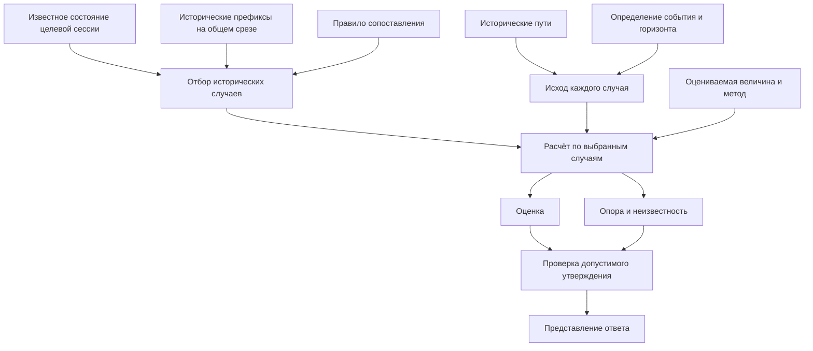

# DR-LAB-SEMANTIC-ARCHITECTURE-0.2 — содержательное дополнение к редакции 0.1

Основа — представленная вами спецификация 0.1. Ниже зафиксированы конкретные исправления её модели и способ формализации. Совместимость предложенной конструкции проверена в памяти на установленном LinkML 1.11.1. Файлы репозитория не изменены.

## 1. Исправить фактические границы реализации

| Место в 0.1 | Исправление |
|---|---|
| §8.3, T14, T16, A20: интеграции Q1 в №24 «нет» | Разделить **отсутствие в принятой основной линии** и **наличие кандидата**. В `ekran-24-otsyuda@1412567` существуют ARRIVE-24, маршрут, контрактная проверка, блок интерфейса и тесты. Приёмка и принятие предложенной поправки контракта остаются отдельными вопросами. |
| §10, PROC-17, GAP-05: SWPC описывается преимущественно как будущая реализация | Зафиксировать существующую кандидатную реализацию. Машинные результаты M01–M18 опубликованы исполнителем; человеческая приёмка H01–H12 остаётся неподтверждённой. Наличие реализации, результаты прогонов и человеческое принятие записывать отдельно. |
| ENT-25, PROC-15: расчёт попытки фактически отождествляется с сохранением | **Расчёт ответа, показ ответа и сохранение выпуска — три операции.** В пилоте сохранение вызывается отдельно. Журнал выпусков поэтому нельзя автоматически считать журналом всех рассчитанных или просмотренных ответов. |
| GAP-08: доступ к будущему через диагностический API | Сохранить узкую формулировку: endpoint возвращает полный путь, поэтому абсолютное утверждение «будущее недоступно через API» неверно. Это само по себе не доказывает использование будущего вычислителем. |

Кандидат интеграции описан в [PR #7](https://github.com/FARTOFALOS/dr-idr/pull/7). Отдельное сохранение видно в [коде страницы пилота](C:/Users/Admin/Claude/dr-idr/.worktrees/q1-pilot/lab/q1/web/app.js:243).

## 2. Развести определения, экземпляры и результаты

В исходных ENT-записях сохранить понятные человеку групповые названия, но раскрыть их через самостоятельные типы:

| Группа 0.1 | Разделяемые объекты |
|---|---|
| `Question` | Определение вопроса → конкретный запрос → конкретная цель → оцениваемая величина |
| `BASEFamily`, `Q1MatchSet` | Правило включения → фактический состав на определённых данных |
| `ProjectionR/X`, `OutcomeLabel` | Определение измеряемого свойства → результат измерения одного случая |
| `Estimator/Matcher` | Правило сопоставления состояний → способ получения оценки |
| `Estimate/Support` | Общий расчёт и его происхождение → оценка **и отдельно** опора |
| `Issue/ObservedOutcome` | Сохранённый выпуск → связанная ревизия наблюдённого исхода |
| `PresentationBinding/ScreenState` | Правило представления → конкретное состояние представления |

Большинство этих различий уже существуют в [LinkML-схеме SC-1.1](C:/Users/Admin/Claude/dr-idr/contract/schema/dr_lab_sc.yaml:396). Их следует переиспользовать, сохранив действующие идентификаторы.

**Добавить следующие определения идентичности.**

- **Вопрос** определяет смысл независимо от автора запроса и времени запуска.
- **Запрос** связывает вопрос с конкретными параметрами и контекстом исполнения.
- **Цель Q1** сохраняется при изменении среза, пока сохраняются сессия, вопрос, рамка, L и H. Это специальное свойство данного вопроса.
- **Новый расчёт** может относиться к прежней цели, но иметь другой срез, состав, метод или снимок входов.
- **Выпуск** существует после сохранения соответствующей записи. Его наличие не доказывает показ человеку.
- **Показ** не доказывает правильное прочтение.

Сохранение цели Q1 нельзя автоматически переносить на NOW. Например, вопрос об обновлении **нынешнего** минимума получает другой ценовой якорь после изменения этого минимума. Правило идентичности цели должно задаваться для каждого вида вопроса.

Также явно ограничить соответствие `TradingSession → StrategySessionRecord`: существующая машинная запись требует коробку и активацию. Она не покрывает автоматически формирующуюся или ещё неподтверждённую сессию. Это граница покрытия конкретной формы данных, которую общий каталог обязан показывать.

## 3. Исправить вычислительные зависимости и смысл «закрытости»

Для NOW/Q1 отбор и измерение исходов представить двумя отдельными ветвями:



Следствия для R09–R12:

- Членство определяется допустимыми входами отбора.
- Метка исхода вычисляется из пути по отдельному определению.
- Оценка и опора — результаты общего расчёта; одна не является причиной другой.
- Проверка допустимости утверждения учитывает конкретные величину, набор, профиль и форму высказывания. Произвольная запись `Validation` не предоставляет допуска.

**Уточнить C1.** Условное историческое описание может иметь явно ретроспективное условие. Допустимость такого условия для ответа «отсюда» определяется отдельно. Для живого сопоставления NOW/Q1 требуется доступность условий на срезе. Класс утверждения и временная допустимость отбора — разные свойства.

**Заменить единый статус закрытости тремя независимыми оценками:**

1. **Определённость модели:** объекты, отношения, условия и отсутствие ответа описаны однозначно.
2. **Соответствие реализации:** конкретная версия кода выполняет эти обязательства.
3. **Приёмка представления:** проверено различение смыслов человеком.

Непройденная H-проверка оставляет открытым третье свойство. Она сама по себе не делает неопределённым математическое событие. Обратно, закрытая формальная модель не устанавливает пригодность интерфейса.

## 4. Формализация в LinkML

Добавление оформить как отдельный кандидатный модуль, импортирующий существующую схему SC-1.1. Действующий реестр и сохранённые payload Q1 сохраняются.

Переиспользовать `TraderQuestionSpecification`, `QuestionRequest`, `EstimandSpecification`, `CaseSetSpecification`, `CaseSetSnapshot`, `OutcomeSpecification`, `EstimatorSpecification`, `DerivationRecord`, `StatisticalResultBundle`, `FactForm` и `ApiSurface`.

Добавить машинные проекции для отсутствующих связей:

| Тип | Обязательное содержание |
|---|---|
| `Q1TargetIdentity` | Существующий `target_id`, вопрос, сессия, рамка, точное L, горизонт. Срез и оцениватель в идентичность цели не входят. |
| `Q1IssueIdentity` | Существующий `issue_id`, цель, срез, оцениватель, версия модели, снимок входов, вид выпуска, отпечаток payload. |
| `Q1OutcomeLink` | Исход, цель, конкретный выпуск, отпечаток этого выпуска, номер ревизии и предшествующая ревизия. |
| `ArchitectureCheckEvidence` | Проверяемое обязательство, точная версия артефакта, происхождение свидетельства, результат и источник. |
| Привязки представления | Отдельные типы для статистики, факта и отсутствия ответа. |

Эти записи индексируют существующие объекты. Они не создают новые идентичности вместо сохранённых Q1 и не меняют алгоритм их хеширования.

**Универсальный `ASSERTION-PASSPORT` из §14 заменить общим контекстом и раздельными типами содержания.** Факт не должен получать фиктивный знаменатель; отсутствие ответа — фиктивную оценку.

Проверенный вариант разделения:

```yaml
classes:
  ArchitecturePresentationBinding:
    abstract: true
    attributes:
      id:
        identifier: true
        required: true
      binding_class:
        range: string
        designates_type: true
        required: true
      surface:
        range: ApiSurface
        required: true
      semantic_source:
        range: SourceReference
        required: true

  StatisticalPresentationBinding:
    is_a: ArchitecturePresentationBinding
    attributes:
      estimand:
        range: EstimandSpecification
        required: true

  FactPresentationBinding:
    is_a: ArchitecturePresentationBinding
    attributes:
      fact_form:
        range: FactForm
        required: true

  AbsencePresentationBinding:
    is_a: ArchitecturePresentationBinding
    attributes:
      absence_reason:
        required: true
```

Это фрагмент индекса привязок. Полное содержание существующих паспортов SC/SWPC остаётся в своих источниках.

**Существенный результат проверки:** первоначальный вариант с одним классом и условным `value_presence: ABSENT` пропустил запрещённое поле через сгенерированный JSON Schema. Раздельные классы при проверке с запрещёнными дополнительными свойствами отвергли этот контрпример.

Поэтому каждому ограничению сопоставляется фактически исполняющий его механизм. Поддержка конструкций различается между способами валидации LinkML. [Документация валидаторов](https://linkml.io/linkml/data/validating-data.html).

## 5. Проверки связей и граница результата

Поверх структурной проверки обязательны:

- разрешимость ссылок и соответствие типа адресуемого объекта;
- уникальность идентификаторов;
- совпадение цели исхода с целью связанного выпуска;
- совпадение отпечатка выпуска;
- корректная последовательность ревизий одного исхода;
- согласованность составов, счётчиков и знаменателей;
- соблюдение временной доступности входов;
- соответствие формы утверждения конкретному профилю;
- покрытие всех ENT/R/INV/PROC/T-записей определёнными объектами и проверками.

Само объявление `range: Q1TargetIdentity` не обеспечило обнаружение несуществующей цели в проверенном JSON Schema. Отдельная проверка связей её обнаруживает. Аналогично, наличие `ACTUALLY_DISPLAYED_ISSUE` среди выразимых значений не разрешает его использование в историческом пилоте.

**Выполненная проверка осуществимости:** в памяти импортированы 67 существующих классов, добавлен пробный модуль из девяти классов. После исправления все **19 сценариев** дали ожидаемые результаты: 11 структурных и 8 проверок связей. Исходная схема сохранила прежний SHA-256.

Это проверка конкретного способа формализации. Полный каталог редакции 0.1, все реальные записи Q1 и рабочий интерфейс этой проверкой ещё не охвачены.

При подготовке консолидированной 0.2 сохранить исходные идентификаторы разделов, внести указанные исправления, добавить соответствия существующим LinkML-типам и отдельно перечислить непокрытые объекты. Результат должен содержать точные определения и проверяемые связи, а каждый заявленный статус — ссылку на соответствующее свидетельство.
