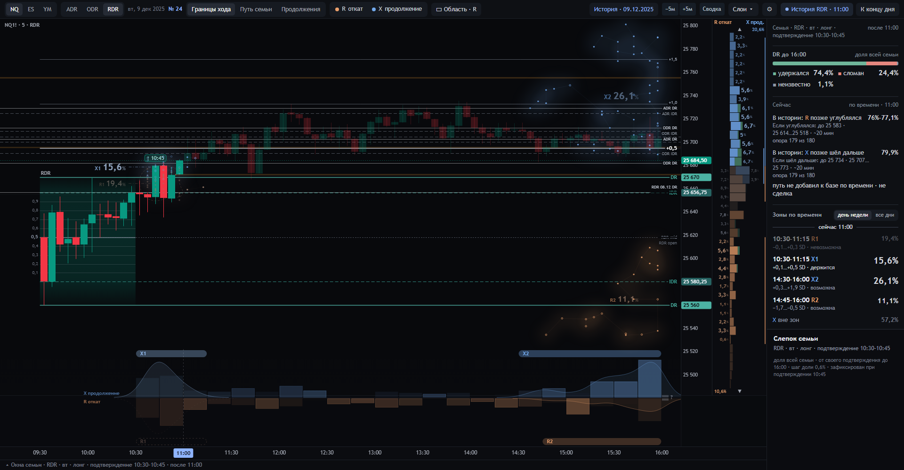

# Аудит созвездий экрана 24: что они считают и как это соотносится с автором (18.10.2026)

**Что это.** Аудит исполнителя (Claude Code) по просьбе оператора 18.10. Вопрос оператора: правильно ли созвездия
экрана 24 переносят смысловой каркас DR/IDR автора, что они держат «под капотом» и не появился ли дрейф смысла после
большой работы Codex 15–16.10. Это **вторая редакция**: перед записью оператор попросил самопроверку по скиллу
[`decisions`](https://github.com/FARTOFALOS/agent-skills/blob/main/skills/decisions/SKILL.md). Часть выводов первой,
устной редакции оказалась неверной или поверхностной. Что исправлено — раздел 9.

Это не решение оператора и не новая норма. Расчёты, контракт и экран не менялись. Метки статуса — как в
[`../../README.md`](../../README.md).

**На чём основано:**
- метод автора: [`docs/STRATEGY.md`](../../../docs/STRATEGY.md) и субтитры автора (156 роликов, локальный файл оператора);
- цепочка решений: [`07`](../../07-cepochka-reshenij.md), [`10`](../../10-dizajn-24.md), [`12`](../../12-karta-zon.md),
  [`14`](../../14-vperedi-i-proshlo.md), [`17`](../../17-rabota-treidera.md), [`docs/DECISIONS.md`](../../../docs/DECISIONS.md);
- контракт SC-1.1, SWPC-1.1 и FOM, который хранится в `integration/reference/` как замороженный справочник;
- код: [`lab/scene24.py`](../../../lab/scene24.py), [`lab/zonemap24.py`](../../../lab/zonemap24.py),
  [`lab/contract.py`](../../../lab/contract.py), [`design/sozvezdiya-24/src/`](../../../design/sozvezdiya-24/src/);
- сверка `main` с GitHub и проверки проекта;
- замеры: [`studies/audit_sozvezdij_2026_10_18/`](../../../studies/audit_sozvezdij_2026_10_18/README.md).

## Коротко

1. **Codex не менял того, что вычисляют созвездия** [проверено].
   - Расчёт семьи и точек R/X не менялся с 07.10, правило зон — с 01.10, 53 принятые величины контракта прежние.
   - «Продолжения», PRE и ARRIVE живут отдельно и включаются сами по себе.
   - Страница, которую видит оператор, совпадает со свежей сборкой из исходников, и её проверка `ui_check24` проходит.
2. **Перенос от автора адекватен** [проверено по определениям и на одном опубликованном ключе автора].
   - Созвездие — это то, что автор в роликах Time & Price тоже называет кластером: группа соседних частых клеток
     распределения максимального отката (или расширения) по его ключу.
   - На опубликованном ключе автора наше раннее созвездие R лежит там же, где его первая зона.
3. **Чем наше созвездие отличается от авторского.** Это три сознательных выбора, и каждый меняет смысл:
   - берутся все сессии семьи, а не только удержавшие DR (решение оператора);
   - откат берётся за всю сессию, а не только до отсечки по времени, поэтому появились поздние созвездия: «слив после вершины»;
   - зоны строятся автоматически по плотности «цена × время», а не на глаз. Добавка этого сверх простых распределений
     у R небольшая, у X её нет.
4. **Главный риск — прочтение, и его теперь можно измерить.**
   - Ранние и поздние созвездия — противоположные сценарии.
   - В созвездиях лежит около трети семьи.
   - Процент на созвездии плохо говорит о сегодняшнем дне, а статус («держится / возможна») говорит много.
   - В малых семьях проценты зон заметно завышены.

## 1. Что стоит за одним созвездием

1. **Активация сегодня** — первое закрытие M5 за DR после коробки.
2. **Семья F.** Тот же инструмент, сессия, день недели, направление и 15-минутное окно подтверждения (по подписи свечи),
   все сессии 2006–2025 строго раньше показанного дня. Семья фиксируется в момент подтверждения и до конца дня не
   меняется. Сломавшие DR остаются в ней и рисуются кольцом.
3. **Две точки у каждой исторической сессии:**
   - **R** — самая глубокая точка против подтверждения, от её подтверждения до конца её сессии;
   - **X** — самая дальняя по подтверждению.

   Время точки — открытие первой M5, где эта цена достигнута. Цена считается в ширинах IDR самой сессии от её края
   IDR и переносится на сегодняшнюю коробку.
4. **Созвездие (зона `zone-map-3`).**
   - Сетка 0,1 IDR × 15 минут.
   - Для каждой клетки считаем точки в квадрате 3 × 3 вокруг неё.
   - Зона — связная область на половине высоты собственной вершины. В ней не меньше max(4; 5 % N) сессий, иначе эти
     сессии уходят в остаток «вне зон».
   - Процент — сессии зоны, делённые на всю семью N.
5. **Статус на сегодня** — по закрытым M5 после сегодняшней активации:
   - «держится» — сегодняшний предварительный экстремум лежит в зоне;
   - «возможна» — более дальний экстремум ещё может попасть в зону вовремя;
   - «невозможна» — иначе.

   Отдельно идут часы истории: есть ли у семьи события зоны позже среза.
6. **Рисунок:** звёзды, дымка, нити, подпись, капсула в ленте времени. Это изображение, а не новое число.

## 2. Сверка с автором

| | Автор (Time & Price, 2024–2025) | Экран 24 | Что это значит |
|---|---|---|---|
| Ключ похожести | инструмент × сессия × день недели × направление × окно подтверждения 15/30 мин по подписи свечи | то же, окно 15 мин | совпадает [проверено, forensic 30.09] |
| Что берётся у сессии | максимальный откат и максимальное расширение после подтверждения и их время | R и X до конца сессии, время первой M5 | совпадает |
| Шкала | SD = ширина IDR от края IDR | то же | совпадает |
| Какие сессии | только удержавшие DR («assume the session holds true») | все; сломавшие — кольцом | сознательно, решение оператора 30.09 |
| Слово «кластер» | двумя смыслами: перекрытие прошлых DR-уровней («тёмные зоны») и группа соседних частых клеток его распределения отката | созвездие — второй смысл | первого смысла на экране 24 нет |
| Откат для зон | «M7 retracement» — особый, не раскрытый расчёт, «до того, как сделано расширение»; цены смотрятся только до отсечки по времени | самая глубокая точка за всю сессию | отсюда поздние созвездия (4.1) |
| Как выделяется зона | 1–2 полосы на глаз, где около 70 % откатов, плюс самая частая ячейка | автоматическое правило плотности, обычно 12–15 % семьи на зону | «где основная масса» против «где сгущение» |
| Цель | уровень, до которого дошли 70 % сессий, или самая частая ячейка | лесенка «на уровне или дальше» (хвост X) | у нас это не созвездие, а уровень |

Насколько часто автор употребляет «кластер» в каждом смысле: в субтитрах это слово встречается 130 раз. Примерно 49 раз
рядом стоят прошлые DR-уровни, примерно 46 — данные отката и расширения, остальное не размечено (грубая разметка по
контексту).

**Опубликованный ключ автора на нашей ленте** [проверено, разведка]: NQ · пятница · RDR · шорт · подтверждение
10:30–11:00 (ролик jPvvCww8aP8). Автор даёт: DR true 85 %, зоны отката +0,09…−0,3 и −0,51…−0,7, цель 1,0–1,09.

| | Что получилось |
|---|---|
| Процедура автора на нашей ленте: 30 минут, только DR true, откаты до 12:00 | 205 сессий, DR true 167 (81 %); из них откат до 12:00 у 80. Медиана −0,11, 70 % не глубже −0,27 — **это его первая зона**. Цель: до +0,73 дошли 70 % DR-true сессий, у автора 1,0–1,09 (то же расхождение нашла линза 6) |
| Созвездия экрана 24, окно 10:30–10:45 (N 148) | R1 18,9 % (−0,4…+0,2, 10:30–11:45, откат раньше вершины у 100 %); R2 7,4 % (−0,6…−0,2, 15:00–15:45) и R3 12,2 % (−1,8…−0,8, 15:15–16:00) — у всех вершина была раньше. X1 17,6 % (+0,2…+0,7, 10:30–11:15, у всех вершина раньше отката); X2 6,1 % и X3 5,4 % в 15:30–16:00 |
| Созвездия, окно 10:45–11:00 (N 57) | R1 14 % (−0,3…+0,3, 10:45–11:45); R2 8,8 % в середине дня; R3 14 % и R4 7 % в конце; X1 28,1 % (+0,1…+1,1, 10:45–12:15); X2 7 % |

Чтение. Ранний R1 — это первая зона автора. Его вторая зона (−0,51…−0,7 до полудня у DR-true сессий) у нас
отдельным созвездием не выделилась: в семье из всех сессий она тонет в остатке. Зато видны поздние R2/R3. Автор их
не видит: он смотрит только откаты до своей отсечки и только удержавшие DR сессии. Числа — `author_key.txt`.

## 3. Фасетная карточка созвездия

FOM в `main` хранится как замороженный справочник (`integration/reference/trace/`). Codex прямо записал, что фасеты не
превращались в состав экрана, и рисунок созвездий они не задавали. Но их стоит использовать как линзу проверки. Ниже —
созвездие R (величина `EST:B-ZONE-R`, у X так же) по фасетам FOM, с проверкой расчёта и показа.

| Фасет | Значение у созвездия | Расчёт | Показ |
|---|---|---|---|
| Категория объекта | алгоритмическая область клеток над окончательными R семьи; число — доля семьи. Не событие рынка, не уровень и не «место прихода»: FOM CQ-07 прямо запрещает отождествлять «место» с зоной R | ✓ | ✓ слова из реестра |
| Фаза | определено в момент активации, неподвижно весь день; после слома — другая семья | ✓ `sem24`: зоны не двигаются со срезом | ✓ |
| Доступность знания | метка исторической сессии известна по её концу; сегодняшний день в зону не входит; статус — только из закрытых M5 | ✓ по построению (правило 6 AGENTS.md); проверка Trace FUTURE-MEMBERS сохранена в справочнике | ✓ |
| Ценовая рамка | своя ширина IDR каждой сессии, перенос на сегодняшний край и ширину IDR | ✓ | ✓ |
| Временное выравнивание | собственный горизонт сессии на реальных часах ET; время — когда она **впервые** дошла до своей крайней точки | ✓ | ✗ читается как длительность (Н4 в [17](../../17-rabota-treidera.md), подтверждено оператором 08.10) |
| Роль набора | базовая семья F, без отбора по сегодняшнему пути | ✓ | ✓; «Сейчас» и «Продолжения» считают по другим наборам, их проценты не сравнимы с процентом созвездия |
| Знаменатель | вся семья N, включая сломавших DR и неизвестные; зоны + остаток + неизвестно + нет периода = N | ✓ | ~ после 16.10 звёздами на графике видна около трети семьи (раздел 5) |
| Форма утверждения | C1, описание: «у n из N сессий семьи…»; прогноз и решение (C2/C3) закрыты | ✓ контракт | ✓ |
| Основание | правило DR Lab `zone-map-3` поверх объектов DR-LAB-SEM-1.0, не правило автора | — | — |
| Поверхность | звёзды и дымка, подпись с долей, капсула, строки колонки цены, строка «Сводки», паспорт | ✓ `ui_check24` | ~ сила дымки не связана с долей (раздел 5) |

**Итог по фасетам.** Расчёт держит все различия. Разрывы — только в показе. Это время, знаменатель после правки 16.10
и сила рисунка. Ни один из них не ломает число; каждый может подменить его прочтение.

## 4. Что созвездие говорит — и чего не говорит

Замеры рабочими функциями экрана. Все — разведка на уже виденной истории 2006–2025; 2026 не открывался. Скрипты и
агрегаты лежат в [`studies/audit_sozvezdij_2026_10_18/`](../../../studies/audit_sozvezdij_2026_10_18/README.md).

### 4.1. Ранние и поздние созвездия — противоположные сценарии

Взяты все семьи по дню недели с N ≥ 20: около 170 на сессию и событие (NQ, ES, YM; медиана N 46). «Ранняя» зона
начинается в окне активации или в следующие 15 минут, «поздняя» доходит до последних 15 минут блока. Масса — доля
сессий во всех зонах этого типа.

| | Доля массы зон | Откат раньше вершины | Средняя глубина | DR ломался |
|---|---|---|---|---|
| R ранние | 50–61 % | 96–99 % | ≈ 0 (у края IDR) | на 20–27 п. п. реже семьи |
| R в середине | 10–16 % | 45–49 % | — | — |
| R поздние | 24–40 % | 2,5–6 % | −0,87…−1,0 (у противоположного края IDR) | на 9–10 п. п. реже |
| X ранние | 56–71 % | 2–3 % | +0,51…+0,64 | на 25–27 п. п. **чаще** |
| X в середине | 7–10 % | 48–68 % | — | — |
| X поздние | 22–37 % | 92–97 % | +1,26…+1,73 | на 17–20 п. п. реже |

Как читать [вывод]:
- **Ранний R** — откат сразу у края IDR, глубже потом не ходили, дальше было расширение.
- **Поздний R** — самая глубокая точка пришла уже **после** вершины сессии. На вопрос «где был самый глубокий откат»
  он отвечает честно. Но после такого отката эти сессии свою вершину не обновляли: это не «откат перед
  продолжением».
- **Ранний X** — дальше этой цены сессии не пошли, потом пришёл более глубокий откат, и DR в них ломался заметно
  чаще. Назвать её своей целью — право трейдера, но продолжения за ней в этих сессиях не было.
- **Поздний X** — тренд в закрытие.

Это в основном **структура окончательных точек**, а не открытие о рынке. Крайняя точка любого пути на отрезке
времени чаще всего бывает у его начала или конца. Окончательный R в конце сессии почти по определению идёт после
вершины. На путях без направления та же карта получается такой же ([12](../../12-karta-zon.md) §4).

Отличить ранние созвездия от поздних можно уже по их месту на оси времени. Не хватает правила чтения, а не нового
значка. Отдельная строка порядка R/X оператору не нужна (решение 08.10).

Когда случаются окончательные точки:
- в первые 60 минут после активации — 32–37 % R и 35–43 % X;
- в последние 60 минут блока — 25–35 % R и 23–33 % X;
- на первой же M5 после активации — около 11 % R и 11–15 % X.

### 4.2. Созвездия держат около трети семьи

| | Медиана по семьям с N ≥ 20 |
|---|---|
| Зон на семью | 2 |
| Доля семьи во всех зонах | 26–36 % |
| Вне зон | 61–64 % |
| Одна зона | 12–15 % (у 10 % зон больше 24–26 %) |
| Неизвестно (нет свечи) | RDR 3,8 %, ODR 2,8 %, ADR 11 % |

У автора зона — полоса, где около 70 % откатов. Наше созвездие отвечает на вопрос «где сгущение», а не «куда обычно
ходит цена».

### 4.3. Процент на созвездии и сегодняшний день: статус весит больше доли

Проверка без заглядывания вперёд, как в [`studies/zone_map_3_2026_10_01`](../../../studies/zone_map_3_2026_10_01/README.md).
- Цели — сессии 2018–2025.
- Семья каждой цели — только более ранние даты, по дню недели, как на экране.
- Статус каждой зоны берётся через 60 минут после подтверждения цели.
- Зона «сбылась», если окончательная точка цели легла в неё.

| Статус через 60 минут | Семьи N ≥ 60: доля на подписи → сбылась | Семьи N 20–59: доля → сбылась |
|---|---|---|
| держится | 16,5–17 % → 42–44 % | 20,5–20,7 % → 43–47 % |
| возможна | 8,3–9 % → 4,6–4,7 % | 13,8–14,8 % → 4,9–6,0 % |
| невозможна | 13–13,6 % → 0 | 17 % → 0 |
| возможна, поздняя зона R | 9,1 % → 5,5 % | 14,9 % → 7,9 % |

Через 30 и 120 минут картина та же. У зоны «держится» сбылось 29–33 % через полчаса и 61–65 % через два часа.

Вывод [вывод]:
- для сегодняшнего дня процент на созвездии не служит ни оценкой, ни границей;
- через 60 минут у «держится» исход в 2,1–2,6 раза выше подписи, у «возможна» — в 1,8–2,8 раза ниже;
- главный сигнал на сегодня — статус.

Контракт так и говорит: доля зоны — не шанс на сегодня. Но размер подписи растёт с долей, а не со статусом.

### 4.4. Малые семьи и день недели

Насколько показанная масса всех зон потом сбывалась на новых сессиях (2018–2025, без заглядывания вперёд). Для N ≥ 60
цифры совпали с [12](../../12-karta-zon.md) §4; малые семьи — новое.

| Семья | N ≥ 60 | N 20–59 |
|---|---|---|
| по дню недели (как на экране) | 0,67–0,82 | **0,50–0,63** |
| все дни недели | 0,86–1,02 | 0,59–0,69 |

В малых семьях по дню недели показанная масса зон завышена в 1,6–2 раза. Это примерно 40 % случаев с N ≥ 20. Без
дня недели в больших семьях масса почти честная. Это подкрепляет открытый вопрос О25
([05](../../05-otkrytye-voprosy.md)), но не решает его: день недели в ключе — решение оператора 01.10.

## 5. Рисунок

- **Дымка.** Контуры каждой зоны строятся на 0,22 и 0,6 её собственной вершины, прозрачность постоянна. Поэтому зона
  из 4 сессий заливается так же плотно, как зона из 25. Силу видно только по размеру подписи (15–21 px), насыщенности
  капсулы и числу звёзд.
- **Время звезды и зоны** — момент, когда сессия впервые дошла до своей крайней точки. Это не время, сколько цена там
  стояла (Н4). Где цена стояла по часам, отвечает «Путь семьи».
- **Нити** соединяют звёзды одной зоны. Это рисунок, а не путь.
- **Правка 16.10** — прямое поручение оператора; она сделана локально и не опубликована. Звёзды вне зон скрыты, дымка
  ослаблена вдвое, из постоянных вертикалей осталась только полночь Нью-Йорка.
  - В эталонном состоянии NQ · RDR · 17.12.2025 (N 156, проверено на текущей сборке) из 152 известных X на графике
    16, остальные 136 не рисуются. Из R — 63 из 152.
  - Колонка справа от цены и строка «вне зон» по-прежнему показывают всё распределение.
  - SWPC-1.1 (B04) требует, чтобы остаток оставался частью картины на графике. Решение принято оператором; здесь
    зафиксировано его следствие: взгляд «сначала на созвездия» видит меньше половины истории.
- **Проверка показа** [проверено]. На текущей локальной сборке `ui_check24` проходит при 1600×900 и 1920×1000: NQ RDR
  17.12.2025 и 09.12.2025, отдельный сервер на 8779, рабочий 8767 не трогался.

На снимке все четыре типа рядом:
- R1 19,4 % — ранний, невозможен;
- X1 15,6 % — ранний, держится;
- X2 26,1 % — поздний, 14:30–16:00, возможна;
- R2 11,1 % — поздний, 14:45–16:00, около −1, возможна.

В «Сводке» видно «X вне зон 57,2 %».

## 6. Чьи это решения

| Что | Кто | Когда, где |
|---|---|---|
| Скелет автора, ключ семьи, окно по подписи свечи | оператор | 30.09, [08](../../08-semantika-klasterov.md) §3.0 |
| Все сессии, без пересчёта на DR true, один N | оператор | 30.09, линза 12 |
| Главная картина — слепок дня, который делит 100 % и зафиксирован при подтверждении | оператор (слова) | 30.09, [razbor](../../razbor-2026-09-30/README.md) §5 |
| Окончательные R/X как основа: спецификация аудитора DR-LAB-SEM-1.0, которую оператор сам приложил к поручению | оператор поручил; содержание — аудитор | 01.10, [10](../../10-dizajn-24.md) |
| Несколько зон и остаток, день недели по умолчанию, доля зоны ≠ шанс | оператор | 01.10, [12](../../12-karta-zon.md) |
| Правило зоны (3 × 3, половина вершины, max(4; 5 % N)) и пороги приёмки | исполнитель; принято в составе SC-1.1 | 01.10 / 07.10 |
| Вид «дымка и нити», R и X вместе | оператор выбрал | 01.10 |
| Контракт SC-1.1 | оператор принял | 07.10 |
| После подтверждения онтология покрывает вопросы трейдера, разрыв — в восприятии | оператор подтвердил | 08.10, [17](../../17-rabota-treidera.md) |
| Без отдельной строки порядка R/X | оператор | 08.10 |
| Звёзды вне зон скрыть, дымку ослабить | оператор (локально) | 16.10 |

Переход от «где цена приходила» (29.09) к окончательным R/X (01.10) — решение оператора с причиной. Ему нужен был
слепок на 100 %, а точки прихода сотню не делят: одна сессия приходит во многие места. Записан этот переход честно
([17](../../17-rabota-treidera.md), «Хронология»).

У этого решения есть цена. 30.09 оператор видел внутри слепка созвездия как «где цена бывала». На экране 24 созвездия
построены из самого слепка, то есть из окончательных точек. «Где цена бывала» отвечают лесенка «на уровне или дальше»
и «Путь семьи»; 08.10 оператор подтвердил это: «да, это оно».

## 7. Работа Codex и состояние репозитория

- **GitHub и локальная копия.** `main` на GitHub совпадает с локальным (8376c97), открытых PR нет. #1 и #14 слиты,
  #2–#13 закрыты с адресными решениями (`integration/pr-dispositions.json`).
- **Что не менялось с 07.10:**
  - `lab/scene24.py` и `lab/zonemap24.py` (последний — с 06.10);
  - реестр величин;
  - эталонные определения BASE в `lab/contract.py`.
- **Что добавил Codex:**
  - снятие числа вместе с его рисунком при нарушении (SWPC M14/M16);
  - отдельные режимы-кандидаты: «Продолжения» — свой набор сессий по положению цены, в проверенной сцене 60 из 97 не
    из семьи; PRE; ARRIVE;
  - отдельный предлагаемый реестр на 60 величин.
- **Тот же путь расчёта.** Интеграционный путь (`integration24.scene`) зовёт те же `_family` и `attach_family`.
  Страница проводит семью через тот же `buildSnap`.
- **Проверки на текущем дереве.** smoke, sem24, now24, contract_sc11, continuity24, continuations24 — ALL GOOD.
  `lab/dist/24` совпадает со свежей сборкой исходников.
- **Локальные хвосты правки 16.10** (не опубликованы):
  - `spec/ekran-24/tools/annotate.py` всё ещё ставит метку 11 на убранную линию конца блока (`C2.end = null`), и
    следующая пересъёмка упадёт;
  - строки 10–11 в `spec/ekran-24/02-obzor-grafik.md` описывают убранные вертикали.

## 8. Что из этого следует (предложения; экран не менялся)

1. **[предложение]** Записать в смысловой слой правило чтения, без новых меток на графике:
   - ранний R — откат до вершины;
   - поздний R — после вершины;
   - ранний X — вершина, за которой пришёл глубокий откат;
   - поздний X — тренд в закрытие.

   Нужна ли строка об этом в инспекторе при наведении на зону — решение оператора.
2. **[вывод]** На сегодня читать статус, а не размер процента. Через 60 минут после подтверждения «держится»
   сбывалась в 2,1–2,6 раза чаще подписи, «возможна» — в 1,8–2,8 раза реже (4.3).
3. **[открыто, О25]** День недели. Малые семьи по дню недели завышают массу зон в 1,6–2 раза. Решение оператора.
4. **[открыто]** Звёзды вне зон — решение оператора 16.10. Если оставить, помнить: график показывает около трети семьи.
5. Локальные хвосты 16.10 (раздел 7) исправить вместе с публикацией этой правки, если оператор её опубликует.

## 9. Самопроверка: что исправлено против первой редакции

Первая редакция 18.10 была устной, в чате. Самопроверка по скиллу `decisions` нашла в ней двенадцать мест.

| Было в первой редакции | Что не так | Как теперь |
|---|---|---|
| Основа сменилась «через принятие спецификации, а не вашей фразой»; это и есть поворот первоначального импульса | Несправедливо: оператор сам требовал слепок на 100 %, сам приложил спецификацию и 08.10 подтвердил полноту | Раздел 6: решение оператора с причиной; цена решения названа |
| «Кластер» у автора — это прошлые DR-уровни; оператор ставит неверный знак равенства | Автор употребляет слово в двух смыслах; созвездие соответствует второму | Раздел 2 и сверка на его ключе |
| «Дрейф в прочтении, а не в коде» | Слишком узко: поздние зоны и автоматическое правило зоны — наш выбор в самом расчёте | «Коротко», п. 3 |
| «Ваше чтение верно только для раннего R и позднего X» | Поздний R честно отвечает «где откат»; неверно только ожидание продолжения после него. Порядок — во многом свойство самих окончательных точек | 4.1 |
| Предложение различать ранние и поздние созвездия на графике | Они уже различимы по времени; отдельную строку порядка оператор отклонил 08.10; лишние метки на графике запрещены | 8, п. 1: правило чтения |
| Ранний X — «не цель» | Слишком жёстко: назвать зону целью — право трейдера | 4.1 |
| «Процент возможной зоны завышает» — по сравнению чисел из разных выборок | Не было прямого замера | 4.3: замер без заглядывания вперёд |
| «Без дня недели карта переносится лучше» | Расплывчато, и не было малых семей | 4.4: в малых семьях завышение в 1,6–2 раза |
| «Где расширялись остальные — на графике не видно» | Колонка справа от цены их показывает | 5: не видно звёздами |
| FOM: «справочник, рисунок не задавал» — и всё | Не ответил на вопрос оператора про фасеты | 3: карточка по фасетам |
| Повторно спросить оператора, что такое созвездие — окончательная точка или приход | Вопрос уже решён (01.10, 08.10); повторять — значит пересматривать решённое | Убрано |
| Экран не проверен: браузер не открыл 127.0.0.1 | Пробел в проверке | `ui_check24` на текущей сборке проходит; снимок выше |

## 10. Пределы

- Вся история 2006–2025 уже видена линией, поэтому все замеры — разведка. Приёмка на сессиях после 2025 года
  ([12](../../12-karta-zon.md) §6) не делалась: журнал новых сессий не ведётся.
- База автора (QuantX) не наша, его «M7 retracement» не раскрыт. Сверка с ним — по смыслу и по одному ключу NQ.
- Классы «ранняя / поздняя / середина» — объявленное здесь правило, а не определение контракта.
- Восприятие оператором (H01–H12 SWPC) не проверялось. Этот аудит говорит, где прочтение рискованно, но не заменяет
  проверку.
- Рыночные данные и записи отдельных сессий в репозиторий не попадают, только агрегаты.
