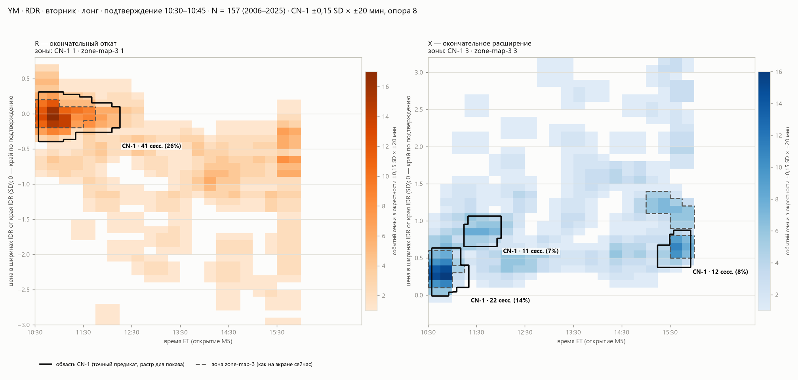

# CN-1: итог для оператора и проверка

21.10.2026. Пишет Claude (Opus 5.5). Это продолжение работы Codex по [HANDOFF.md](HANDOFF.md): Codex предложил
определение созвездия CN-1 ([SPEC.md](SPEC.md)). Я проверил его, и вторая проверка изменила мои первые выводы (§3).
Третья редакция: в ней убраны фразы второй, которые подталкивали к выводам, не следующим из свидетельств (§3, п. 7).
Это предложение исполнителей, не решение оператора. Экран, контракт SC-1.1 и правило зон не менялись.

## 1. Коротко, по ценам

**Что такое созвездие по CN-1.** Это место, где окончательные R (или X) многих сессий семьи лежат близко друг к другу
сразу по цене и по времени. «Близко» значит ±0,15 SD и ±20 минут. «Многих» значит не меньше 5 % семьи и не меньше
4 сессий. Соседние такие места сливаются в одно созвездие. Сетки клеток нет. Доля считается как сейчас: n из N той
же семьи.

**YM · RDR · вторник · лонг · подтверждение 10:30–10:45, N = 157.** Это ваш случай 20.10.

- **R.** Созвездие одно, у края коробки, как и сейчас, но шире: 41 сессия (26 %) вместо 26 (17 %). По цене
  −0,26…+0,29 SD, по времени 10:35–12:15. У 34 % этих сессий самая глубокая точка легла в первые 10 минут после
  подтверждения, у нынешней зоны таких 38 %. Ниже этой точки цена у них позже не опускалась.
- **Ниже цены созвездия нет и по новому правилу.** История там есть: у 60 сессий из 157 (38 %) окончательный R лёг
  глубже −0,4 SD и после 13:30. Но эти R рассыпаны на два с половиной часа и на целый SD: в любом окне ±0,15 SD ×
  ±20 минут их не больше 6 при пороге 8. По аудиту 18.10 такие поздние R почти всегда идут после вершины сессии.
  Отсутствие созвездия здесь не значит отсутствия истории. Её видно в ценовой колонке.
- **X.** Три созвездия:
  - раннее: 22 сессии, +0,06…+0,51 SD, 10:35–11:00;
  - новое: 11 сессий, +0,68…+0,96 SD, 11:15–12:00;
  - позднее: 12 сессий, +0,46…+0,84 SD, 15:25–15:55.

  Нынешней зоны X2 (+0,9…+1,4 SD, 15:00–16:00) нет.

**Что установлено (все 540 карт семей, R и X, история до 2026).**
1. **В рисунке CN-1 меньше произвола.** У нынешнего правила рисунок зависит от того, где начинается сетка клеток, у
   CN-1 — от того, что считать «близко». Правило решения я записал до счёта.
   - Беру ближайшие другие «близко»: 0,13 и 0,17 SD, 15 и 25 минут. Зоны CN-1 при них сохраняют состав в 89 %
     пересчётов. Нынешние зоны при штатных сдвигах своей сетки — в 85 %.
   - Новых случайных зон у CN-1 примерно вдвое меньше: R — 0,23 против 0,43 на карту, X — 0,22 против 0,38.
2. **Устойчивость к составу семьи** для R выше, но проверено только на 18 картах. Для X не установлена. Часть
   выигрыша даёт то, что CN-1 чаще оставляет одну зону.

**Чего CN-1 не даёт и что он делает заметнее.**
- **Нового знания о рынке он не даёт.** Места те же, что у нынешнего правила. Ни для одного из двух правил не
  установлено, что совместная картина цены и времени говорит больше двух отдельных шкал и больше, чем даёт форма
  любого пути.
- **В его зонах больше начала.** Доля сессий, у которых окончательная точка легла в первые 10 минут после
  подтверждения:

  | | Зоны CN-1 | Нынешние зоны | Вся семья |
  |---|---|---|---|
  | R | 38 % | 30 % | 14 % |
  | X | 48 % | 36 % | 17 % |

  Это свидетельство об исходе: как часто самая глубокая или самая дальняя точка всей сессии пришлась на первые
  минуты. Особенностью DR оно почти не является. В ответе на линзу 15 (первые 30 минут) у R настоящие сессии и пути
  без памяти дают у начала одну долю, у X у настоящих сессий она на 2–3 п.п. больше. Ответом на вопрос «куда цена
  пойдёт дальше» оно тоже не является. CN-1 устойчивее отчасти потому, что полнее захватывает именно это скопление.
- **Проверки на новых сессиях и вашего чтения** не было. 2026 закрыт.

**Как читать созвездия нынешнего экрана.** Правило зон не менялось, это следует из тех же 540 карт. Всё ниже
описывает исход, который в каждой исторической сессии стал известен только к её концу.
- В зоне R примерно у 3 из 10 сессий самая глубокая точка всей сессии была в первые 10 минут: ниже неё цена позже не
  опускалась. Были ли у них позже откаты от новых вершин выше этой точки, эти числа не говорят.
- В зоне X примерно у 1 из 3 сессий лучшая точка всей сессии была в первые 10 минут. Две трети таких сессий потом
  сломали DR, у остальных сессий семьи — одна из пяти.
- Правилом для решения сегодня это не становится. В 10:45 ещё нельзя знать, окажется ли утренний минимум или
  максимум окончательным. Этот вопрос на текущих часах задаёт слой «Сейчас»: «В истории: R позже углублялся…».
- Через 10 минут такие сессии переходят в часть «у семьи раньше среза». Экран это уже различает.

**Что решаете вы.** Срочного ничего. Моя рекомендация: на экране оставить нынешние зоны, а CN-1 держать как
исследовательскую геометрию.
- Он выигрывает в непроизвольности рисунка. При сдвиге сетки у нынешнего правила не сохраняется 15 % зон, у CN-1 при
  ближайших других «близко» — 11 %.
- Места и смысл зон те же, поэтому вывод, который вы делаете по экрану, от замены почти не изменится.
- Пробовать его на экране имеет смысл, если вам важна именно непроизвольность рисунка или если проверка на новых
  сессиях покажет перенос не хуже.

Какое событие считать откатом, решается в [пакете RPX](../2026-10-21-rpx-decisions/README.md).

## 2. Как проверено

Скрипты [recheck.py](recheck.py) и [recheck2.py](recheck2.py), результаты [recheck-results.json](recheck-results.json)
и [recheck2-results.json](recheck2-results.json) (только агрегаты), рисунок [img/cn1-ym-rdr.png](img/cn1-ym-rdr.png).
Файлы и квитанция Codex не переписывались.

| Что | Чем | Результат |
|---|---|---|
| Файлы Codex целы | независимо, отпечатки | 9 из 9 |
| Исторический прогон | тот же код | отпечаток чисел `25dc061c…` совпал бит в бит |
| Контрпример к CCPB линзы №19 | независимо, чтение псевдокода | верен буквально: новая вершина делает `continue`, коррекция взводится только на баре позже якоря |
| Произвол рисунка | тот же `cn()` и `map_of` продукта; правило решения до счёта | CN-1 проходит и для R, и для X (§1) |
| Сессии «первых 10 минут» в зонах | тот же код | §1 |
| Удаление 10 % и половины семьи, по размеру зон | тот же код | R лучше в обоих опытах; X — хуже при 10 %, лучше при половине; размер объясняет мало, слияние не отделено |
| Поздняя масса R в YM | тот же код | 38 % семьи; лучшая окрестность 5–7 при пороге 8; зоной становится только при вдвое более широком «близко» |
| Правила общей границы и малых компонент | тот же код | 3 и 105 случаев из 50 412 |
| Растр областей на рисунке | свой код | на глаз совпадает с членством; формально не сверялся |

**Независимой реализации CN-1 по тексту SPEC нет.** Ошибку в `cn()` мои проверки унаследовали бы. Я прочитал код и
расхождений со SPEC не нашёл.

**Поправки к тексту Codex.**
1. Квитанции `CHECKPOINT.json`, на которую ссылается HANDOFF §2, в пакете нет. Её роль выполняют `validation.json` и
   отпечатки в `probe-results.json`, они целы.
2. Чувствительность к масштабу в SPEC §8 описана мягче, чем есть. При ±0,10 SD худшее совпадение состава — 0,26.
   При ближайших значениях масштаб влияет меньше, чем сетка у нынешнего правила (§1).
3. Отрицательный результат по X верен только при удалении 10 %.
4. «31 синтетическое утверждение» — это 19 разных свойств. Одно из них проверено 13 раз на разных наборах.

## 3. Что я исправил в своих первых выводах

1. Я назвал проверку независимой, а большая её часть сделана тем же кодом Codex (§2).
2. «Устойчивее не только потому, что зоны крупнее» — завышено.
   - Размер объясняет около 0,01 из выигрыша 0,07.
   - Слияние в одну зону не отделено: одна зона в 10 из 18 карт у CN-1 и в 3 из 18 у нынешнего правила.
   - На картах с равным числом зон R лучше в 3 из 3, X смешанно.
3. Выигрыш X при удалении половины семьи совпадает со сменой режима порога: m падает с 7–10 до 4–5. Устойчив в обоих
   опытах только R.
4. В разговоре я назвал «первыми двумя M5» первые три (15 минут). Верно для YM:
   - в первые две M5 (10 минут): 34 % у CN-1 и 38 % у нынешней зоны;
   - в первые три M5: 46 % и 54 %.
5. Я принимал устойчивость за качество. Самое устойчивое в окончательных экстремумах — скопление у начала горизонта.
   Устойчивость нужна рисунку, но смысла его не мерит.
6. Вопрос «ставить ли CN-1 на экран» я задал преждевременно.
7. Затем я сделал обратную ошибку и назвал это скопление наименее содержательным для трейдера. Оно не отвечает на
   вопрос «где ждать отката позже», но прямо свидетельствует об исходе сессии. Плох не объект, а вывод, который нельзя
   сделать в момент решения. Вторая редакция этой страницы подталкивала к таким выводам в трёх местах:
   - «позже отката у них не было» — на деле ниже этой точки цена не опускалась;
   - «две трети потом сломали DR» без оговорки — окончательность утреннего максимума в 10:45 неизвестна;
   - «ранняя часть X чаще значит „лучшее было сразу“» — долю именно в ранних зонах я не мерил.

   Кроме того, «это форма пути» для X сказано слишком широко: у X настоящих сессий у начала на 2–3 п.п. больше, чем у
   путей без памяти.

**Что я решил сам.**
- Набор «ближайших других близко» для CN-1 и правило решения записаны до счёта.
- «Первые 10 минут» — это первые две M5 горизонта события.
- Два масштаба ±0,25 × ±30 и ±0,3 × ±45 считались только затем, чтобы понять, что значит отсутствие зоны ниже цены.
  Это не предложение параметров.

**В чём я не уверен.**
- Другой выбор «ближайших» значений мог бы дать другой ответ. При крупных изменениях, 0,10 и 0,20 SD, состав меняется
  сильнее (SPEC §8).
- Связь «лучшее сразу → слом DR» описательная, механизм не установлен. Почему у X в первые 30 минут на 2–3 п.п.
  больше, чем у путей без памяти, не проверялось.
- Средняя зона X YM на 11 сессий держится на двух ядрах.
