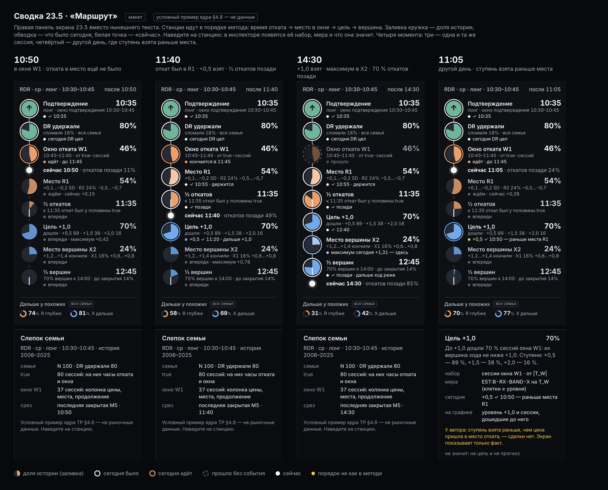

# Сводка 23.5 «Маршрут»: разбор ядра TP-1.4 и вопросы исполнителю (04.11.2026)

> **Что это.** Предложение по поручению оператора от 04.11: новая правая панель «Сводка» экрана 23.5 (вариант
> «Маршрут») и разбор того, как ядро TP-1.4 (PR #27) показано на экране. Это **вход** для исполнителя PR #27 и
> **решения для оператора**, а не принятый текст. Экран, сервер, контракт и смысл чисел здесь не менялись. По
> протоколу ([06](../../06-protokol.md) §3) этот PR добавляет только новые файлы в `lens/`.

**Составил:** Claude, сессия «Визуальная сводка рынка», 04.11.2026.

**Слова оператора, на которых держится задача** (чат 04.11):
- «мне кроме сводки все нравится… особенно созвездия, с дымкой»;
- «сводка должна быть не вчитываемая, а визуально быстрая, понимаемая нативно… я её никогда и не читаю»;
- «эти созвездия правильно проанализируй по смысловому… как они должны появляться и где — пучки и тому подобное»;
- «отделяй смыслы, которые предлагали агенты и которые потом отбросились»; «не применяй предыдущие версии»;
- «визуализируй только третий вариант… сделай пиар и вопросы агенту».

**Файлы:**
- [`marshrut.html`](marshrut.html) — макет панели с кодом. Открывается в браузере без сервера; наведение на станцию
  показывает её паспорт в инспекторе. Числа — условный пример ядра §4.8, **не рыночные данные**.
- [`marshrut.png`](marshrut.png) — снимок макета: четыре момента, у последнего наведена станция «Цель».



**Пометки:** [О] — слово оператора; [А] — автор метода; [Р] — запись репозитория; [И] — решение исполнителя без
оператора; [моё] — вывод этой работы.

---

## 1. Коротко

1. **Ядро 1.4 в смысле верно по автору.** Основа — true-сессии. Порядок: время → цена → продолжение. Видны все пучки,
   окна идут от медианы и от отметки 70 %. Места отката — полосы цены только среди сессий окна. Места вершины —
   полосы всех вершин окна, вершины последних 15 минут местом не бывают.
2. **Показ местами расходится со смыслом ядра.** Найдено восемь мест (§4). Главные три:
   - окно в покое всегда W1, а не окно, в котором был сегодняшний откат;
   - у мест вершины X инспектор говорит о времени окна, хотя в 1.4 место вершины — полоса цены;
   - у долей сессий окна стоят слова «семьи».
3. **Нынешняя сводка повторяет ленту текстом:** пучки, окна, ½ и 70 %. Это против правила оператора: в правой панели
   нет строки, которая повторяет график.
4. **Предложение — «Маршрут».** Восемь станций-кружков в порядке метода. Заливка кружка — доля истории, обводка —
   сегодняшний факт, белая точка — «сейчас».
   - Каждое число — паспорт уже зарегистрированной меры (§6).
   - Новое только одно — факт порядка «ступень раньше места» (ядро §6 п. 3). Его определение — вопрос В5.
5. **Вопросы исполнителю — §7. Решения оператора — §8.**

## 2. Где истина для 23.5

Порядок старшинства:
1. Решения оператора [О]: `docs/DECISIONS.md`, узлы `meaning/07`, чат 03–04.11.
2. Метод автора (Time & Price). Оператор выбрал следовать ему: «как у автора» [О 03.11].
3. Ядро TP-1.4 — [`meaning/23`](../../23-tp-smyslovoe-yadro.md), ветка `tp-x-places`, PR #27. Это **проект на
   утверждение**: пункты §11 и параметры §12 оператор отдельно не утверждал.
4. SC-1.1: каждое число на экране — паспорт зарегистрированной меры.
5. Решения исполнителя [И], временные до параметров §12:
   - правило пучка и полосы, опора max(4, ⌈5 % N⌉);
   - W1 начинается с подтверждения, если до медианы нет пучка;
   - у X шаг 0,2 SD, срез «последние 15 минут»;
   - часы T не публикуются, страница считает их сама.

Цепочка ядра:

```
семья F — только исход DR, одна 100 %
└─ true-сессии T (DR удержали)
   ├─ часы отката до вершины: пучки (доля от |T|), линии ½ и 70 %
   ├─ окна: до окна · W1 (начало 1-го пучка → ½) · W2 (½ → 70 %) · позже
   └─ сессии окна T_W
      ├─ места отката = полосы цены (0,1 SD) среди T_W → созвездия R
      └─ продолжение T_W:
         ├─ часы вершин: пучки, ½, 70 %; последние 15 минут — отдельная строка
         ├─ места вершины = полосы цены (0,2 SD) всех вершин без последних 15 минут → синие созвездия
         └─ «дошли до L» — лестница (под мышью)
```

**Ловушка, которую надо держать на виду** (`docs/STRATEGY.md` §15.2). Всё, что считается по T, — это история сессий,
которые DR **удержали**. Будет ли сегодняшняя сессия true, на срезе неизвестно. Поэтому рамка «DR удержали 80 %
семьи» должна стоять рядом со всем, что посчитано по T. Сводка — единственное место экрана, где это видно.

## 3. Что отброшено

Здесь собраны линии, которые предлагали агенты или исполнитель и которые потом сняли. Возвращать их нельзя.

| # | Что | Предложено | Снято | Почему |
|---|---|---|---|---|
| 1 | Итоговый экстремум до конца сессии как звезда во времени | 28.09, агенты | 29.09 [О], правило 10. На 23.5: R до вершины (29.10), X без последних 15 минут (04.11) | куча у 16:00 — место, где сессия кончилась |
| 2 | Первое касание места как «пришла» | 29.09 | 01.10 [О]: итоговые R и X | доли больше 100 %; по сути лестница |
| 3 | Вся семья («честная когорта») как основа мест; C13 как довод | 30.09; C13 от 25.09 | 03.11 [О]: основа — true, C13 не использовать ([24](../../24-stopy-true-sessiy.md)) | автор считает только true; C13 не проверяла метод автора |
| 4 | zone-map-3 как смысл созвездия | 01.10 | 27.10 [О] | это алгоритм склейки, а не смысл |
| 5 | Локальные откаты PB-L вместо R; ядра 0,3 SD × 15 мин | 22–23.10 [И] | 26.10 [О] | меняли само событие; ядра на уровне шума |
| 6 | Таблица 15 мин × 0,1 SD и «сильнейшая клетка» как число места | 27–28.10 | 03.11, ядро | 107 из 127 клеток держат одну сессию |
| 7 | Новый рисунок 27.10; три рисунка звёзд 30.10 | [И] | 28.10 и 30.10 [О]: «те же визуализации», «прикрути бэкэнд к фронтенду» | менять смысл, а не рисунок |
| 8 | Созвездия из клеток таблицы (от 2 сессий, связь через 2 клетки) | 30.10 [И] | 03.11, ядро | склейка без окна |
| 9 | «У X созвездий во времени нет» | 03.11, ядро 1.1–1.2 | 04.11 [О]: «X так же, как R, синим» | трейдеру нужно «докуда тянуть сделку» |
| 10 | Места X «пучок вершин × полоса» и капсула «вершина» | 04.11, ядро 1.3 [И] | 04.11 вечер, ядро 1.4 | места не лучше случайных (2–3 % на новой сессии); капсула повторяла линию ½ |
| 11 | Вердикт фазы «откат сделан» и приглушение стороны | 08.10 | 26.10 [О]: два факта без вердикта | экран показывает, что было |
| 12 | Баланс R против X («чаще на N п. п.», перевес на ленте) | 06.10 | 30.10 | это разные события |
| 13 | Кандидат «Сводки» 13.10 (лестница цен, экран 24) | 13.10 [И] | не принят | [19](../../19-svodka-kandidat.md) |

## 4. Разбор ядра 1.4 на экране

Источники:
- код — ветка `tp-x-places` (PR #27, `cf44be3`);
- снимки страницы — проверка сессии PR #27 04.11 на синтетической истории;
- слова оператора — переписка той же сессии 04.11.

### 4.1 Что верно

Совпадает с автором и с решениями оператора:
- основа — true-сессии;
- все пучки видны, каждый со своей долей;
- W1 — от первого пучка до медианы, W2 — от медианы до 70 %;
- полосы отката ищутся только среди сессий окна;
- место вершины — полоса всех вершин окна;
- вершина в последние 15 минут — отдельная строка, не место.

Где объекты стоят на экране, тоже верно:
- время (пучки, окна, ½, 70 %) — на ленте;
- места — созвездиями на графике;
- распределение по цене — в колонке.

Оператор 04.11 о сегодняшней сессии: «большой откатный W1-кластер… цена это же и сделала»; «это меня воодушевляет,
что мы как бы идём по верному пути» [О].

### 4.2 Что не так или спорно

1. **Окно в покое — всегда W1.**
   - У автора продолжение зависит от того, **когда** был откат: до медианы — одна цель, после — другая [А l5DwIIH0rJ8,
     ykcHCRLkYx8, LGfT_icUEd4].
   - Если сегодня откат пришёлся на время W2, на экране всё равно места и цели W1.
   - Предложение [моё]: окно выбирается сегодняшним фактом. Это окно, в котором по времени лежит сегодняшний откат до
     текущей вершины. Пока отката нет — окно, в котором сейчас часы, а до его начала W1.
   - Это выбор одного из уже посчитанных наборов по закрытым M5, а не прогноз. Если позже придёт более глубокий откат,
     окно сменится. Решает оператор (Р2), вопрос исполнителю — В1.
2. **Инспектор места вершины X говорит о времени.**
   - Где: `app.js:2946` (`zoneTip`), `app.js:2932` (`winLine`).
   - Что показывает: «окно зоны 11:15–15:45 · действует ещё 195 мин», «у семьи впереди · пиковые 15 минут» и
     сравнение R и X «в окне зоны».
   - В 1.4 место вершины — полоса цены, у неё нет своего окна времени.
   - Эти строки достались от карты зон. Они возвращают «коробку времени», которую сняли вместе с капсулой «вершина»: та
     же ловушка «время зоны = длительность» (`meaning/17`, Н4). Вопрос — В2.
3. **Слова не называют набор.**
   - Пример: «28,6 % семьи в этой зоне» у доли **сессий окна** W1. Подпись идёт из реестра:
     `contract/registry/40-claims.yaml:254`, `EST:B-ZONE-*`, ключ `share`.
   - Так же «у семьи впереди».
   - Ядро §7: «у каждой доли виден её набор». Трейдер читает «семьи» как всю семью. Вопрос — В3.
4. **На ленте R и X на одной шкале высоты** (`tp235.js:196`).
   - R — доля всех true-сессий, X — доля сессий окна.
   - 04.11 оператор сравнивал их: «когда у нас превалирует столбик X…» [О]. А сравнение R и X как одного баланса снято
     30.10 (`meaning/13`, запись 61). Вопрос — В4.
5. **Факта «ступень взята раньше, чем цена пришла в место» нет нигде.**
   - Ядро §6 п. 3. У автора это значит «сделки нет» [А J054OlJm8jE, dfp2aAKt-Ss]; экран должен показать только факт.
   - Поиск по `tp235.js`, `app.js`, `panel.js`, `integration.js` ничего не дал. Вопрос — В5.
6. **Окна режутся по 15-минутным клеткам.**
   - W1 кончается в конце клетки медианы. На снимке проверки (синтетика): медиана 10:50, 70 % — 11:00, W1 = 73,7 %,
     W2 нет.
   - «До медианы» читается как «половина», а в окне может быть три четверти.
   - Это не ошибка, а параметр §12 (шаг часов). Вопрос — В6.
7. **Наборы в одной панели смешаны.** «Сейчас» (NOW-1.0) считается по всей семье, а карта — по true. Ядро §6 п. 4
   [И], вопрос открыт. Вопрос — В7.
8. **Сводка повторяет ленту текстом** (`tp235.js::tpPanel`).
   - Строки пучков, окон, медианы, 70 % и пучков вершин уже подписаны на ленте.
   - Правило оператора от 28.09 для правой панели: «no line that repeats what the chart shows at a glance»
     (`docs/UI_RULES.md`). Оператор: «я её никогда и не читаю» [О 04.11].

### 4.3 Как объекты должны появляться и где — вывод

- **Время** (пучки, окна, ½, 70 %, часы вершин) — на ленте, как сейчас. В сводке оно не повторяется. В сводке только
  фаза: где «сейчас» относительно окна и ½, и сколько откатов по часам уже позади (E4).
- **Места отката** — созвездия на графике в своём окне и полосе, как сейчас. Окно — по сегодняшнему факту (п. 1).
- **Места вершины** — полоса цены. Звёзды стоят в своё время, это свидетели. Наведение показывает полосу, «кончили»,
  «дошли до» её нижнего края и линии ½ и 70 % вершин, но не окно времени (п. 2).
- **Сводка** — только то, чего график одним взглядом не даёт (§5).

## 5. Задача сводки

**Показывает:**
- рамку и вложенность наборов: семья → true → окно → место. Отсюда видно, почему у созвездия «54 %»;
- фазу в одном месте (решения оператора 06.10 и 08.10): где «сейчас» относительно окна и ½;
- сегодняшние факты и их порядок: место посещено, ступени взяты, «место → ступень» или наоборот;
- «докуда тянуть»: лестницу «дошли до» и место вершины;
- «Сейчас» с явной пометкой набора.

**Не показывает:**
- пучки и линии подписями — они на ленте;
- места списком — они на графике;
- количества сессий (правило 28.09);
- слова прогноза (K33).

**Размер.** 292 × 560 — область сводки над инспектором при 1600 × 900. Прокрутки нет.

## 6. «Маршрут»: станции, наборы, меры

| # | Станция | Число | Набор · знаменатель | Мера (паспорт) | Сегодня — факт | На графике при наведении |
|---|---|---|---|---|---|---|
| 1 | Подтверждение | 10:35 | — | факт пути | ✓ | плашка ↑ |
| 2 | DR удержали | 80 % | семья F · N | `EST:B-DR` | DR цел | — |
| 3 | Окно отката W1 | 46 % | T · \|T\| | `EST:B-RX-WINDOW-R` на T | идёт / кончается / прошло | капсула W1; колонка и созвездия — сессии W1 |
| 4 | Место R1 (R2 — подстрокой) | 54 % | T_W · \|T_W\| | `EST:B-ZONE-R` на T_W | посещено; держится / возможно / невозможно (E3) | созвездие R1 |
| 5 | ½ откатов | 11:35; заливка — сколько позади | T · \|T\| | `EST:B-CLOCK-R` на T, часть «раньше», срез | позади / впереди | линия ½ на ленте |
| 6 | Цель +1,0 (ступени +0,5 / +1,5 / +2,0 подстрокой) | 70 % дошли | T_W · \|T_W\| | `EST:B-RX-BAND-X` на T_W, клетки не ниже уровня | взята в чч:мм; раньше места — жёлтая точка | уровень +1,0 и дошедшие сессии |
| 7 | Место вершины X2 (X1 — подстрокой) | 24 % кончили | T_W · \|T_W\| | `EST:B-ZONE-X` на T_W | максимум сегодня здесь | синее созвездие X2 |
| 8 | ½ вершин | 12:45; заливка — сколько позади | T_W · \|T_W\| | `EST:B-CLOCK-X` на T_W | позади / впереди | линии ½ и 70 % вершин на ленте |
| — | «сейчас» | откатов позади K % | T · \|T\| | `EST:B-CLOCK-R` на T, срез (E4) | — | срез на ленте |
| — | «Дальше у похожих» | R глубже / X дальше | **вся семья F** | `EST:N-NEW-R`, `EST:N-NEW-X` (NOW-1.0) | — | отметки «Сейчас» у шкалы цены |

**Знаки:**
- заливка кружка — доля истории;
- обводка — сегодня: белая — было, своим цветом — идёт, серый пунктир — время прошло без события;
- белая точка на линии — «сейчас»;
- жёлтая точка — порядок не как в методе (ступень раньше места).

**Цвета** — те же, что на экране: R `#EBA06C`, X `#72A9EC`, DR удержали `#6FB59A` (`meaning/13`, запись 26). Пару
«удержали / сломали» (зелёный / красный) плохо различают люди с дальтонизмом (ΔE 4,9 при дейтеранопии). Поэтому
рядом всегда стоят числа и подписи.

**Что макет решил сам [моё]:**
- **Цель на станции 6** — самая дальняя ступень, до которой дошли не меньше 70 % сессий окна. Это правило автора:
  `docs/STRATEGY.md` §6.3 п. 6 (вопрос В9).
- **Место на станциях 4 и 7** — место с наибольшей долей в окне. У вершины — среди ещё достижимых сегодня; второе
  место — подстрокой (вопрос В10).
- **Числа «сейчас» и часов в макете** — условные, сведены с примером ядра §4.8, но не посчитаны.

## 7. Вопросы исполнителю (агенту PR #27)

- **В1. Окно в покое.**
  - Откуда «в покое — W1»: это решение оператора 03.11 (что значит его «Да, 4 по окну»?) или выбор исполнителя?
  - Нарушит ли выбор окна по сегодняшнему факту правило 6 (честность префикса) или SC-1.1? Факт — время самой глубокой
    точки до текущей вершины по закрытым M5.
  - Хватит ли правки страницы? Семьи всех окон уже запрашиваются в `tpView`.
- **В2. Инспектор места вершины.**
  - Задуманы ли для полос 1.4 окно времени, «действует ещё N мин», пиковые 15 минут и сравнение R и X «в окне зоны»
    (`zoneTip`, `winLine`)?
  - Предложение: у места вершины — полоса, «кончили», «дошли до» нижнего края, линии ½ и 70 % вершин. Окна и пика нет.
  - Какие слова для этого нужны в реестре кандидатов?
- **В3. Слова наборов.**
  - Можно ли сделать «семьи в этой зоне» и «у семьи впереди» зависимыми от набора («сессий окна W1», «true-сессий»)?
  - Можно ли это через реестр кандидатов, без новой меры?
- **В4. Шкала ленты.**
  - R (доля \|T\|) и X (доля \|T_W\|) стоят на одной высоте (`tp235.js:196`). Это намеренно?
  - Варианты: своя шкала у каждой половины или подпись набора у половины.
- **В5. Факт «ступень раньше места».**
  - Какая ступень считается: любая ступень лестницы, +0,5 или цель 70 %?
  - Можно ли считать его фактом префикса по закрытым M5, как посещение, без новой меры?
  - Что показывать, если у окна нет места?
- **В6. Окна по клеткам.**
  - Как часто на реальной истории (NQ, ES, YM, окно W1) W1 держит больше 60 % T?
  - Как часто W2 не возникает?
  - Что изменится, если резать окно временем медианы по закрытию M5, а не концом 15-минутной клетки?
- **В7. «Сейчас» на T.**
  - Что нужно, чтобы NOW-1.0 считался по true-сессиям (ядро §6 п. 4)?
  - До перевода: держать «Дальше у похожих» в сводке с пометкой «вся семья» или убрать?
- **В8. Паспорта станций.**
  - Выдаются ли все числа «Маршрута» уже зарегистрированными мерами на своих семьях? Сверяет ли их `/api/d24/verify`?
  - Особенно:
    - `EST:B-CLOCK-R` на T на любом срезе («откатов позади»);
    - `EST:B-CLOCK-X` на T_W;
    - `EST:B-RX-BAND-X` для ступеней STD, а не только нижних краёв мест.
  - Где нужна правка страницы или реестра?
- **В9. Цель станции.**
  - По автору: самая дальняя ступень, до которой дошли не меньше 70 % сессий окна. Верно?
  - Что показывать, если такой ступени нет, например в малом окне?
- **В10. Место станции.**
  - У отката — место с наибольшей долей в окне. У вершины — с наибольшей долей среди достижимых сегодня.
  - Согласуется ли это с ядром и статусами E3?
- **В11. Фаза 08.10.** `phaseOf` (`integration.js`) берёт самую глубокую точку после подтверждения. Но R на 23.5 — откат
  до вершины. Это намеренно?
- **В12. Переход на «Маршрут».**
  - Что убрать из нынешней панели (`tpPanel`, `zonesHtml`, `nowHtml`), чтобы не потерять паспорта и сверки?
  - `tests/tp235_page.mjs` ищет в панели «Время отката · true-сессии» и «Места отката». Какие проверки переписать на
    станции?

## 8. Решения оператора

Исполнитель готовит к ним варианты.

- **Р1.** Принять «Маршрут» как сводку 23.5 вместо нынешнего текста. Что из прежнего остаётся при наведении или в
  инспекторе.
- **Р2.** Окно в покое: W1, как сейчас, или по сегодняшнему факту (§4.2 п. 1).
- **Р3.** Исправить пп. 2–5 разбора: слова и показ, смысл чисел не меняется.
- **Р4.** «Дальше у похожих» в сводке: держать с пометкой «вся семья», пока NOW не переведён на T, или убрать.
- **Р5.** Шаг часов для окон (параметр §12) — после замера В6.

## 9. Что в этом PR и чего нет

**Есть:** новые файлы в `meaning/lens/2026-11-04-svodka-marshrut/` — этот текст, макет с кодом и его снимок.

**Не менялись:**
- экран и его сборка;
- сервер и контракт SC-1.1;
- тесты;
- `meaning/07`, `docs/DECISIONS.md`, журнал `meaning/13`.

**Ограничения:**
- Макет построен на условном примере ядра §4.8. На реальных данных он не проверялся: реальные данные есть только на
  компьютере оператора.
- Сегодняшний вид экрана на реальных данных я видел только по словам оператора. Снимки сессии PR #27 сделаны на
  синтетической истории.
- День 03.11 в переписке сессии PR #27 — почти сплошь вывод инструментов. Решения 03.11 взяты из ядра и
  [`docs/DR-LAB-23-5-TP.md`](../../../docs/DR-LAB-23-5-TP.md), где они записаны со словами оператора.

**При приёме исполнителю:**
- добавить строку в [`lens/README.md`](../README.md);
- по решениям оператора — узел в `meaning/07`, запись в `docs/DECISIONS.md`;
- при правке экрана — запись в журнал `meaning/13` и проверки страницы.

## 10. Источники

**Репозиторий:**
- `main` `5fd95c7` (PR #25, ядро 1.2);
- ветка `tp-x-places` `cf44be3` (PR #27, ядро 1.4): `meaning/23`, `docs/DR-LAB-23-5-TP.md`, `tp235.js`, `panel.js`,
  `app.js`;
- `docs/DECISIONS.md`, `docs/UI_RULES.md`;
- `docs/STRATEGY.md` §1.6, §3, §4, §6.3, §8, §14, §15.2;
- `meaning/06`, `07` (узлы 22.10–04.11), `13` (записи 1–63), `14`, `17`, `19`, `22`, `24`.

**Переписка сессии PR #27** (04.11, сообщения оператора 10:24, 10:38, 11:58, 12:03, 12:07, 19:23, 19:28, 20:38, 20:52 по
Киеву). В репозиторий не копируется: здесь только пересказ и короткие цитаты.

**Автор:** ролики J054OlJm8jE, dfp2aAKt-Ss, l5DwIIH0rJ8, ykcHCRLkYx8, LGfT_icUEd4, HdY_wCZzZy0, pxL9XxVE-Ig — по ссылкам
ядра §14.
