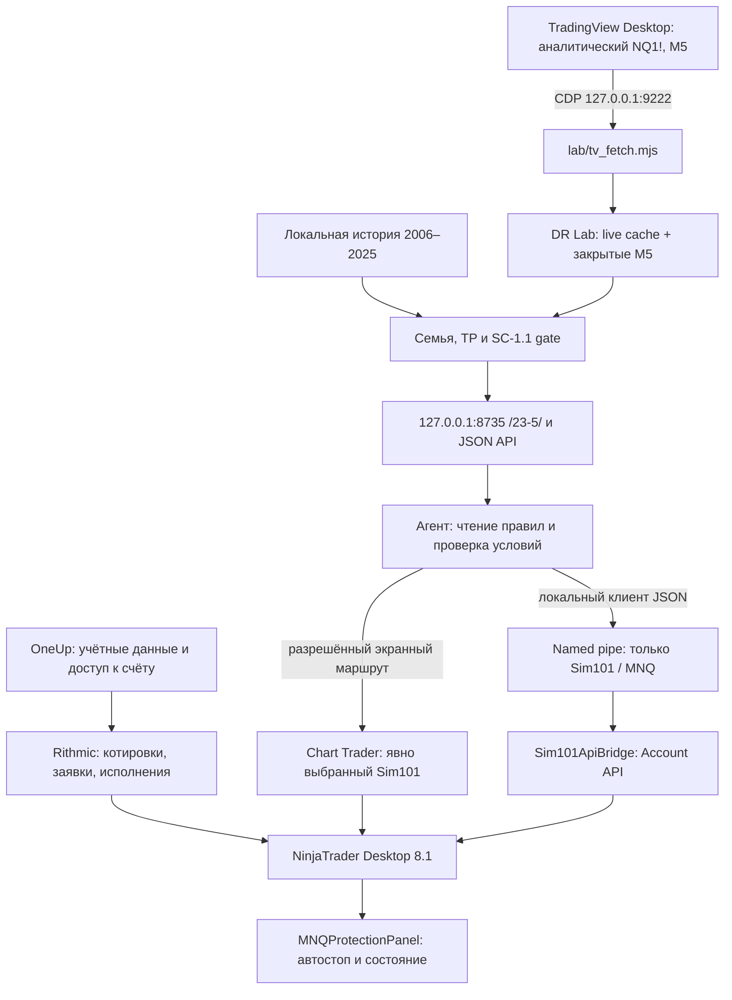

# Спецификация технического стека для агентской торговли через 23.5

Версия 1.0 · 06.11.2026. Архитектура, процедура установки и передача следующему агенту.
Документ описывает существующие технические средства. Он не превращает статистику 23.5 в сигнал,
не разрешает самостоятельную торговлю и не подтверждает соответствие автоматизации правилам проп-фирмы.

## 1. Назначение и точка входа

Стек позволяет читать DR/IDR и time & price на 23.5, проверять выбранный инструмент/счёт,
а при отдельном разрешении оператора исполнять ограниченные симуляционные команды:
через экран NinjaTrader или через локальный API. Действия с капиталом подчиняются действующим
разрешениям человека, правилам инструмента управления и условиям брокера/проп-фирмы.
Если инструмент требует handoff финансового действия человеку, агент его не обходит через другой канал.

Начинать с `AGENTS.md`, [смыслового ядра](../meaning/23-tp-smyslovoe-yadro.md),
[встраивания TP](../docs/DR-LAB-23-5-TP.md), [архитектуры](../docs/ARCHITECTURE.md),
[машинного контракта](../contract/README.md) и [метода](../docs/STRATEGY.md).
Решения оператора важнее пересказа прежнего агента. При неопределённом правиле входа — не придумывать его.

**Граница версий:** эта ветка основана на `main` `5fd95c7` (опубликованное ядро TP‑1.2).
На компьютере при составлении документа работала локальная TP‑1.4: места X — полосы всех вершин
выбранного окна на сетке 0,2 SD, без последних 15 минут. Эти незавершённые изменения экрана
не включены в данный пакет. Для точного повторения локальной картинки нужна отдельно опубликованная
и проверенная версия TP‑1.4. Не объявлять свежий clone воспроизведением этой картинки только потому,
что он открывает `/23-5/`. Перед работой сверить редакцию ядра, health/revisions и запросы страницы.

## 2. Две независимые цепочки данных



Между 23.5 и NinjaTrader **нет автоматического маршрута сигнал → ордер**. Агент сопоставляет данные
и проверяет правила; никакой модуль этого пакета не вычисляет торговые входы из процентов 23.5.
Свечи 23.5 приходят из TradingView, а состояние счёта — через Rithmic/NinjaTrader.
Локальный AddOn — не прямой клиент Rithmic API и не облачный NinjaTrader REST API.

| Компонент | Роль и срок жизни |
|---|---|
| OneUp Evaluation | Программа отбора и конкретный счёт; не равен Sim101 |
| R\|Trader Pro | Первичное подписание рыночных соглашений, диагностика, альтернативно plugin-маршрут |
| NinjaTrader Desktop | Соединение Rithmic, Sim101, Chart Trader, исполнение NinjaScript |
| TradingView Desktop | Источник живых свечей аналитики; отдельная авторизация |
| `tradingview-mcp` | Локальный CLI/CDP-доступ к Desktop; checkout задаётся `TV_MCP_DIR` |
| Python / Node | Сервер, история/контракт / одноразовый сборщик свечей |
| Браузер 23.5 | Визуальная проекция; закрытие вкладки не равно остановке сервера |
| `MNQProtectionPanel` | Индикатор в открытом графике; ордерная защита и две денежные строки |
| `Sim101ApiBridge` | AddOn на время процесса NinjaTrader; принимает только явные запросы |
| `SimApiClient.exe` | Одноразовый CLI-клиент pipe; не запускает стратегию |

## 3. История настройки и нынешний выбор соединения

1. Изначально использовался R\|Trader Pro. Затем установлен NinjaTrader Desktop 8.1, включён
   Multi-provider Mode, добавлен `Rithmic for NinjaTrader Brokerage` под именем `OneUp Trader`.
2. На этапе plugin-маршрута NinjaTrader получал данные через R\|Trader Pro. Остановка R\|Trader Pro
   приводила к жёлтому/неполному соединению; это было свойством выбранного маршрута.
3. Настройка переведена на **прямое подключение**: plugin/use-plugin-data выключен,
   автоподключение сохранено. Для него R\|Trader Pro не обязан оставаться запущенным.
4. Одновременный независимый вход тем же Rithmic User ID в R\|Trader Pro вызывал второй сеанс
   и ошибки входа. Не запускать его «на всякий случай» при прямом соединении NinjaTrader.
5. Создан один сохраняемый workspace `MNQ OneUp Compact` с MNQ, Chart Trader и индикатором.
6. В индикатор последовательно добавлены реальные защитные заявки, Б/У, обработка OCO,
   частичных исполнений, компактный вид, чистый баланс/день, автостоп $300.
7. Добавлен отдельный **Sim101-only** API. Штатный ATI не включался.

Успех прошлой настройки не доказывает нынешнее соединение: нужны обе зелёные составляющие
соединения/котировок, актуальный счёт и свежие данные, а не только имя `OneUp Trader` в меню.

### Прямой маршрут

- Установить официальные NinjaTrader Desktop и R\|Trader Pro. Отдельно авторизоваться в NinjaTrader.
- Через R\|Trader Pro выполнить требуемые рыночные соглашения. Подписание/учётные данные вводит человек
  или разрешённый текущей средой механизм авторизации; этот пакет паролей не содержит.
- В NinjaTrader включить Multi-provider, перезапустить, добавить Rithmic-соединение.
- Для Evaluation обычно используется **Rithmic Paper Trading**: это среда OneUp, а не локальный Sim101.
  Точное имя системы и gateway брать из кабинета/официальной инструкции и доступных вариантов,
  не угадывать по стране агента. Выбрать соответствующие регион/шлюз и данные OneUp.
- Plugin mode выключить; закрыть независимый сеанс R\|Trader Pro; подключить NinjaTrader.
- Проверить появление нужного счёта в Accounts. Новый/сброшенный счёт может иметь другой идентификатор:
  зелёное соединение не гарантирует, что сохранённый workspace выбрал его.

### Альтернатива — plugin mode

Если оператор выбрал совместную работу: в R\|Trader Pro включить Allow Plugins и Market Data,
сначала соединить его, затем NinjaTrader с plugin mode. В этом режиме R\|Trader Pro должен работать.
Не смешивать прямую и plugin-конфигурации. Не менять маршрут при открытой позиции ради диагностики.

## 4. Запуск 23.5 с холодного компьютера

Для точного повторения требуются Windows, лицензированные программы и локальная история.
Репозиторий не содержит рыночной базы, рыночных соглашений, логинов, серверных ключей или DLL вендоров.
Без предоставленной оператором истории можно собрать интерфейс/использовать явно синтетическую проверку,
но нельзя выдать её за рабочую рыночную статистику.

1. Проверить установленные Python с numpy/pandas, Node и git. Прочитать актуальный launcher:
   он выбирает интерпретатор; системный `python` может быть Windows Store alias.
2. Подготовить историю по `docs/ARCHITECTURE.md`/launchers. Она заканчивается **2025‑12‑31**;
   live/2026 не пополняют историческую базу. `lab/.runtime` не публикуется.
3. Подготовить отдельный checkout `tradingview-mcp`, установить его зависимости по его документации,
   задать `TV_MCP_DIR`, если каталог отличается от ожидаемого launcher.
4. Оператор входит в TradingView Desktop. Рабочий launcher запускает/восстанавливает его с CDP `9222`.
   При обычном запуске Desktop порт может отсутствовать; launcher может перезапустить окно.
   Не делать такой restart во время несогласованной работы человека.
5. Запустить `start-dr-lab-23-5.cmd`. Наблюдавшийся отдельный адрес — `http://127.0.0.1:8735/23-5/`.
   Основной launcher использует `8767`; путь `/24/` остаётся отдельным экраном.
   Не запускать оба экземпляра на одном порту и не путать workspaces в `/api/health`.
6. Проверить `/api/health`: `data_kind=MARKET`, integration включён, путь workspace ожидаемый,
   source/data revisions согласованы. Один HTTP 200 не доказывает рабочий live.
7. Проверить дату, инструмент `feed`, `fetched_at`, последнюю закрытую M5 и отсутствие загрузки свечей
   предыдущего символа после смены NQ/ES/YM. Отображение `LIVE` само по себе недостаточно.

Для проверок агента использовать `-HistoryOnly`: он не перезапускает TradingView.
Не подменять рабочего сервера проверочным и не передавать launcher через блокирующий pipe.

## 5. Чтение 23.5 без экрана

Основные read-only маршруты (точные параметры — в `lab/server.py`):

```text
GET /api/health
GET /api/d24/day?instrument=NQ
GET /api/integration/scene?instrument=NQ&session=ODR&at=<закрытый-срез>&view=conf:rpre:tcells&scope=weekday
GET /api/d24/family?instrument=NQ&session=ODR&at=<срез>&view=conf:rpre:held
GET /api/d24/family?instrument=NQ&session=ODR&at=<срез>&view=conf:rpre:held:tw=W1
```

Срез — время закрытой M5 по ET, не текущая незавершённая свеча. Проверить `source=live`, дату,
свежесть и contract envelopes; удержать `context.id`, family/snapshot/revision для воспроизводимости.
Сам запрос `scene` с `tcells` не равен TP-слою: для T/T_W отдельно читать `held`/`tw` и сверять
редакцию TP. `#tp=0` — старый смысл, не автоматически текущая стратегия.

По ядру локальной TP‑1.4: исход DR — вся F; часы отката — T (сессии с удержанным DR);
места R/X — выбранное T_W; «Сейчас» остаётся на F. Не смешивать знаменатели, часы,
R до вершины и последующий новый лой. Фильтр `held` использует известный исторический исход,
а не доказывает, что сегодняшний DR удержится. X-полоса не гарантирует достижение тейка.

Нужен отдельный полный разбор: направление/подтверждение, фактическое окно, уровень/свеча отказа,
инвалидация, размер позиции/издержки, цель по методу, минимальный R:R, новостные/временные ограничения.
Если правила не дают вход/стоп/цель, сообщить это; не добавлять собственное «сопротивление» или
условие входа под видом стратегии 23.5. Фильтр новостей метода не равен правилам OneUp Evaluation.

## 6. NinjaScript-пакет и установка

Исходники и инструменты находятся в [tools/agent_trading](../tools/agent_trading/README.md).
Это рабочий прототип, а не сертифицированная торговая система. Базовая проверенная среда —
NinjaTrader **8.1.8.4**, Windows x64, .NET Framework 4.8; изменения SDK требуют новой проверки.

| Файл | Назначение |
|---|---|
| `src/MNQProtectionPanel.cs` | Индикатор графика, привязка счёта, защита, Б/У, отображение, API snapshot |
| `src/ProtectionMath.cs` | Расчёт риска/целей/комиссий, граница дня, fence отмен исполненного ордера |
| `src/Sim101ApiBridge.cs` | AddOn named-pipe сервера Sim101-only |
| `tools/SimApiClient.cs` | CLI-клиент без экранных кликов |
| `tools/BuildNative.cs` | Полная локальная сборка native Custom.dll с библиотеками установленного NinjaTrader |
| `tools/RiskTests.cs` | Синтетические расчётные/lifecycle проверки, без заявок |
| `tools/probe_api.ps1` | Проверка чтения, отказов и идемпотентности, без допустимого торгового запроса |

Агент сам выполняет команды установки; оператору не передавать терминальные команды вместо готового результата.
Инсталлятор требует полностью закрытый NinjaTrader. Не останавливать его принудительно и не завершать
позиции ради установки: человек сначала сам управляет своей экспозицией, затем закрывает программу.

Пакет собирает полный Custom.dll из локального csproj, подставляя только свои три исходника.
Сохраняются ресурс старой сборки и локальные сторонние исходники; ресурсы/DLL вендоров не публикуются.
Обычный старый `csc.exe` не компилирует все современные исходники NinjaTrader; helper использует
Roslyn, поставляемый с установленным NinjaTrader. Сначала build/test, потом явная установка с backup.
Внешняя успешная сборка сама по себе не доказывает, что терминал загрузил новый модуль.

После установки человек запускает NinjaTrader и входит. На новом графике реального MNQ-контракта:
Chart Trader → **Sim101**, ATM Strategy → **None**, индикатор `MNQ Protection Panel`.
Параметры симуляционной приёмки: RiskBudget `300`, RoundTripCommission `2`,
AutoProtectOnLoad `true`, AutoProfitTarget `false`, AllowLiveOrders `false`.
Последний параметр не мешает Sim101. Не переносить `true` на проп-счёт из чужого шаблона.

Программа должна обнаружить панель/котировки, соединение и Flat. После загрузки с уже открытой
позицией автозапуск ждёт Flat; это не универсальное восстановление управления прежними ордерами.

## 7. Что делает защита $300

Бюджет относится к **оставшейся открытой позиции**, не к убытку всего дня/счёта или всей серии
с уже закрытыми частями. Для q MNQ, point value $2, комиссия вход+выход $2/контракт:

`дистанция = (300 − 2q) / (2q)` пунктов с округлением к допустимому тику без увеличения риска.
Для 1/2/4 контрактов: 149 / 74 / 36,5 пунктов. Это плановый риск, а не гарантия фактического убытка:
между исполнением входа и подтверждением стопа есть задержка, возможны гэпы/проскальзывание/отказ.

- Создаётся реальный StopMarket, не только нарисованная линия. Проверить native статус Accepted/Working.
- После добавления/частичного выхода пересчитывается оставшееся количество и цена. Уже более близкий
  стоп не отодвигается; после сокращения позиции риск может стать меньше $300.
- Количество изменяемого ордера = остаток позиции + уже исполненная часть этого ордера.
- Б/У по среднему входу оставшегося объёма учитывает расчётную комиссию; запрос при pending изменении
  ждёт Ready. После изменения среднего входа старый ценовой Б/У не обязательно означает ноль всей сделки.
- Новому submit — новый OCO ID. Native OCO для Rithmic локальный; работающий терминал нужен для
  сопровождения/связи раздельных заявок. Не называть это серверной офлайн-гарантией.
- Сначала подтверждение исполнения, затем cleanup. Не отменять уже исполненный стоп, не дублировать
  native OCO отмену. Этот race раньше вызывал предупреждение Rithmic «Order is complete».
- Cancel/reject останавливает текущую автоматизацию с сообщением; после Flat автостарт снова может
  вооружиться для нового входа. Ручной OFF — явное управление человеком, не скрытая авария.
- Автотейк в данном профиле выключен. Ручной тейк и Б/У поддерживаются, но наборы нескольких
  сторонних стопов/тейков не имеют полной сертификации распределения остатка; не считать их проверенными.

Баланс в панели: для наблюдавшегося OneUp Evaluation `CashValue − комиссии текущей сессии`;
чистый день — `GrossRealizedProfitLoss − те же комиссии`, без плавающего PnL. Повторы исполнений
отсекаются по execution/order/instrument. Комиссия фактически исполненного входа учитывается сразу;
будущий выход в денежном балансе заранее не списывается. Калькулятор стопа резервирует round-trip.

**Разные часы:** оператор выбрал для панели 17:00 America/New_York с DST. Официальный торговый день
OneUp в найденных правилах начинается в 17:00 **CT**, то есть обычно 18:00 NY.
Это не одна граница. Дневной PnL/settlement провайдера и переход 17:00–18:00 NY отдельно полностью
не проверялись; не выдавать пользовательскую строку за официальную выписку фирмы на этом переходе.
Для другого тарифа/финансируемого счёта не переносить Evaluation $2 без проверки.

## 8. Экранный маршрут

Текущий инструмент выбирается из доступных средой. В наблюдавшейся сессии использовался
`computer-use` / `@oai/sky` через node runtime; позднее — `mcp__cua_repl`, native App и browser Tab.
Наличие конкретного namespace/метода не обещано другому агенту: прочитать текущий SKILL/API,
получить инвентарь и реальные handles. Вызовы ниже — формы CUA, не универсальные shell-команды.

1. `cua.getState()` → выбрать **точный** Chart / Control Center, `cua.getApp({windowId: ...})`.
   Browser 23.5 — через браузерный коннектор, не native кликами при доступном DOM.
2. Наблюдение `getAXStateAndScreenshot()`. Проверить счёт и в Chart Trader, и в панели, контракт,
   quantity, Flat/позицию, ATM, автостоп, текущие заявки. Не брать номер счёта из старого чата.
3. Fresh snapshot → **одно действие** → наблюдение и native журнал/состояние исполнения.
   При нескольких screenshot regions передавать id нужного региона. После действия id/индексы устаревают.
4. Если координаты/фокус расходятся, окно перекрыто/свёрнуто или неизвестен результат — остановить
   ввод, обновить состояние. Не повторять торговый клик вслепую. При неустранимой ошибке попросить
   человека развернуть нужное окно/передать управление. Не обходить блокировку инструментом другого типа.
5. Для специально разрешённого Sim-теста выбрать Sim101. Дополнительная страховка — Global Simulation
   Mode: штатно ограничивает интерфейсы симуляционными счетами. Он не заменяет проверку селектора.
   Успешный прошлый клик/галочка не доказывает нынешний режим; проверить состояние после каждого перехода.
6. Только после отдельного разрешения теста — одна заявка, проверить Filled, затем автостоп
   с правильным количеством/ценой и Accepted/Working. Не добавлять контракты для теста без разрешённого объёма.
7. Завершить тест по согласованному плану; проверить Flat и отсутствие сиротских заявок.
   Не переключать на OneUp и не выключать симуляционный режим молча, пока тест не завершён.

**Наблюдавшаяся ошибка:** в двухмониторной среде автоматизация неверно направляла клики,
появлялись непреднамеренные заявки. Экранный путь не признан надёжным торговым API.
Нельзя обещать безопасное исполнение только на основании AX-имени кнопки.
Нужна блокировка Sim/подтверждённый счёт и прекращение ввода при первом несоответствии.
Никаких бесконечных циклов «нажать ещё раз». Встроенный API предпочтительнее для разрешённого Sim-теста.

## 9. Локальный API без мыши

Транспорт — `\\.\pipe\MNQ-Sim101-Api-v1`, JSON по строкам, один запрос на соединение.
Это Windows named pipe, не URL. ACL — текущий Windows SID; Network SID явно запрещён.
HTTP/TCP-порт не открыт; ATI остаётся выключенным. Session ID — защита от старых запросов,
не пароль и не защита от другого процесса того же пользователя Windows.

Read-only `status` возвращает Sim101/MNQ, процессную session, позицию, активные заявки,
готовность панели и bid/ask/last. `quoteAgeMs` — возраст **локального callback**, не биржевой timestamp
и не доказательство real-time entitlement. История M5 читается из 23.5, не из этого endpoint.

| op | Контракт |
|---|---|
| `status` | Чтение Sim101; чужой account/symbol отклоняется до поиска счёта |
| `arm` | Запрос включения защиты только найденной панели Sim101, только при Flat; селектор не меняет |
| `preview_entry` | Все проверки входа, без отправки ордера |
| `place_entry` | Market BUY или SELL, ровно 1 MNQ; явный `confirm=SIM101_ONLY` |
| `close_test` | Закрывает только собственный API-вход в текущем процессе, без посторонних исполнений |

Для preview/write: прочитать нынешнюю session, передать уникальный requestId (8–80 символов).
Тот же id+тот же запрос возвращает прежний ответ; другой запрос с этим id отклоняется.
После restart новая session, старые команды не исполняются. Кэш до 512 запросов, без вытеснения/повторного исполнения.

```json
{"op":"preview_entry","account":"Sim101","instrument":"MNQ DEC26","session":"CURRENT_SESSION","requestId":"unique-preview-001","side":"BUY","quantity":1}
```

Границы первой версии: **строго Sim101, MNQ DEC26, 1 контракт**. Для входа нужны Flat,
отсутствие активных MNQ-заявок, armed/connected панель Sim101 с $300/$2 и положительные свежие quotes
(локальный возраст ≤10 секунд). Нет операций произвольного `change`, `cancel`, `flatten_all` или OneUp.
При rollover это имя перестанет быть текущим контрактом: требуется явное изменение константы/проверок и новая сборка.
Не заменять его на NQ1!, не выбирать новый контракт автоматически по строковому сходству.

`close_test` не закрывает старые/ручные позиции и теряет владение входом после restart.
Поэтому закрывать всё на других счетах не нужно: пустым должен быть только Sim101/MNQ для нового теста.
Существующая позиция — блокировка нового входа, а не основание для принудительного flatten.

API пока опирается на работающий индикатор Compact для автостопа. **Атомарной операции
«исполнение входа вместе с гарантированным стопом» нет**. Нельзя переключать/удалять/выключать
панель между проверкой и исполнением и утверждать, что защита всё равно гарантирована.
Без запущенного NinjaTrader pipe не работает; запросы не ставятся в очередь на будущий запуск.

## 10. Compact, сохранение и восстановление

Стандартные пути вычислять относительно реального Documents текущего пользователя (возможен OneDrive):
`NinjaTrader 8/workspaces/MNQ OneUp Compact.xml`, `_Workspaces.xml`, `bin/Custom`, `log`, `trace`, `db`.
Не прошивать чей-либо профиль Windows, ID/пароль счёта или прежний HWND.

- Создать/сохранить workspace, пока график открыт. `Workspaces → Compact → save`.
- `ReopenWorkspaces=true`, активный/open workspace — Compact; окно находится на подключённом экране.
- У XML декларация **`encoding="utf-8"`**, не `utf8`: последнее реально отвергалось .NET.
  Проверять `XmlDocument.Load(path)`, не только Python XML parser/`[xml]` от уже прочитанной строки.
- При закрытии NinjaTrader сохранять нужный вид с открытым графиком. Если график уже закрыт и
  остался пустой workspace — не перезаписывать им рабочий шаблон.
- Зелёный workspace означает «уже активен», не команду восстановить закрытый chart.
  Восстановление: `Workspaces → Compact → close → No → открыть Compact заново`.
- Если окно за пределами дисплея: сначала восстановить/переместить штатными средствами; при закрытом
  NT и сохранённой копии исправить Location/Size. Отрицательная X может быть корректна для левого монитора,
  но не переносится как универсальная конфигурация на другой компьютер.
- Проверять, что XML содержит Chart и индикатор, нужный аккаунт, budget/auto свойства; размер файла
  сам по себе не доказательство. Новый счёт после reset требует новой привязки, не угадывания.

Ранее установлен локальный startup-guard: раз в 500 ms восстанавливает файл из known-good копии,
если XML стал валидным, но без Chart. Он не создаёт окно в работающем пустом workspace,
не проверяет живой счёт и не исправляет сериализацию/плохую резервную копию.
Это временная локальная защита, не обязательная часть чистой установки. Её исходный путь и настройка
не переносятся в public-пакет; при необходимости реализовать только файловый restore с backup,
без торговли/GUI/autologin. Не считать наличие guard доказательством холодного запуска.

## 11. Политика OneUp и границы исполнения

По проверке официальных страниц 06.11.2026: NinjaTrader/Rithmic поддерживаются, но явного актуального
разрешения именно на AI/API-исполнение не найдено. Официальный блог 17.03.2021 говорит о запрете algo;
он старый и не доказывает сам по себе нынешнюю политику Evaluation/партнёра. Нужен письменный ответ
о ручном подтверждении API-команд, автономных AI-входах/выходах и custom SL/TP/BE отдельно,
для Evaluation и фактического funding partner. Отправка через экран не меняет природу автоматизации
и не является способом обойти запрет. Документ/пароль/технический доступ не создаёт такого разрешения.

Sim101 — локальная симуляция NinjaTrader, не Evaluation и не funded; её сделки не учитываются в отборе.
Публичный пакет не имеет API-пути отправки на OneUp. Не расширять эту границу лишь потому, что
в Accounts виден ещё один счёт. Разрешение на разработку/публикацию данного пакета дано оператором
в чате 06.11.2026; это не постоянное разрешение следующему агенту торговать или менять границы.

## 12. Матрица фактической проверки

| Проверка | Результат на момент документа |
|---|---|
| 23.5 health/day/scene JSON без GUI | Успешно; источник live при свежих fetch/revisions |
| Прямое NinjaTrader ↔ Rithmic без R\|Trader Pro | Работало; повторный независимый вход вызывал конфликт |
| Native сборка/загрузка Custom | Успешно; ресурс/экспортируемые типы сравнивались при автостопе |
| Создание автостопа $300 после 1 MNQ на Sim101 | Наблюдались Filled входа и Accepted защитного StopMarket; 149 пунктов + расчётная комиссия |
| Завершение того Sim-теста | Наблюдались Cancelled стопа, Filled закрытия, Flat; это не тест исполнения стопа |
| Пересчёт $300 при adds/partial fills, Б/У | Формулы/часть lifecycle проверены offline; полной новой native сертификации нет |
| Возврат после отключения ноутбука | Sim-позиция и стоп сохранялись; панель не подхватывала управление до Flat |
| API transport/status/quotes | Успешно из CLI, без экрана |
| API account/symbol/session/quantity/ownership/idempotency guards | Отказы проверены на работающем сервере; позиция/ордер не менялись |
| Допустимый API entry → auto-stop → close | Не исполнялся; не объявлять end-to-end проверенным |
| Последний cold restart после исправления XML | Не повторён; повторное открытие Compact и XML native parsing проверены |
| Полное совпадение TP‑1.4 fresh clone | Не обеспечено этой веткой: см. границу версий §1 |

Никакие результаты на симуляторе не являются проверкой API на OneUp или подтверждением торгового преимущества.
В SQLite встречались ошибки записи и повторные исполнения. Сохранять копию и дедуплицировать по
executionId+orderId+instrument; отсутствие строки в одном журнале не доказывает отсутствие исполнения.
Чтение базы — не real-time command acknowledgement. Текущую позицию сверять с native/API состоянием.

## 13. Приёмка следующего развёртывания и отказ

1. Зафиксированы версия repo/ядра, SDK, dependency paths и нужный контракт; нет паролей в git.
2. Health/revisions/fresh M5/дата/символ/contract подтверждены. Вся история до 2025, runtime локальный.
3. Подключение и аккаунт проверены независимо от сохранённого имени workspace.
4. Пакет проходит build и offline math tests; предыдущие DLL/source/csproj сохранены; NT закрыт при install.
5. После входа API status видит реальный нынешний процесс/session; код не инициирует стартовую сделку.
6. Прочитаны реальные positions/orders; восстановленная позиция не закрывается и не «присваивается» агентом.
7. Read-only/rejected-command probe не изменил состояние. Это достаточная проверка связи, не исполнения.
8. Для отдельного разрешённого Sim-теста заранее назвать количество/сторону/цель проверки/cleanup;
   подтвердить Sim101 и защиту, наблюдать native статусы, после — Flat/no orphan. Не повторять заявки
   при timeout: сначала status/orderId/requestId. Не проводить тест, если человек остановил его.
9. Холодный запуск workspace проверять только когда допустим restart; отличать «файл настроен» от наблюдавшегося startup.
10. При неизвестном состоянии, stale feed, конфликте счёта/инструмента, нарушении контракта, отказе защиты,
    потере GUI-фокуса, permission rejection или расхождении API/журналов остановить зависимое действие
    и сообщить человеку конкретную причину. Не отключать защитные заявки автоматически ради ремонта.

При передаче указать сделанное, наблюдавшееся, непроверенное, текущие positions/orders, версии и разрешённый
объём следующего шага. Журналы/квитанции с реальными ценами, сделками и счетами хранить локально вне git.

## 14. Первичные внешние источники

- [OneUp: список платформ](https://help.oneuptrader.com/article/380-supported-platforms)
- [OneUp: NinjaTrader 8.1 и отличие Sim101](https://help.oneuptrader.com/article/491-ninjatrader-desktop-version-v-8-1-connection-guide)
- [OneUp: direct/plugin инструкция](https://help.oneuptrader.com/article/511-steps-to-set-up-a-rithmic-based-connection-with-ninja-trader)
- [OneUp: Evaluation rules, включая CT](https://help.oneuptrader.com/article/387-what-are-the-rules-of-the-evaluation)
- [OneUp: Evaluation комиссии](https://help.oneuptrader.com/article/354-are-commissions-factored-into-my-evaluation)
- [OneUp: funded rules](https://help.oneuptrader.com/article/372-funded-trader-rules)
- [OneUp: датированная статья об algo](https://blog.oneuptrader.com/funded-trading/what-is-an-algorithmic-trading-system/)
- [NinjaTrader: расположение ордеров и локальный Rithmic OCO](https://static.ninjatrader.com/support/helpGuides/nt8/where_do_your_orders_reside_.htm)
- [NinjaTrader: Global Simulation Mode](https://static.ninjatrader.com/support/helpGuides/nt8/global_simulation_mode.htm)
- [NinjaTrader: Account CreateOrder](https://docs.ninjatrader.com/ninjascript/createorder)
- [NinjaTrader: Account Change](https://docs.ninjatrader.com/ninjascript/change)
- [NinjaTrader: ATI DLL functions (не используемый нашим pipe канал)](https://static.ninjatrader.com/support/helpGuides/nt8/functions.htm)

Правила и интерфейсы могут измениться; следующий агент проверяет источники заново перед внешним действием.
