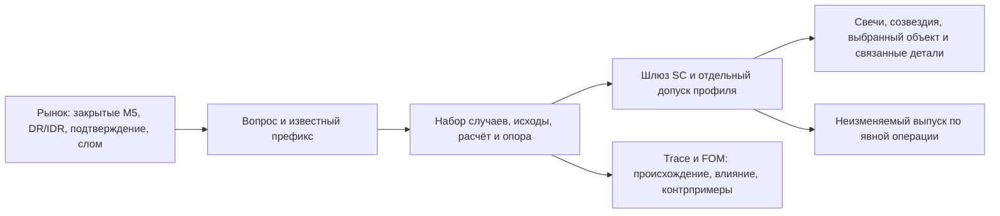

# DR Lab · конструкция целостного интерфейса и инженерная спецификация 1.0

**14.10.2026 · авторское архитектурное решение Codex, подготовленное по поручению оператора.**
Статус: проект реализации с закрытым ядром и явно ограниченными кандидатными расширениями.
Это не новая редакция SC-1.1, не принятие кандидатных профилей или внешнего вида и не разрешение слияния.
Исходная рабочая линия: `main@2672841da928f7379e5d7bc27eef8ff3e0fa5738`.
Документ и стенд подготовлены в `codex/integration-architecture-spec`; рабочий `main` не изменён.

**Решение.** Собирать систему вокруг принятого рыночного экрана 24: свечи, DR/IDR, совместные R/X,
созвездия, общий час, необязательная сводка и существующие связанные детали. Под ним согласовать
контекст рынка, отдельные исторические вопросы и свидетельства их ответов. Не превращать фасеты в разделы экрана,
Q1 — в организатор всей композиции, а экспериментальную BASE_D — в основной ответ.

Такой вариант сохраняет больше проверенного смысла и защищённых зрительных отношений, чем перенос целых веток
или предложенная Deep Research постоянная правая колонка. Его преимущество обосновано сохранением инвариантов и
устранением найденных противоречий; превосходство нового человеческого прочтения ещё не установлено.

Навигация:

- [Сквозная онтологическая реконструкция и общие основания](../meaning/lens/2026-10-14-integration/01-ontology-reconstruction.md).
- [Происхождение и точные единицы интеграции](../meaning/lens/2026-10-14-integration/02-integration-map.md).
- [Сопоставимые реальные сцены A/B](../meaning/lens/2026-10-14-integration/comparison/README.md).
- [Проверки, продуктовые развилки и передача инженеру](../meaning/lens/2026-10-14-integration/03-engineering-and-decisions.md).
- [Зафиксированные SHA и файлы](../meaning/lens/2026-10-14-integration/sources.json),
  [извлечённые результаты исследования](../meaning/lens/2026-10-14-integration/research-evidence.json),
  [собственная проверка противоречий](../meaning/lens/2026-10-14-integration/reconstruction-checks.json).
- [Неизменённый вход Deep Research](../meaning/lens/2026-10-14-integration/input-deep-research.md).

## 1. Для какой работы строится система

Из `meaning/17-rabota-treidera.md` следует более широкий вопрос, чем Q1: **где ждать откат,
что уже произошло и какие продолжения наблюдались в истории**. Оператор сверяет DR Lab с TradingView;
само решение о входе, стопе и отказе у уровня остаётся его работой. Важны как минимум четыре состояния:
до подтверждения, сразу после него, во время отката, у исторически значимых мест.

На одном экране должны быть различимы:

1. сегодняшний известный рынок на закрытии M5;
2. окончательные исторические R/X фиксированной семьи;
3. исторический остаток после общего среза у отдельно названного сопоставимого набора;
4. состоявшееся сегодня событие, которое уже не является вопросом о будущем остатке;
5. неизвестность, отсутствие периода, отсутствие опоры и отказ публикации.

Q1 «отсюда до места» полезен в пункте 3. Он не заменяет пункты 1–2 и не отвечает сам по себе на
время окончательного отката, длительность стояния цены или последовательность всех движений.
Полезность «Пути семьи» для чтения длительности не доказывает, что частоты закрытий M5 измеряют
непрерывное пребывание в области. Для отдельного числа длительности нужны отдельные событие и разрешение наблюдения.

## 2. Что сохранять, менять и исключить

| Решение исполнителя | Основание | Граница |
|---|---|---|
| Сохранить BASE-24 и NOW-1.0 с их принятыми определениями и вычислениями | Это действующий предметный контракт; новое исследование не опровергло их вопросы | Совпадение чисел не доказывает принятие кандидатного оформления |
| Сохранить основной пространственный строй экрана 24 | Большие свечи, совместные R/X, янтарный R / голубой X, детали по выбору служат чтению рынка | Изменение этих отношений требует отдельного решения оператора |
| Разделить фиксированную семью, пригодные случаи вопроса и совпавшие аналоги | Они отвечают на разные вопросы и имеют разные знаменатели | Не менять незаметно смысл слова «семья» и исходный `N` |
| Согласовать единственный контекст и привязку ответа к выбранному объекту | Ветки уже имеют `cur`, `snapOf`, пакеты, паспорта и связи; повторное вычисление этих сущностей не нужно | Тонкая проекция существующих объектов, не новая параллельная онтология |
| Сохранить Q1 engine/store как изолированную реализацию кандидата | Есть версионированный расчёт, эталон и неизменяемые выпуски | Это не допуск ARRIVE в принятую линию и не признание выбранного метода лучшим |
| Сохранить Semantic Trace и FOM вне горячего расчёта | Trace проверяет цепь утверждения; FOM добавляет основания, зависимость смысла, вопросы и контрпримеры | Ни один граф не доказывает полноту незаявленных зависимостей или понимание человеком |
| Использовать точные множества случаев из PR #9 как источник связанной детализации | Можно проверить, те ли случаи подсвечены, о которых говорит ответ | Новые карточки, переключатели, многопутевой вид и маркеры пока кандидаты |
| Исключить дублированный перенос #11 и повторное применение #13 поверх #9 | Одинаковая голова #2/#11; #9 уже включает `a2d076a` | Идеи не теряются; один источник на уникальную дельту |
| Исключить автоматический переход на BASE_D и универсальное подавление при `n<20` | Таких выводов исследование и действующие профили не дают | Метод и поддержка — отдельные решения по конкретному вопросу |
| Исключить сокращение FOM «потому что ближайший UI не использует узел» | Отсутствие прямого UI-потребителя не означает отсутствия проверки влияния | Сокращение возможно только после показанного избыточного механизма и проверки сохранности |
| Исключить постоянную новую колонку Today / Historical Answer / Status из текущего задания | Нет парного свидетельства лучшего чтения; затронуты принятые ограничения | Остаётся проверяемой дизайнерской гипотезой, не указанием инженеру |

## 3. Что установлено о сопоставимости Q1

Источник: `q1-sopostavimost@2a36608`, протокол и `checks.py`, а не только пересказ Deep Research.
В протоколе BASE_D прямо названа **измерительной опорой, не кандидатом в продукт**.
Автор отчёта не запускал рабочую ленту и UI; его результаты тестов веток не являются независимой сквозной проверкой.
В этой работе исходные агрегаты прочитаны и сопоставлены с кодом; полный подсчёт исследования заново не запускался.

| Парная проверка на собственной общей области | Brier метода | Brier BASE_D | Разность метода минус BASE_D | После уравнивания опоры |
|---|---:|---:|---|---|
| NODEPOS_WD, P1, 66 461 строк | 0,216088 | 0,213020 | +0,003068; интервал [0,001021; 0,005012] | −0,000868; интервал пересекает ноль |
| NODEPOS_ALL, P2, 200 487 строк | 0,179406 | 0,181658 | −0,002252; интервал [−0,003093; −0,001423] | −0,001139; [−0,002040; −0,000310] |
| GEO, P3, 208 358 строк | 0,177250 | 0,180586 | −0,003336; [−0,003741; −0,002943] | +0,000388; интервал пересекает ноль |

Это разные парные области. Нельзя ранжировать методы по абсолютным Brier между строками таблицы.
В собственной области P2 преимущество NODEPOS_ALL сохраняется после контроля размера опоры и по эпохам.
Поэтому упрощение до BASE_D нельзя обосновать превосходством качества. У GEO значительная часть выигрыша
связана с опорой. CLOCK хуже BASE_D на своей парной области; это не доказательство ненужности любой геометрии.

Границы: NQ/ES/YM, ODR/RDR; цели с исходной weekday-семьёй не меньше 40; целый DR, полный префикс,
ещё не достигнутое место, специальные срезы с шагом 15 минут. Оценка качества исключает UNKNOWN исход цели.
Статистика множества строк учитывает повторные срезы; блочные сравнения нужны именно из-за зависимости наблюдений.
Рабочий экран обновляется на каждой закрытой M5. Перенос результата на все остатки M5, малые исходные семьи,
другие блоки и полную рабочую популяцию не доказан.
Положительный контроль обнаружения дополнительной информации прошёл не полностью; отрицательный результат
не устанавливает ненужность ширины, глубины префикса или иных признаков вообще. Near-target geometry и совместное
использование дополнительных признаков требуют отдельных проверок, а не незаметной подстройки текущего matcher.

Важное уточнение: изученный POINT и runtime POINT оба считают `yes/(yes+no)` среди известных.
Ошибка не в их равенстве. Интервал неизвестности `[yes/n_match, (yes+unknown)/n_match]` — другая величина,
со всем `n_match` в знаменателе; Brier известной точки не проверяет этот интервал и его прочтение.

**Техническое решение:** сохранить методы и их версии в диагностике, существующий D1 — только как воспроизводимый
кандидат; выбор продуктового оценивателя оставить открытым. Конкретный протокол следующей проверки дан в передаче,
без открытия 2026. Разделение семьи и набора для вопроса принять как устройство программы; выбор этого набора
для видимого ответа нельзя выдать за уже принятое изменение смысла.

## 4. Найденные противоречия и обязательное обращение с ними

### 4.1. Уровень «после среза»: два различных горизонта

В принятом `contract/build/registry.json`, `EST:B-LEVEL-REST.q6_time_ru` написано:
после `max(t, собственная активация)` до конца блока. Но `OUT:REACH-REST-1` задаёт начало
`COMMON_CUT_EXCLUSIVE`, а `lab/contract.py::verify_passports` и страница используют общий `(t,H]`.

Это не эквивалентные формулы. На реальной семье NQ/RDR, 17.12.2025, срез 10:40,
есть случай с собственной активацией 10:45, для которого на одном уровне результат общего горизонта YES,
а горизонта после собственной активации NO. Свидетель сохранён только в локальном runtime;
[воспроизводящая проверка](../meaning/lens/2026-10-14-integration/tools/audit.py) не публикует рыночную базу.

**Решение:** не «исправлять» расчёт молча и не называть оба вопроса одним. При интеграции сохранять
действующие результаты BASE и зафиксировать конфликт определения. Сверить с владельцем смысла:
подтвердить принятый общий горизонт и исправить противоречивую строку либо ввести отдельную версию вопроса
после собственной активации. До этого не использовать спорный вопрос как незаметный заменитель Q1
и не заявлять семантическую закрытость этой строки. Блокируется её смысловая миграция, а не весь BASE/NOW.

### 4.2. Углубление R для короткого направления

`CF:N-NEW-R.title_mark` говорит «ниже сегодняшнего дна» независимо от направления.
При short более глубокий R расположен физически выше. При `p=e+d·w·u`, `d=−1`,
уменьшение направленного `u_R` увеличивает цену. Число и зарегистрированная строка могут пройти проверку
совпадения и всё равно образовать ложное человеческое отношение.

**Решение:** вынести отдельную исправляемую дельту полярности слов/геометрии с зеркальной парой long/short.
Использовать направленное «углублялся» или физически корректное выше/ниже; окончательная новая фраза — предмет
просмотра оператора. PR #13 содержит подходящее `title_rail` с `px_above/px_below`, но это не принимает
остальную сводку и не исправляет все оставшиеся употребления `title_mark` автоматически. Числа не менять.

### 4.3. Момент события и момент знания

Q1 `Table.target_state().time` — закрытие M5, на котором распознано RESOLVED.
Сводка #13 вычитает пять минут и подписывает начало свечи. Оба времени могут быть полезны, но это разные поля.
Для вывода требуется `bar_open`, `bar_close`, `available_at=bar_close` и тип `M5_INTERVAL`;
по OHLC нельзя обещать точный момент внутри свечи. Время первого прихода не равно времени окончательного R/X.

### 4.4. Принятое определение не равно принятому виду

`ACTIVE` в реестре, исполнение C1, совпадение с зарегистрированной строкой, публикация PR и человеческое принятие
независимы. В кандидатных ветках под названием SC-1.1 лежит текст с другим SHA, чем принятый 07.10.
Аддитивность и успешная сборка не заменяют решения о редакции. Унаследованное принятие формы также не принимает
каждую новую метку, добавленную исполнителем в #13. Не сливать эти признаки в один enum `accepted/candidate/perceptually_unverified`.

### 4.5. Связанная история должна совпадать с ответом

Закрытия путей не показывают касание тенью. В PR #9 полезны диапазоны M5 для случаев вопроса и точные id его набора.
Но сплошная линия через пропуск, подсветка всей семьи вместо matched или перенормировка семейного столбца на
`n_match` образуют иной рассказ. Данные будущего исторического случая допустимы как исход, не как критерий его отбора.
NOW «насколько углублялся» и «когда впервые углубился» имеют разные исходы/опоры; их нельзя рисовать совместной
прямоугольной областью, будто это одна совместная вероятность.

### 4.6. Что добавила сквозная реконструкция

В KADR-1.1 §2 формула `o_u=e−o` называет направленное смещение нормированной координатой, хотя определение u
требует деления на w. Движок хранит v и w раздельно; исправляется изложение, не математический engine.
Q1 `target_state` сначала возвращает BLOCK_OVER на H, даже если цель ранее была RESOLVED. Это допустимый
статус прекращения нового расчёта, но недостаточный носитель факта цели: факт и применимость вопроса нужны отдельно.
BASE snapshot id связывает R/X/order/outcome и source revision, но не все промежуточные close. Контролируемая
подмена такого close при прежней source revision сохраняет id и возвращает старую NOW series из кеша.
Это свидетель недостающей гранулярности ревизии пути, не утверждение о случившейся порче live-базы.

Реконструкция также проверила общие отношения: final R≤L и reach(L) эквивалентны для полного одинакового горизонта,
но могут иметь разную известность при пропуске; одинаковые R/X не определяют условное сходство на cut;
одинаковые маргиналы не определяют совместный путь. Поэтому повторно использовать следует исторические случаи и
проверенные проекции, сохраняя их связь, а не собирать новый ответ из уже агрегированной картинки.

## 5. Устройство реализации

Три слоя разделены обязанностями, согласованы идентификаторами:



### 5.1. Владельцы данных

| Объект | Единственный существующий источник | Что делает интеграция |
|---|---|---|
| Закрытый рынок и состояние | `scene24.day_view`, `cur/session`, определение M5 | Берёт последнюю закрытую M5; live price только рисуется |
| Семья и её рамка | `scene24.family`, `FamilySnapshot`, `snapOf` | Сохраняет состав, `N`, собственные горизонты и версии |
| Исторические числа и допускаемые слова | `contract.finalize/attach_*`, bundles, паспорта, `lbl` | Не пересчитывает доли в панели/новом UI |
| NOW | `now24`, `nowOf`, пакет своего среза | Сохраняет замороженный matcher/gates и общий час |
| Кандидат ARRIVE | `q1.engine`, `arrive24`, `attach_arrive` | Не подменяет алгоритм новым сходством или BASE_D |
| Выпуски и исходы | `q1.store`, issue/outcome revision | Не сохраняет выпуск от каждого render/hover |
| Допуск и происхождение | существующий `ProfileStanding`/`EditionStanding` в Trace с человеческими источниками | Проецирует независимые оси, не создаёт полномочий |
| Фасеты/смысловое влияние | FOM над SC/Trace | Остаётся инженерным запросом вне рыночного экрана |

### 5.2. Единый контекст, не единый оцениватель

Реализовать одну чистую функцию проекции над существующими объектами, условное имя `projectScene(ctx, standing)`.
Разместить рядом с `cur/snapOf` и переиспользовать в панели, инспекторе и связанных деталях.
Это внутреннее представление, не новое хранилище и не обязательная смена API.

Минимальные поля проекции:

```text
market = instrument, date, block, observation_cut, live_or_replay
frame  = confirmation_or_break, direction, origin, IDR_width, activation
family = case_set_spec_id, family_id, snapshot_id, scope, N, original_snapshot_id
intent = selected_kind, target_or_region, pin_state
answer = estimand_id, estimator_id/version, bundle_id, input/registry/data revisions,
         cut, horizon_start_rule, horizon_end, support_ids/counts, value, reason
standing = semantic_definition, implementation, product_decision, human_acceptance,
           evidence_source, edition_compatibility
target_fact = observed_event, witness_interval, time_known, observation_revision
query_applicability = current_control_status, actual_answer_cut, reason
```

Это ссылки и значения существующих записей, а не новая идентичность взамен них. Для BASE ссылка на снимок
не меняется от нового среза. Для условного ответа ключ кеша/запроса включает **весь** контекст:
инструмент, дату, блок, рамку, scope, семейный snapshot, cut, вопрос/цель, matcher/model,
версию входов и реестра. Ответ с другим ключом не показывается как текущий.
Потребитель OHLC/close-пути дополнительно проверяет соответствующую ревизию/дайджест пути; один id свёртки R/X
не удостоверяет более подробный вход. Вычислять такой witness при загрузке/сборке источника, не на каждом hover.
Общий контекст допускает разные фактические cut ответов (например frozen NOW); они не переписываются market cut.

Идентичности различаются:

- смена физической цели меняет Q1TargetIdentity; смена знания создаёт новый ответ/issue;
- смена оценивателя меняет Estimate/model/issue, но сама по себе не обязана менять estimand;
- смена определения события, горизонта или популяции величины требует новой смысловой версии;
- новый срез не пересоздаёт фиксированную семью; переключение scope создаёт другую явную семью;
- закреплённый интерес к месту сохраняется при новом M5, если место ещё определено; старое значение ответа
  не закрепляется под видом нового. Неизменяемый сохранённый выпуск живёт отдельно от этого интереса.

### 5.3. Три множества и знаменатель

`F` — фиксированная родительская семья с одним `N`. `E_q(t)` — случаи, пригодные для конкретного вопроса на общем
срезе. `M_q(t)` — выбранные matcher случаи среди пригодных. Не переименовывать `M` в семью и не записывать его в `F`.
В Q1 возможен иной исходный исторический universe, чем BASE, но его продуктовый выбор ещё открыт.

Для каждого видимого числа обязателен пакет: событие/отношение, cohort и source ids, знаменатель,
рамка/цель, горизонт, срез знания, yes/no/unknown/no_period, версия расчёта, форма утверждения и причина допуска.
Эти подробности живут в паспорте/инспекторе; не добавлять служебные названия на основной график.
Нет пакета или он устарел — нет процента и связанного с ним графического обещания.

### 5.4. Допуск

Чистый фильтр допуска работает после корректного вычисления и до показа. Для рабочей сборки allowlist —
принятые BASE-24/NOW-1.0 и принятая редакция. PRE/ARRIVE и новый вид идут только в отдельном локальном
сравнительном режиме; сам факт их наличия в реестре ничего не включает. Диагностика не требует новых
кнопок/плашек в повседневном экране. Отказ допуска не стирает наблюдаемые свечи и факты рынка.

Вычислить, показать и сохранить — три самостоятельные операции. Не делать запись Q1 side effect рендера,
не выводить сохранённый выпуск как пересчитанный текущий ответ, не менять его после наступившего исхода.
Правка исхода создаёт revision/supersedes с причиной; старая запись остаётся проверяемой.

## 6. Переходы состояния и поведение

| Событие | Историческое состояние | Представление / сброс |
|---|---|---|
| Коробка не сформирована / подтверждения нет | Семьи подтверждения ещё нет | Свечи и известная коробка; не рисовать вымышленную семью. PRE — только отдельно допущенный кандидат |
| Закрытие подтверждающей M5 | Один раз зафиксировать confirmation snapshot, сторону и окно | Показать обе R/X истории. Не назначать новую фазу внимания от самой активации |
| Новое закрытие M5 | BASE `F/N/snapshot` те же; пересчитать сегодняшний префикс и разрешённые в этом состоянии условные вопросы | Атомарно заменить ответы своего cut; временно снять старые условные проценты/подсветки |
| Цена между закрытиями | Никакого изменения знания, семьи или отбора | Только живая цена |
| Выбор уровня/области/строки | Один явный intent с типом вопроса | Старая hover/pin механика; связывать ровно свой пакет и набор |
| Q1 место достигнуто на закрытой M5 | RESOLVED с интервалом свечи и временем знания | Состоявшийся факт вместо процента «ещё дойдут»; не превращать его в 100 % |
| DR сломан на закрытии M5 | Перейти к **отдельной семье слома**: своя активация, направление, состав и `N` | Снять вопросы целого DR; BASE семьи слома продолжает работать. Её рамка не наследуется от первой семьи |
| Явный возврат к исходной семье | Вернуть исходные id/рамку/`N`; сегодняшний cut остаётся текущим; NOW исходной семьи сохраняет принятую остановку `FROZEN_AT_BREAK` на последней закрытой M5 **перед** сломом (`break_close−5`) | Ясно показать выбранную рамку и фактический cut ответа; не воскресить Q1 целого DR и не выдать остановленный NOW за пересчитанный после слома |
| Смена инструмента/дня/блока/scope | Инвалидировать несовместимые запросы/кеш и pin | Поздний ответ старого контекста игнорировать; смешанных кадров не показывать |
| Replay назад/вперёд | Те же правила закрытой M5 и допустимости префикса | Дальнейшие свечи могут быть нарисованы как будущее, но не отбирают случаи и не меняют известное |
| Возврат live | Новый контекст и запрос по последней закрытой M5 | Старый replay-ответ не выступает live-ответом |
| Конец блока / нет остаточного периода | Отдельный NO_PERIOD | Не ноль, не UNKNOWN и не «мало» |
| Устаревший реестр, ошибка расчёта/сети, неизвестная версия | Соответствующая именованная причина отказа | Убрать только зависимые числа/геометрию, оставить достоверный рынок и не маскировать причину нулём |

## 7. Малая опора и неизвестность: политика по объекту

| Объект | Правило |
|---|---|
| BASE: непустая малая семья слома | Доли той семьи остаются с её `N`, unknown/no_period и предупреждением; не расширять и не убирать проценты по универсальному порогу |
| Порог предупреждения семьи слома | Перенос `20` из PRE — выбор прежнего исполнителя, журнал №56 прямо оставляет подтверждение при приёмке. Не объявлять новым общим правилом |
| ARRIVE кандидат | `n_match<20` — нет исторического процента и его условных графических кодировок; состояние цены/уровня и причина остаются. Нет автоматического перехода на all-days или BASE_D |
| ARRIVE с достаточным n, но unknown | POINT среди известных отдельно от bounds на всём `n_match`; при `n_known=0` нет точки, причина видима. UNKNOWN не входит в NO |
| NOW | Применять собственные неизменённые gates по компонентам. Опора продолжения, величины при продолжении и времени не обязана совпадать |
| PRE кандидат | Собственный frozen comparator и правила публикации; не переносить на BASE/NOW или vice versa |
| Пустая семья | Нет семейных долей; именованное отсутствие, не выдуманные 0 % |

Счётчики — в инспекторе/паспортных деталях. Не добавлять их обычным фоном в правую сводку.
Существующее специальное «мало сессий: n=…» имеет отдельное происхождение и статус, а не разрешает любые счётчики.

## 8. Закрытая композиция и граница кандидата

**Закрытый инженерный каркас:** основной режим «Границы хода», крупные M5, DR/IDR и STD, совместные янтарный R /
голубой X; созвездия final R/X на общей шкале времени. Сводка остаётся включаемой. В ней сохраняются принятые
отношения, в том числе строка R без нового текста, неизменённая строка X, историческая семья и проценты.
Один выбранный объект, согласованные hover/pin и инспектор; шесть нижних окон открываются и закрепляются прежним способом.
Нет новой постоянной панели, вводных надписей, C0/C1-плашек или подписей поверх свечей.

`Исторические часы` и `логическая достижимость сегодня` остаются разными кодировками. Выключение слоя/наведение
не меняет знаменатель, состав семьи или величину числа. Тусклость не становится незаявленной вероятностью.
Правило оператора «откат сделан» по −0,7 и половине семейных часов — правило, а не наблюдённый окончательный R;
его кандидатную визуальную реализацию не расширять до автоматики внимания/звука.

**Переносимая идея кандидата:** выбранный вопрос связывает цель, точные исторические case ids, соответствующие
пакету диапазоны/пути и инспектор. Если будут допущены многопутевые детали, использовать нижнее существующее место,
не вытеснять созвездия и свечи, не менять открытие окон и не включать другой главный режим ярлыком.
Прототип B в сравнении показывает источник этой идеи, но новые карточки R/X и вид «Путь» ещё затрагивают защищённое.
Положительный машинный тест не разрешает их перенос в закрытый каркас.

Оба варианта сравнения используют одинаковые даты, NQ/RDR, cut и scope. A — принятый коммит;
B — PR #9 с четырьмя явно описанными поправками представления. Это **честный кандидат**, а не притворно принятый экран.
Галерея и протокол отделяют совпадение данных, наблюдаемые визуальные различия и непроверенное человеческое преимущество.

## 9. Trace и FOM

Сохранить schema import SC → Trace → FOM, существующие id, version/hash staleness, standing,
обратный обход и заявленные границы покрытия. Не вводить вторую базу графа, второй вычислитель вероятностей
или FOM-запрос на каждом рыночном render. Сборка и аудит могут быть отдельными командами инженера.

FOM решает другую задачу, чем шлюз чисел: влияние правила, например собственного окна слома или рамки,
на downstream-величины и необходимые различения. Его alpha — наблюдаемое влияние в заявленной цепочке,
omega — заявленная обязанность/граница; граф не становится доказательством полного sound impact всей программы.
Контекстная зависимость может не менять число в каждой сцене. Масштабирование цены не обязано менять истинность DR.
PRE от IDR low не становится направленной координатой из-за одинаковой буквы `u`.

Сократить можно только показанный механизм: например, удалить повторный ручной список, если он полностью
порождается из канонического источника и mutation-тест подтверждает ту же обнаруживаемость. Здесь такой выигрыш
для удаления смысловых узлов не установлен. Сохранить 29 вопросов, основания, типы границ и контрпримеры;
PARTIAL не переименовывать в PASS. Публикация нового исследования требует обновить происхождение, а не сделать его принятым.

## 10. Что инженер может собрать и что остаётся решением человека

| Рассмотренная конструкция | Оценка по установленным отношениям |
|---|---|
| Оставить накопленные линии как самостоятельные экраны/термины | Сохраняет привычный host, но не устраняет разрыв между одним случаем, его вопросами и отображением; допускает найденные подмены времени/опоры |
| Объединить все PR и принять их последний UI | Дублирует наследство, переносит кандидатные определения/формы и затрагивает защищённые визуальные решения; A/B не даёт основания для такого переноса |
| Сделать BASE_D и постоянную колонку центром | Метод не выбран исследованием, работа трейдера шире Q1, сравнительного преимущества колонки нет |
| Заменить SC/Trace/FOM новой универсальной онтологией | Ни один найденный дефект не требует нового стека: различающие проверки выполняются существующими функциями и полями |
| Сохранить принятый host и согласовать контекст, случаи, вопросы и проекции | Закрывает конкретные разрывы, допускает перекрёстные проверки общего свидетеля, сохраняет возможность выбирать метод/вид отдельно; минимально затрагивает защищённое |

Последний вариант выбран исполнителем как сильнейший из **сейчас обоснованных**. Это вывод об устройстве и границах
изменения. Утверждение, что ещё не принятый графический вариант лучше читается трейдером, потребовало бы другого свидетельства.

Можно реализовать в отдельной интеграционной ветке от зафиксированного main:
согласованную проекцию контекста/ответа; защиту от поздних запросов; раздельный допуск;
проверяемую привязку объекта/пакета/набора; сохранение вычислений BASE/NOW и диагностик;
изолированную проверку Q1/Trace/FOM и сравнение представлений. Ни одно из этих действий не требует
назначить BASE_D главным или принять новую правую колонку.

До отдельного решения не переносить кандидатную редакцию SC, новые профили в рабочий allowlist,
новую композицию сводки/путей или смысловую развилку горизонта. Их точные варианты и способы проверки
даны в инженерной передаче. Выбор техники, кеша, файла функции и обратимых коммитов остаётся инженеру;
он не может самостоятельно менять событие, популяцию, знаменатель или защищённое зрительное отношение.

Готовность конструкции означает: известны владельцы данных, переходы, ключи, ограничения, источники дельт,
фальсификаторы и граница приёмки. Это не утверждение, что будущий интерфейс уже реализован или принят.
Слияние и публикация остаются отдельным действием после проверок и решения оператора.
