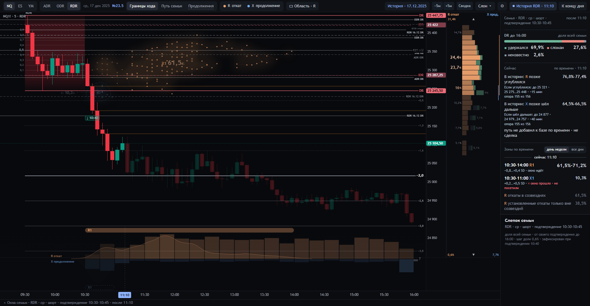
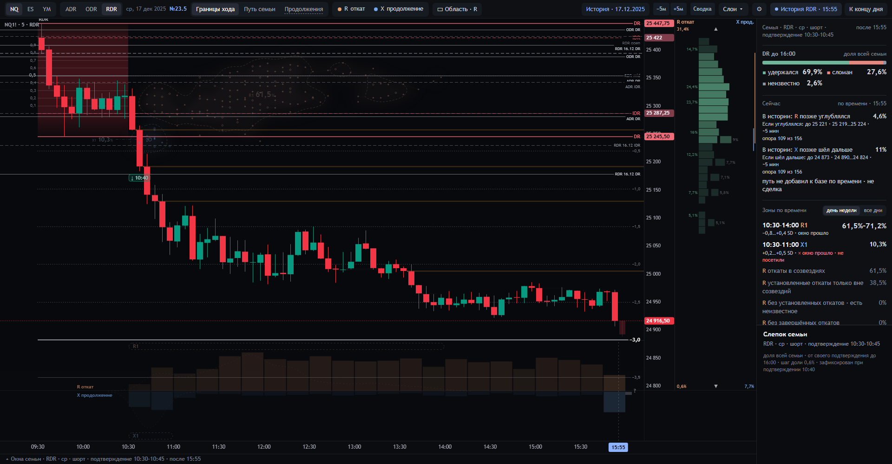
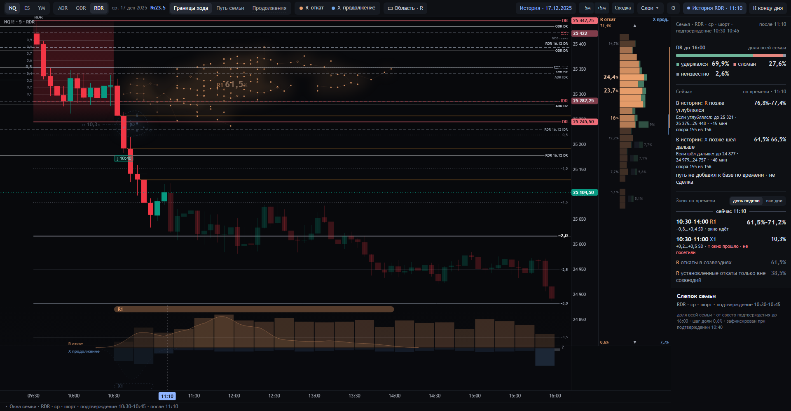

# Рабочая страница 23.5

22.10.2026. Отдельная реализация в main, совместно с 24. Смысловая точка входа —
[фасеты, формулы, решения и неопределённость](../../docs/DR-LAB-23-5-SEMANTIC-DECISIONS.md).

- `start-dr-lab-23-5.cmd` → `http://127.0.0.1:8735/23-5/`; обычный вид — «Границы хода».
- Янтарный R — согласованные локальные откаты PB-L; голубой X — окончательные расширения.
- Контролы/свечи/роли прежние. Новые числители могут менять расположение/размеры, но не единицу шкалы или N.
- Основная 24 на 8767 и `/24/` сохранена. Настройки двух страниц изолированы даже на одном origin.
- Нормативный SC-1.1 — 53, предложенный реестр — 63. Публикация работающего вида не создаёт C2/C3.

Контроль: NQ · RDR · 17.12.2025 · 11:10 · день недели, масштаб 1.

Справа сохранён исходный процент полной полосы; яркость и кегль выделяют выраженные строки. Минимальные
не удаляются из истории — они доступны при наведении. Внизу столбцы несут доли N, а холм — форму времени
всей зоны с одним Gaussian-вкладом сессии в каждом t. Его нормировка не является новым процентом.

Истёкшее окно на том же историческом дне:

Проверки: `tests/pullbacks24.py`, `profile235_bindings.py`, `profile235_page.mjs`, `pullbacks235_page.mjs`,
`shading235_page.mjs`, `visit_states_page.mjs`, `continuations235_page.mjs`, вместе с обязательными наборами.
Результаты и их границы — [квитанция](../../integration/23-5-release-checks.json).

## Исправление по отрицательной приёмке 22.10

Звёзды обоих цветов включены. Компактные представители M5/SD покрывают всю зону, а не только квадрат возле её
вершины; координаты взяты из действительных исторических свидетелей. Все непустые временные столбики видны,
в том числе X вне окон созвездий. У PB-L/FINAL-X нет усиления цвета по «перевесу»: локальные откаты допускают
несколько времён одной сессии, окончательный X — одно. Высоты сохраняют исходные n/N на общей линейной шкале,
а их отношение не является вероятностью возврата против продолжения. Числа и правила события не менялись.

Адресная проверка самого рисунка — `tests/constellations235_page.mjs`. Это исправление прежнего результата,
не доказательство, что оператор принял его визуально.
