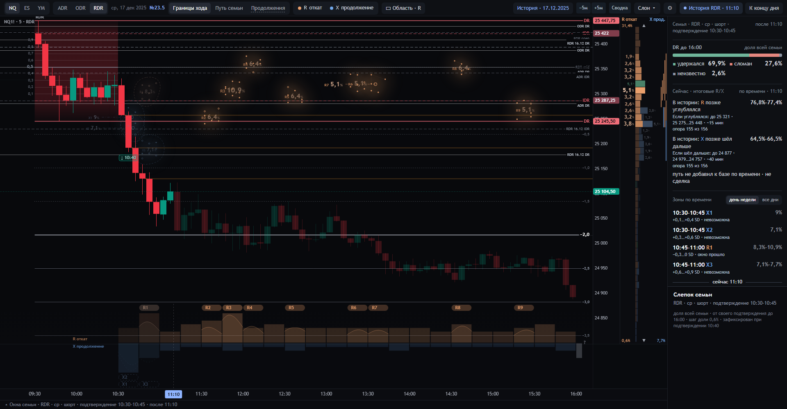
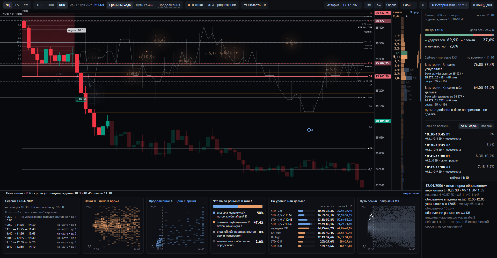
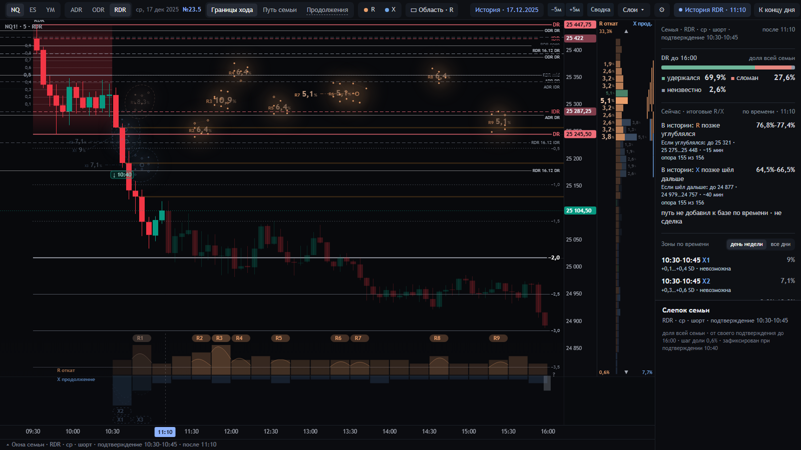

# Паспорт экрана 23.5 · время × SD

23.10.2026. [Смысл, формулы, источники и решения](../../docs/DR-LAB-23-5-TIME-SD.md).
Страница `/23-5/`, порт 8735, существующий ярлык `start-dr-lab-23-5.cmd`. Режим «Границы хода».

| Элемент | Что означает число / состояние | Проверка |
|---|---|---|
| R-созвездие | unique F cases с PB-L в точной маске 15 минут × 0,3 SD | EST:TS-CORE-R, тот же состав у рисунка и инспектора |
| X-созвездие | unique F cases с FINAL-X в такой же локальной маске | EST:TS-CORE-X, без подмены локальным B |
| Цена R/X | максимум n/N по времени для фиксированной 0,1 SD клетки | EST:TS-PEAK-R/X; hover сохраняет выбранный b |
| Время R/X | максимум n/N по цене для этих 15 минут | EST:TS-PEAK-R/X; hover сохраняет выбранный k |
| Зелёный участок | ранняя часть установленных событий выбранной совместной клетки | один case только ранний или поздний |
| Затенение PB | окно по часам прошло; не невозможность повторяемого PB | собственный clock, не FINAL-R phase |
| Сегодняшний визит | цена M5 пересекла именно эту маску в её окне | закрытый префикс; UNKNOWN/NO_PERIOD отдельно |
| Завершение PB | закрыта B, строго превысившая свою H | визит в ядро не является завершением |
| Связанные цели в R-инспекторе | те же истории после собственного L посетили цель; доля всей N | EST:TS-LINK, собственные хронологические свидетели |
| Выбранный прямоугольник | unique case union в явном пересечении | EST:TS-REGION-R/X; не максимум и не сумма |
| Остаточные категории | установленные вне новых ядер / неизвестно / нет события | EST:TS-SESSIONS-R/X, полная N |
| NOW / порядок / путь / Продолжения | собственные исходные определения | не переименованы в PB-статистику |

Компактная звезда — реальная M5/SD-точка, представляющая совпадения. Каждая история и связь H/L/B доступна
в подробностях. Цветовая масса не является вероятностью выбора следующего направления.

Проверки: `tests/time_sd235.py`, `tests/time_sd235_page.mjs`, `tests/profile235_bindings.py` и общие наборы.
Точные результаты: [квитанция](../../integration/23-5-time-sd-checks.json). Это машинная и инженерная проверка;
визуальное принятие оператором не объявлено.
