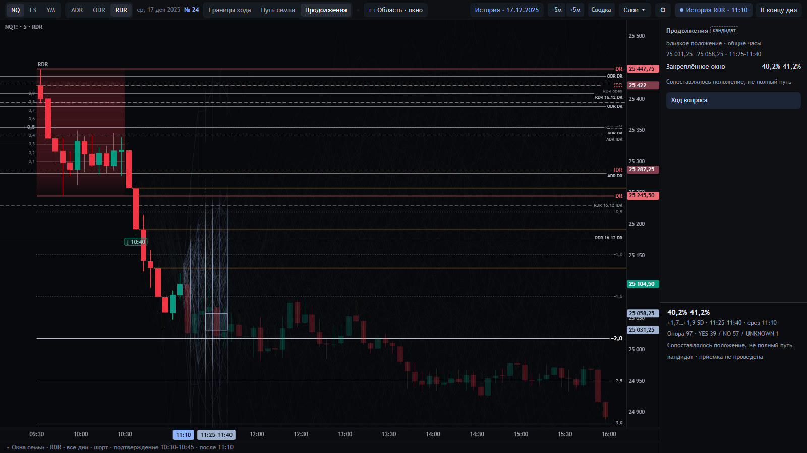
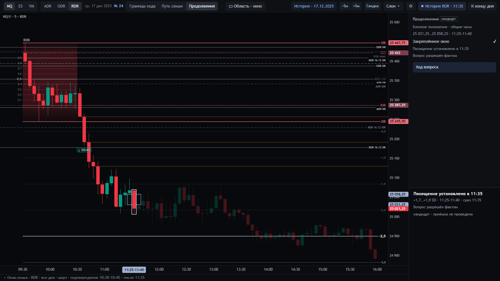
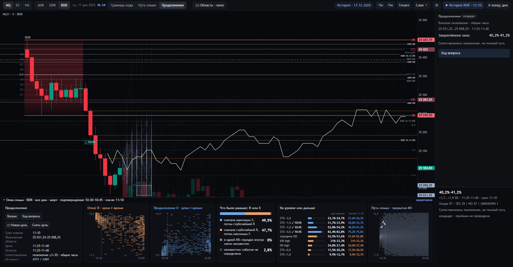
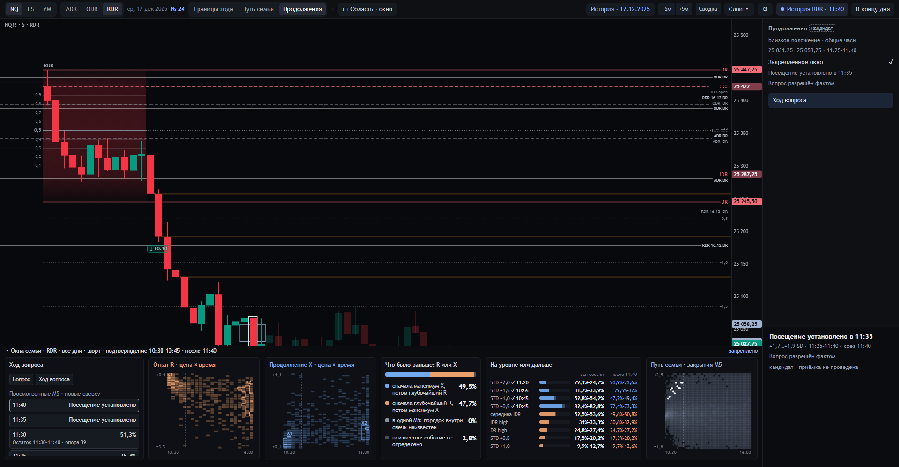

# 14 · Продолжения: закреплённая область и следующие M5

15.10.2026. Реализованный кандидат; SC-1.1 BASE/NOW сохранён. Перцептивная приёмка оператором не подменяется
браузерными тестами. [Устройство и происхождение](../../integration/DELIVERY.md).

| Элемент | Предмет и знаменатель | Источник → показ | Недопустимое прочтение |
|---|---|---|---|
| «Границы хода» | Исходные final R/X семьи F, один неизменный N | `scene24`, `zonemap24` → прежние созвездия | Нельзя прочитать как first visit или пересобранную по цене семью |
| «Продолжения» | Отдельный условный вопрос посещения выбранной области в абсолютном M5-окне | `continuity24.release` → `continuations24.publish` → `continuations.js` | Не новый BASE/NOW или метод Q1 вообще |
| Прямоугольник | Фиксированная физическая область, исходная DR/IDR-рамка, направленные [low,high), точное окно | `Target.physical` и `pin` → brush, существующие границы осей | Цена не должна следовать за новым close; SD ≠ статистическая сигма |
| Процент | YES/все случаи названного набора риска; UNKNOWN даёт границы [YES/N,(YES+UNKNOWN)/N] | `EST:C-WINDOW`, `PROFILE:CONTINUATIONS-24`, отдельный proposed gate → прежняя скрываемая сводка/инспектор | Не вероятность сегодняшней сделки, не доля F и не разбиение одной сотни между областями |
| Новый остаток | Та же цель, другое окно/условие известного непосещения, отдельный набор риска внутри POS_GEO | `question.id`, `WINDOW_NO_VISIT` → явная строка остатка и инспектор | Нельзя скрыть смену вопроса под изменившимся общим прогнозом |
| Пути | Реальные M5 ranges/closes каждого участника опубликованной опоры, включая случаи вне F | Полный source witness в том же выпуске; собственная w → сегодняшняя фиксированная рамка | Линия close не доказывает intrabar путь; совпадение положения не означает совпадение всего префикса |
| Выбор случая | ID → конкретный полный путь → исход → выпуск | Первое прежнее нижнее окно, список «Путь случая» | Выделение не пересчитывает долю и не меняет опору |
| Факт | Наблюдённый M5-диапазон и момент знания на его закрытии | `observed` → рамка свидетельствующей свечи, текст факта; в ячейке числа знак «✓», как у дошедшего места «Отсюда» (19.10) | Не 100 %, не новый first-arrival estimand, не автоматический вопрос возврата; «✓» не процент |
| Статус кандидата (19.10) | Режим и все его поверхности — кандидат редакции DR-LAB-CANDIDATES-1, приёмка не проведена | `FF:CANDIDATE-STATUS` → метка «кандидат» в заголовке сводки, последняя строка инспектора и нижнего окна, пунктир и подсказка у вкладки | Не принятая функция экрана и не прогноз |
| Отказ | Малая опора/пропуск/слом/устаревшие данные/несвязанные число и пути | scoped reference + client check → снимаются зависимые число и пути | Нельзя оставить правильную цифру с чужим рисунком или старую оценку на новой M5 |
| Части закреплённого окна (19.10) | Прошедшее время и остаток внутри неизменного прямоугольника | target/window + текущий закрытый cut → серая прошедшая часть и светлая оставшаяся, разделитель только внутри области | Ширина частей не кодирует вероятность; серый здесь не статус зоны BASE |
| Причины исключений (19.10) | Разность POS/RISK, по известному посещению, неизвестности или поздней активации | независимый пересчёт активации/прошедших M5 → `risk_exclusions` и `exclusion_counts` в hash proof → инспектор и паспорт | Исключённые не входят в знаменатель остаточного ответа; неизвестность не называется посещением |
| «Ход вопроса» (19.10) | Реально просмотренные выпуски одной цели; у каждого собственные cut/question/support | квитанция принятого клиентской проверкой выпуска → первое нижнее окно, новые сверху | Не траектория одной вероятности; нет интерполяции непосмотренных M5 или сведений из будущего replay |

Свечи остаются основой композиции; шесть нижних окон, инспектор и скрываемая сводка сохранены. На график не
добавлены текстовые подписи/числа. Во время режима отдельно видны пути его собственной опоры; остальные
представления исходной F имеют прежний смысл. Новый режим выключается в настройках независимо от PRE/ARRIVE.

Реальная сцена NQ/RDR 17.12.2025, все дни: 11:10 — 97 случаев, 39 YES / 57 NO / 1 UNKNOWN; 60 случаев вне F.
В 11:30 — 81 близкое положение, 39 случаев с требуемым непосещением; 20 YES / 19 NO. В 11:35 — факт.

Инспектор остаточного вопроса держит цепочку опоры и её причины рядом: «По положению 81 → опора остатка 39», затем
«Уже заходили в окно 42»; смена набора по положению («вошли 42, вышли 22») — последней строкой. Это разные операции,
одинаковые числа не должны читаться как одна причина (журнал 13, № 55).

В «Ходе вопроса» клик по строке переводит обычный replay на её срез; заново проверяются ответ и рисунок.
Сброс цели/смена версий очищают ряд, перезагрузка вкладки начинает его заново. Внутренние прокрутки прежних окон
сохранены. Счётчики остаются в инспекторе и паспорте; в правой сводке — историческая доля/факт.

Проверки: `tests/continuity24.py`, `continuations24.py`, `continuations_page.mjs`. Исходная F после возврата
проверяется по family/snapshot/members/counts/zones. Подмена пути за пределами целевого окна сохраняет правильный
счёт, но должна лишить пакет публикации. Проверяются также неверная активация, потеря пути, чужой bundle,
запаздывание ответа. Снимки — результат реального UI, не макет; сырые индивидуальные пути не публикуются.

Операторская проверка: последовательно пройти 11:10 → 11:25 → 11:30 → 11:35 и своими словами различить цель,
новое условие/остаток, опору и факт; выбрать случай вне F; вернуться к исходным R/X. Ошибка при чтении нового
числа как прежнего прогноза, пути как условия отбора или факта как 100 % требует корректировки представления.
