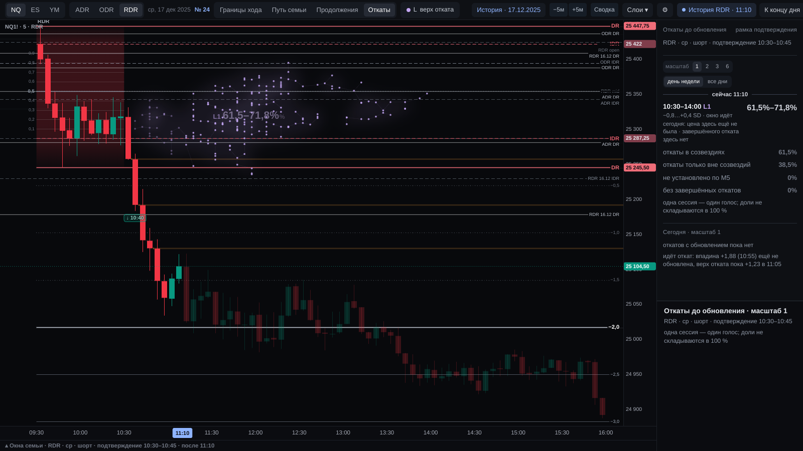
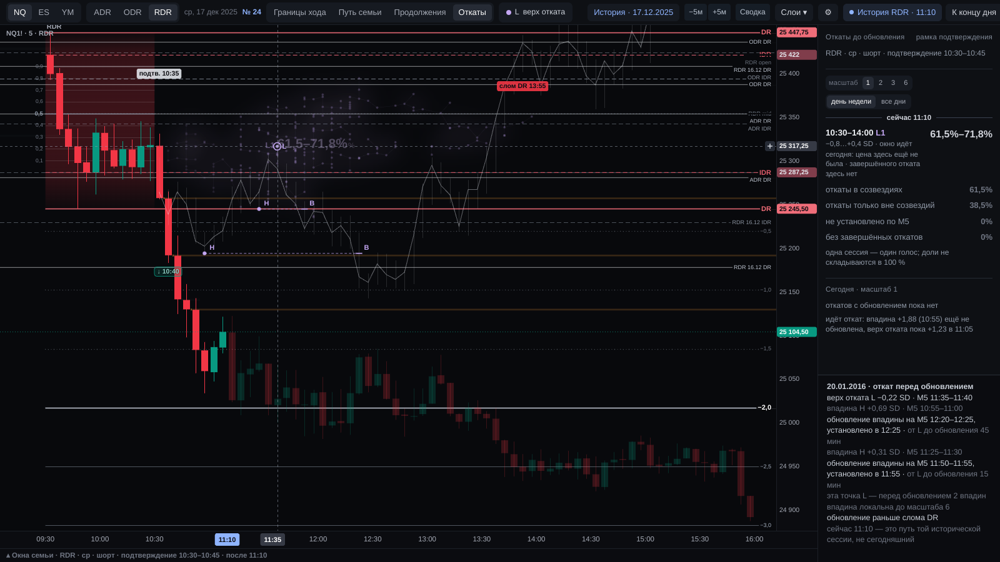
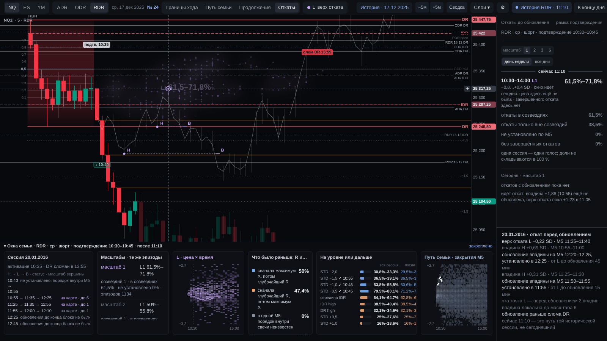
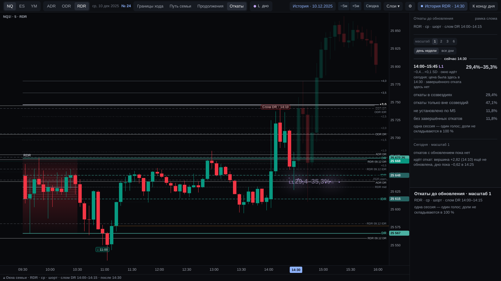
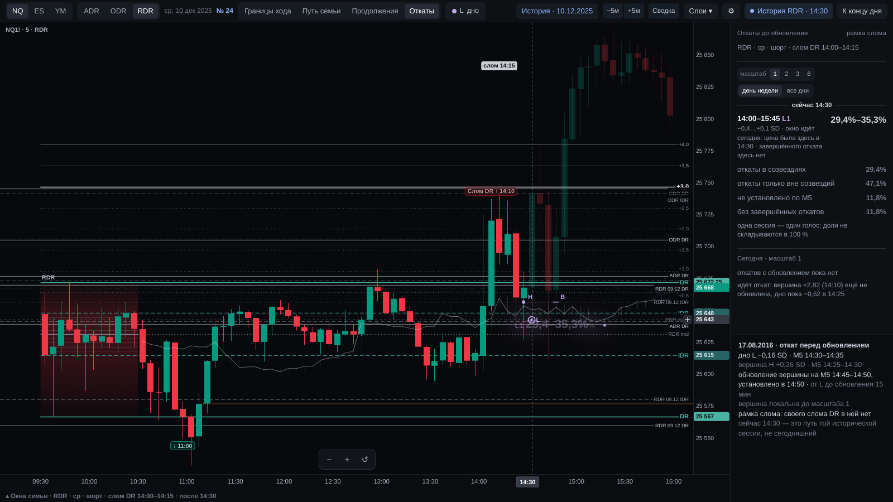
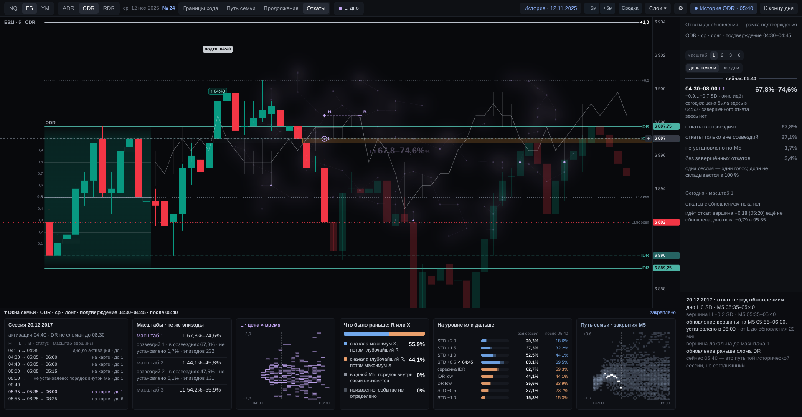

# 15 · Откаты до обновления: где у похожих сессий кончался откат перед обновлением вершины

21.10.2026. Реализованный кандидат DR-LAB-PB-0.1. SC-1.1 BASE/NOW и принятые R/X сохранены. Перцептивная приёмка
оператором браузерными тестами не подменяется. Определение и происхождение правил —
[meaning/lens/2026-10-21-otkaty-do-obnovleniya/03](../../meaning/lens/2026-10-21-otkaty-do-obnovleniya/03-opredelenie-PB-0.1.md).

**Как открыть.** «⚙ → Испытание кандидатов → «Откаты до обновления · кандидат 21.10»». Вид открывается сразу, в
тулбаре появляется кнопка «Откаты» на месте кнопки области. После перехода в «Границы хода» вернуться можно строкой
«L Откаты до обновления ›» в панели.

| Элемент | Предмет и знаменатель | Источник → показ | Недопустимое прочтение |
|---|---|---|---|
| Звезда | Дно L одного исторического эпизода H → L → B семьи F (одна M5, одна цена; несколько обновлённых вершин — одна звезда) | `pullbacks24.history` → `points` → `pbDraw` | Не сегодняшнее событие; не R/X; не каждое касание цены |
| Дымка и нити | Рисунок сгущения звёзд выбранного масштаба | `pbKde`, `pbMst` по точкам зоны | Чисел не несут; их форма не граница зоны |
| Подпись L1… | Доля зоны: сессии с установленной точкой в клетках зоны / N; «от–до», если неизвестное могло попасть внутрь | `EST:PB-ZONE` (POINT или BOUNDS) | Не вероятность отката сегодня; доли зон не складываются в 100 % |
| Масштаб 1 / 2 / 3 / 6 | Вершина выше k соседних M5 с каждой стороны; те же эпизоды, другой отбор вершин | `definition.scales`, `maps[k]` | Не настройка «лучшего» параметра; эпизод не меняется задним числом |
| Строка зоны в панели | Окно и цена зоны; отношение к сегодня: окно по часам, посещение, завершённость | `today.zones[k]` → `FF:PB-TODAY` | Посещение ≠ завершённый откат; статусы R/X не применяются |
| Четыре строки N | Разбиение всех N сессий на масштабе: в созвездиях / только вне / не установлено / без откатов | `EST:PB-SESSIONS` | Это одна сотня; к долям зон не прибавляется |
| «Сегодня» | Сегодняшние эпизоды по закрытым M5: завершённые обновлением и идущий откат (вершина, дно пока) | `today.episodes` | Идущий откат не завершён, пока не обновлена его вершина |
| Наведение на звезду | Один путь той исторической сессии в рамке экрана: H, L, B со своими M5, время установления B, порядок слома DR, связанные вершины, масштаб | `sessions[].bars` (свидетельство) → `pbDrawPath`, `pbInspector` | Не сегодняшний путь («сейчас ЧЧ:ММ — это путь той исторической сессии») |
| Окно сессии | Все эпизоды сессии со статусами: на карте / дно до активации / порядок внутри M5 / нет свечи / обновления не было | `episodes` → `FF:PB-EPISODE` | Неустановленный эпизод не «нет отката» |
| «Масштабы · те же эпизоды» | Те же эпизоды на четырёх масштабах: зоны, доли, неизвестное, число эпизодов | `maps` | Не выбор лучшего масштаба |
| Рамка слома | После слома — семья слома со своей ориентацией и своей картой | `context.view = brk` | Эпизоды двух рамок не смешиваются |

Свечи остаются основой композиции. Окна семьи «Что было раньше: R или X», «На уровне или дальше» и «Путь семьи»
показываются под своими названиями: это принятые объекты, кандидат их не меняет. Вид «Откаты» не шире принятого
тулбара: его кнопка стоит на месте кнопки области, которая в этом виде не нужна.

Реальная сцена NQ · RDR · 17.12.2025, день недели, 11:10, семья N = 156 (шорт, подтверждение 10:30–10:45):

- масштаб 1 — L1 10:30–14:00, −0,8…+0,4 SD, 61,5–71,2 %;
- масштаб 6 — L1 11:00–12:15, −0,5…+0,1 SD, 17,9–18,6 %.

Сегодня: окно идёт, цена в зоне ещё не была, идёт откат от впадины 10:55. Остальные числа —
[ответ 04](../../meaning/lens/2026-10-21-otkaty-do-obnovleniya/04-otvet.md), §4.

Проверки:

- `tests/pullbacks24.py` — 48 проверок: девять историй конструкции, масштабы, порядок слома, три времени, реальные
  семьи, публикация, подмены, закрытый 2026.
- `tests/contract_sc11.py` — слова экрана только из реестра.
- Принятые наборы экрана 24 без изменений.

Снимки — результат реального UI, не макет.

**Операторская проверка.** Включить вид на своём дне и навести на несколько звёзд одного созвездия. Своими
словами различить:

- где у той сессии была вершина, где кончился откат, когда вершина обновлена;
- был ли до этого слом DR;
- что сегодняшнее касание зоны ещё не завершённый откат.

Переключить масштаб 1 → 6 и сказать, какой из них ближе к событию, которое вы хотите видеть. Если звезда
читается как сегодняшний сигнал, а доля зоны — как вероятность, представление нужно поправить.
