# 23.5 · Операторская приёмка: одна рабочая сессия трейдера

19.10.2026. **23.5 — копия экрана 24 с новым смысловым контуром.** Экран 24 не изменился: он работает из main на
127.0.0.1:8767, ярлык «DR Lab 24». 23.5 открывается ярлыком «DR Lab 23.5» на рабочем столе (127.0.0.1:8735, ветка
`ekran-23-5`), в панели инструментов написано «№23.5». Свечи, история, семья, зоны и «Сейчас» у обоих экранов одни и
те же. 23.5 отличается тремя вещами:

1. правки Codex от 19.10 в «Продолжениях»: прошедшая и оставшаяся части окна, причины исключений, «Ход вопроса»;
2. метка «кандидат» на всём, что вы ещё не приняли, и знак «✓» у установленного факта;
3. порядок строк остатка, фраза у числа «Продолжений», уточнённые паспорта элементов.

Ниже — проход одной рабочей сессии. По нему 23.5 можно принять или отклонить без инженера: что видно на каждом шаге,
на какой вопрос отвечает каждое число, что изменилось после новой M5 и где историческую долю легко принять за прогноз.

## 1. Три вида знания и статус кандидата

| Вид | Что это | Как узнать на экране | Примеры (17.12.2025) |
|---|---|---|---|
| **История семьи** | Доля всей семьи F: сессии 2006–2025 того же блока, дня недели, направления и 15-минутного окна подтверждения. Семья зафиксирована при подтверждении и за день не меняется | «доля всей семьи», «семьи в этой зоне», шаг доли 100/N | «DR до 16:00 · удержался 69,9 %»; зона R1 21,2 %; колонка справа, лента внизу, «Путь семьи» |
| **Условный ответ** | Доля тех исторических случаев, которые на этом же срезе были в сопоставимом состоянии. Считается заново на каждой закрытой M5: меняются и набор, и вопрос | «В истории: …», «опора n из N», «по времени», «Близкое положение · общие часы» | «Сейчас»: R 80,1–80,8 % в 11:00; «Продолжения»: 40,2–41,2 % в 11:10 |
| **Факт сегодня** | Что уже установили закрытые M5 сегодняшнего дня | без процента: статус зоны, «сегодня пока: …», «✓ · Посещение установлено в 11:35» | X1 «невозможна» с 11:00; «дальше всего +1,88 SD в 10:55» |

Ни одно число на экране не говорит о вероятности сегодняшнего дня. Диапазон «a–b %» появляется, когда у части
случаев исход неизвестен: нижняя граница считает все неизвестные «нет», верхняя — «да».

**Кандидат** — это не четвёртый вид знания, а статус: функция на испытании, ваша приёмка не проведена. Его числа —
тоже история или условный ответ. Как кандидат помечен на экране:

- пунктирная метка «кандидат» в заголовке блока;
- у «Продолжений» — пунктирное подчёркивание вкладки и последняя строка инспектора и нижнего окна «кандидат · приёмка
  не проведена».

У принятых блоков метки нет. Кандидаты включаются в ⚙ → «Испытание кандидатов». Принятые числа от них не зависят;
проверено тестами `tests/integration_baseline.py` и SWPC M05.

## 2. Ключ шкалы SD

SD — ширина IDR, не статистическая сигма. В панели и инспекторе SD отсчитываются **по направлению подтверждения**
(шкала метода, `docs/STRATEGY.md` §1.4):

- 0 — край IDR со стороны подтверждения;
- плюс — по ходу (в шорт — вниз), минус — против;
- −1 — противоположный край IDR.

Лесенка у графика подписана как в Pine: плюс выше коробки, минус ниже. Поэтому в шортовый день полоса
25 031,25…25 058,25 в панели называется «+1,7…+1,9 SD», а на лесенке лежит между −1,5 и −2,0.

Строка «сегодня пока: глубже всего +0,54 SD» значит: откат после подтверждения ещё не вернулся к краю IDR. Его
самая высокая точка — на 0,54 ширины ниже IDR low. Инспектор зоны пишет рядом с SD и цену: «−0,6…+0,5 SD ·
25 220–25 368».

## 3. Проход: NQ · RDR · среда 17.12.2025, подтверждение в шорт

Как открыть: «История» → 17.12.2025, NQ, RDR; срез двигается кнопками «−5м / +5м» или полосой времени. Свечи после
среза бледные и ни одним числом не используются.

### 10:30 — коробка готова, подтверждения нет (кандидат «До подтверждения»)

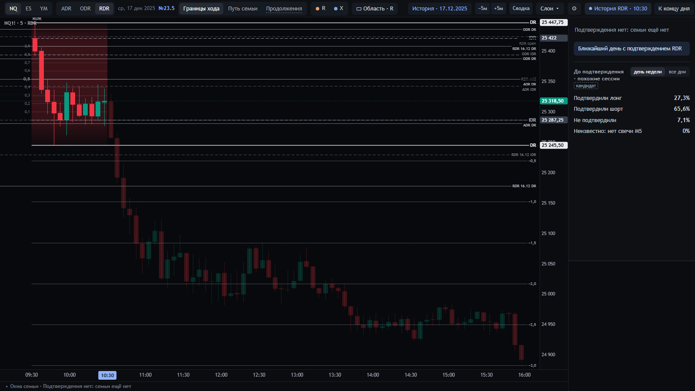

- **Видно.** «Подтверждения нет: семьи ещё нет». Если в ⚙ включён кандидат «История до подтверждения»: блок «До
  подтверждения · похожие сессии», метка «кандидат». Подтвердили лонг 27,3 %, шорт 65,6 %, не подтвердили 7,1 %.
- **Вопрос.** Что потом делали сессии, похожие на сегодняшнюю к 10:30. Похожие — тот же цвет коробки, те же модели
  дня ADR → ODR → RDR, цена в пределах ¼ ширины IDR от сегодняшней.
- **Где можно ошибиться.** «65,6 % — шанс шорта сегодня». Это доля похожих сессий, а не прогноз направления.

### 10:40 — подтверждение: семья зафиксирована

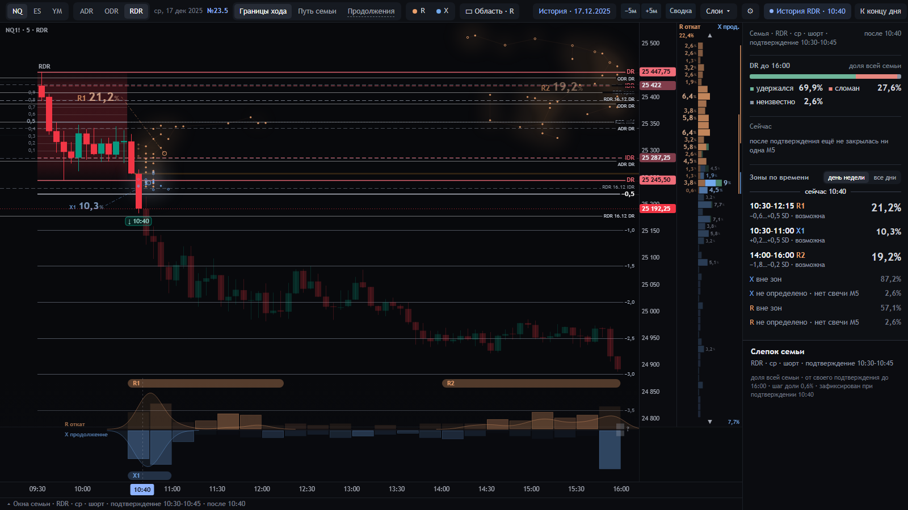

- **Видно.** M5 10:35–10:40 закрылась ниже DR. Семья F: RDR · ср · шорт · подтверждение 10:30–10:45, N = 156, шаг
  доли 0,6 %. Слепок семьи (инспектор) зафиксирован в 10:40 и за день не меняется.
- **DR до 16:00.** Удержался 69,9 %, сломан 27,6 %, неизвестно 2,6 %: исход DR у каждой из 156 сессий от её
  подтверждения до 16:00.
- **Зоны по времени.**
  - R1 10:30–12:15, −0,6…+0,5 SD — 21,2 %;
  - X1 10:30–11:00, +0,2…+0,5 SD — 10,3 %;
  - R2 14:00–16:00, −1,8…−0,2 SD — 19,2 %;
  - остальное — «вне зон» (X 87,2 %, R 57,1 %) и «не определено» (2,6 %).

  У каждого события своя сотня: зоны R, «R вне зон» и «R не определено» дают 100 %.
- **«Сейчас».** После подтверждения ещё не закрылась ни одна M5, поэтому ответа нет.
- **Где можно ошибиться.**
  - «69,9 % — шанс, что DR сегодня устоит».
  - «R1 21,2 % — шанс отката в R1».

  Это история 156 сессий. Крупная цифра у зоны означает большую историческую массу, а не статус.

### 11:00 — двадцать минут после подтверждения

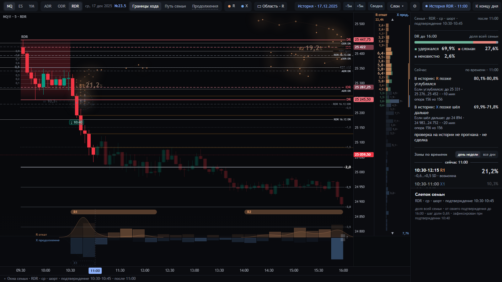

- **«Сейчас · по времени · 11:00».**
  - «В истории: R позже углублялся 80,1–80,8 %». Речь о сессиях семьи, допустимых к 11:00: своё подтверждение было,
    префикс полон, DR цел; здесь это 156 из 156. У этой доли после 11:00 откат стал глубже уже прожитого.
  - «Если углублялся: до 25 331 · 25 276…25 452 · ~10 мин»: медиана и квартили добавки, отложенные от сегодняшнего
    экстремума, и медиана времени до нового экстремума.
  - X: 69,9–71,8 %, до 24 894 (24 983…24 752), ~20 мин.
- **«путь не добавил к базе по времени · не сделка».** Сопоставление по форме пути (M1–M3) не прошло проверку на
  истории. Поэтому в набор входят все сессии, допустимые к этому часу, без отбора по пути.
- **Изменилось с 10:40.**
  - X1 «невозможна»: сегодняшний X в 10:55 уже +1,88 SD, и окончательный X не ляжет в +0,2…+0,5.
  - «Сегодня пока: глубже всего +0,54 SD в 10:40 · дальше всего +1,88 SD в 10:55».
- **Наведение на зону R1** открывает её паспорт в инспекторе:
  - «21,2 % семьи в этой зоне»;
  - окно действует ещё 75 мин;
  - пиковые 15 минут впереди — 11:00–11:15 (1,3 % семьи);
  - в окне 10:30–12:15 свой экстремум поставили: R — 41,7 %, X — 43,6 %. Это две отдельные доли N, а не одна сотня.

  Наведение на строку «Сейчас» рисует на графике полосу, где кончался откат у сессий, ушедших глубже: 25 276…25 452.

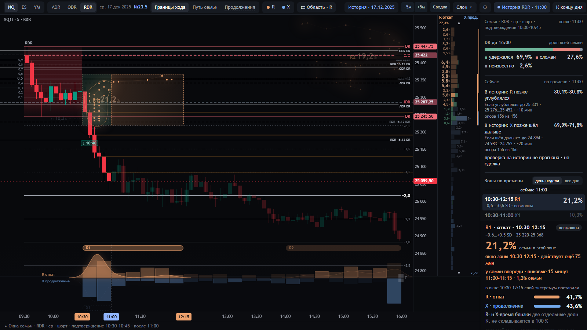
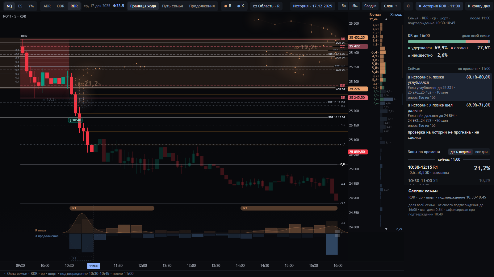

- **Где можно ошибиться.** «80 % — откат сегодня углубится». Это доля исторических сессий к тому же часу. Она
  пересчитывается на каждой M5: в 11:40, 13:30 и 15:55 она другая.

### 11:00 — ваши решения 08.10 как кандидаты

В ⚙ включены «Фаза по вашему правилу» и «Сейчас: откат числом и отметками».

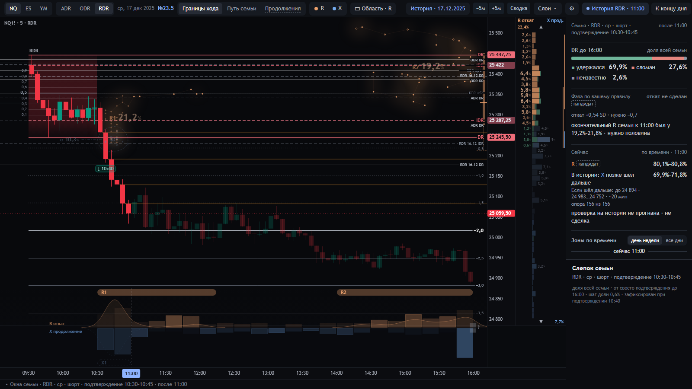

- **«Фаза по вашему правилу · кандидат · откат не сделан».**
  - Откат +0,54 SD, по правилу нужно −0,7.
  - Окончательный R семьи к 11:00 был у 19,2–21,8 % сессий, нужно половина.

  Это ваше правило от 08.10: не факт рынка и не сигнал.
- **Строка R в «Сейчас» с меткой «кандидат»** показывает только число 80,1–80,8 %. Уровни стоят отметками у шкалы
  цены:
  - пунктир — сегодняшний экстремум;
  - узкая полоса — где кончался откат у ушедших глубже;
  - черта — медиана.

  Слова, уровни и опора — в подсказке строки.

### 11:00 — «Отсюда до места» (кандидат)

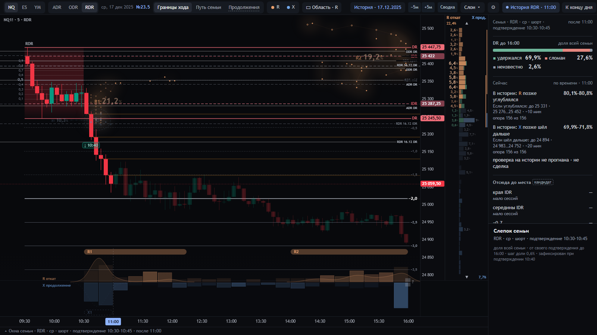

- **Видно.** «Отсюда до места · кандидат»: края IDR, середины IDR, −0,7. На «день недели» у всех трёх мест «мало
  сессий», и числа нет; на «все дни» набор больше.
- **Вопрос.** Из сессий, которые в этот час стояли там же и ещё не были у места, сколько потом дошли до него до
  конца блока.

### 11:10 — «Продолжения» (кандидат): закреплены область и окно

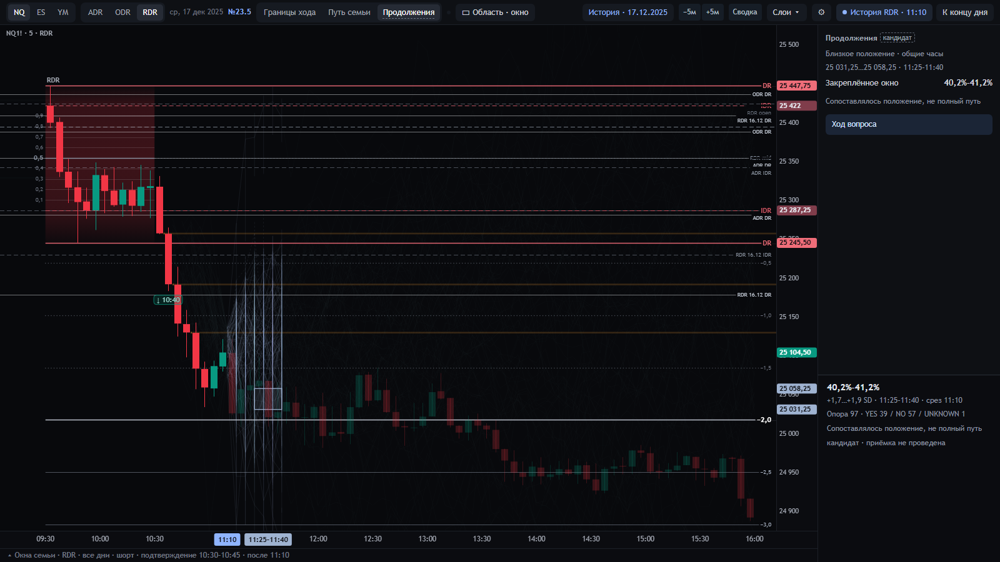

- **Видно.** Вкладка «Продолжения», кнопка «▭ Область · окно».
  - Полоса 25 031,25…25 058,25 (+1,7…+1,9 SD), окно 11:25–11:40.
  - «Закреплённое окно 40,2–41,2 %».
  - Подсказка строки — фраза самого числа: «На срезе 11:10 среди 97 исторических случаев с близким положением и
    указанным условием 39 посетили область в оставшемся окне 11:25–11:40; исход неизвестен у 1». И строка: «история
    этого набора на этот срез; не сегодняшний исход».
- **Набор POS_GEO.**
  - Более ранние даты того же инструмента и блока, все дни недели, обе стороны.
  - К тому же часу своё подтверждение было, DR цел.
  - Закрытие в пределах ¼ ширины IDR от сегодняшнего положения.

  Поэтому 60 из 97 случаев лежат вне исходной семьи F. Сравнивалось положение, не полный путь.
- **На графике.** Пути всех 97 случаев. Один случай выбирается в нижнем окне «Путь случая».
- **Где можно ошибиться.** «40 % — шанс, что цена придёт в окно». Это доля 97 исторических случаев.

### 11:15 → 11:25 — та же цель, новый ответ на каждой M5

| Срез | Ответ | Опора | Вопрос |
|---|---|---|---|
| 11:10 | 40,2–41,2 % | 97 | всё окно 11:25–11:40 |
| 11:15 | 59,1 % | 22 | то же |
| 11:20 | 58,8 % | 51 | то же |
| 11:25 | 75,4 % | 61 | то же |

Область и окно не двигались. Менялся набор сопоставимых дней: сегодняшняя цена ушла, и сопоставимыми стали другие
сессии. Инспектор пишет, сколько случаев вошло в набор и сколько вышло.

**Где можно ошибиться.** «Вероятность выросла с 40 до 75 %». Это ответы о разных наборах; одной растущей вероятности
здесь нет.

### 11:30 — внутри окна: остаточный вопрос

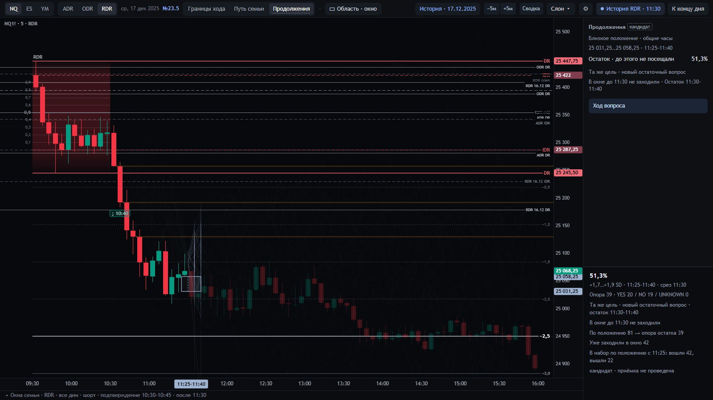

- **Видно.** «Остаток · до этого не посещали 51,3 %».
- **Вопрос.** Сегодня в 11:25–11:30 цена в область не заходила. Вопрос сузился до остатка окна 11:30–11:40. Опора —
  только те исторические случаи, которые тоже не заходили в 11:25–11:30.
- **Инспектор.** Строки идут в таком порядке:
  1. «По положению 81 → опора остатка 39»;
  2. «Уже заходили в окно 42» — это объясняет 81 − 42 = 39; YES 20 / NO 19;
  3. последней — «В набор по положению с 11:25: вошли 42, вышли 22». Это другая операция: смена сопоставимых дней.
- **На графике.** Прошедшая часть окна серая, оставшаяся светлее; между ними пунктир среза.

### 11:35 — факт

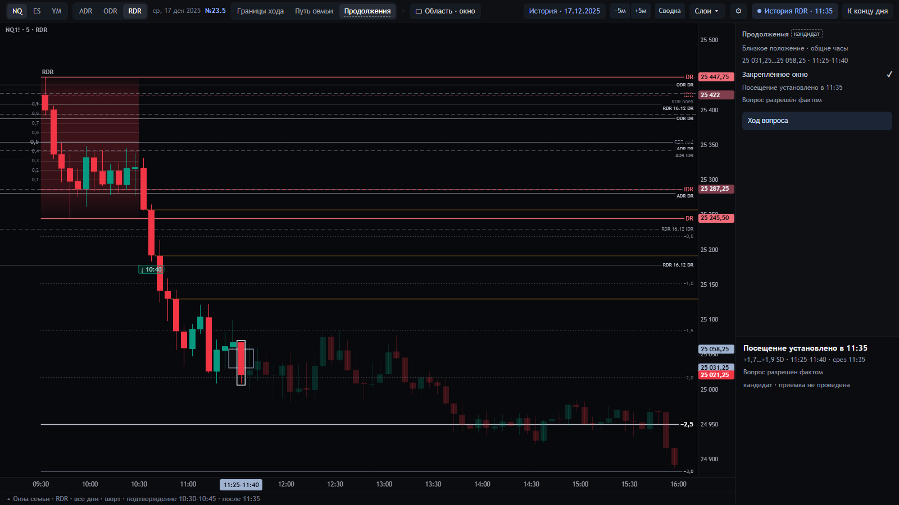

- **Видно.** M5 11:30–11:35 зашла в область: «Закреплённое окно ✓ · Посещение установлено в 11:35 · Вопрос разрешён
  фактом». Свеча-свидетель обведена; пути и процент сняты.
- **Где можно ошибиться.** «✓ = 100 %». Это факт сегодняшнего дня, а не доля.

### «Ход вопроса»

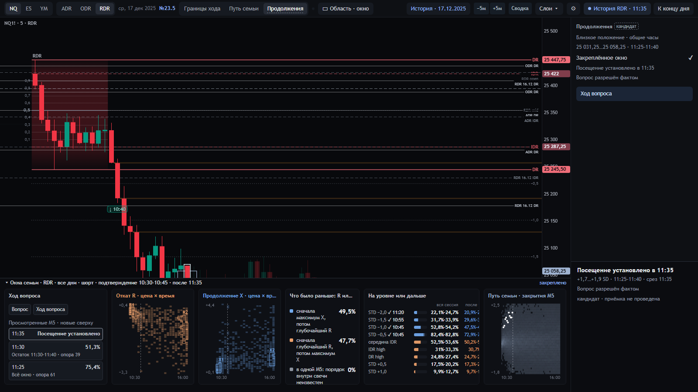

Список реально просмотренных ответов этой цели, новые сверху:

- 11:35 — «Посещение установлено»;
- 11:30 — 51,3 % (остаток, опора 39);
- 11:25 — 75,4 % (всё окно, опора 61);
- 11:20 — 58,8 % (51);
- 11:15 — 59,1 % (22);
- 11:10 — 40,2–41,2 % (97).

Клик по строке возвращает replay на её срез. Это квитанции просмотренных ответов, а не траектория одной вероятности.

### 11:40 — возврат к «Границам хода»

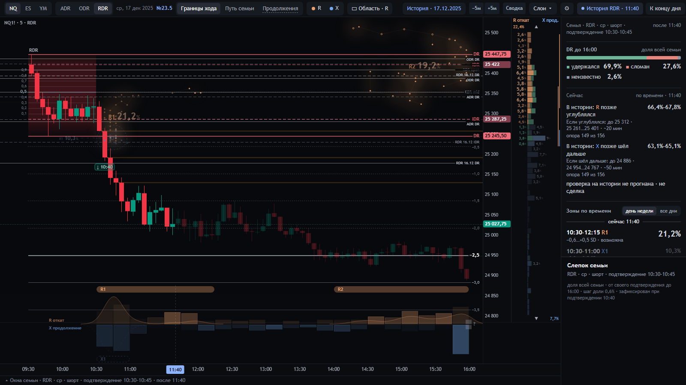

- Семья, зоны и «DR до 16:00» те же. Тест сравнивает слепок после возврата по family, snapshot, members, counts и
  zones.
- «Сейчас» в 11:40: R 66,4–67,8 %, X 63,1–65,1 %. Опора 149 из 156: у 7 сессий к 11:40 DR уже сломан или префикс
  неполон.

### 13:30 — середина дня и «Путь семьи»

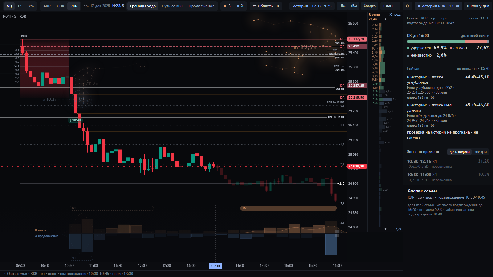
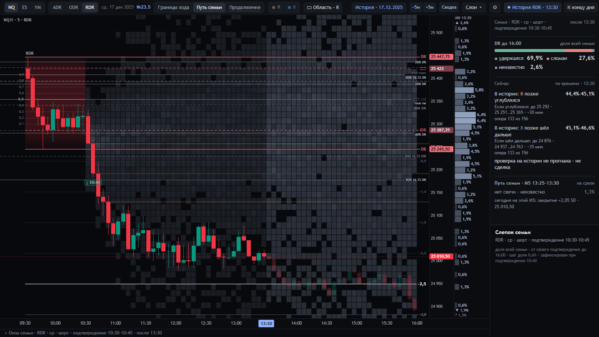

- **Изменилось.**
  - R1 «невозможна»: окно 10:30–12:15 кончилось, а сегодняшний откат в её полосу не вошёл.
  - «Сейчас»: R 44,4–45,1 %, X 45,1–46,6 % (опора 133).
- **«Путь семьи» на M5 13:25–13:30.** Где закрывались сессии семьи в эту же пятиминутку: колонка справа, доли семьи.
  Сегодняшнее закрытие — +2,05 SD (25 010,50). Это не путь, который пройдёт цена.

### 15:55 — конец блока

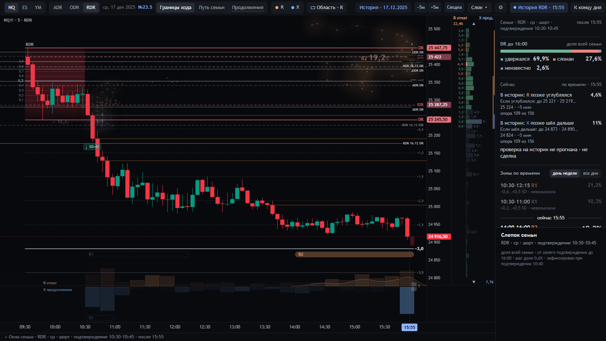

- «Сейчас»: R 4,6 %, X 11 % (опора 109). У этих долей исторических сессий откат или продолжение после 15:55 ещё
  обновлялись.
- R2 (14:00–16:00) пока «возможна».

### Слом DR: NQ · RDR · 10.12.2025, 14:30

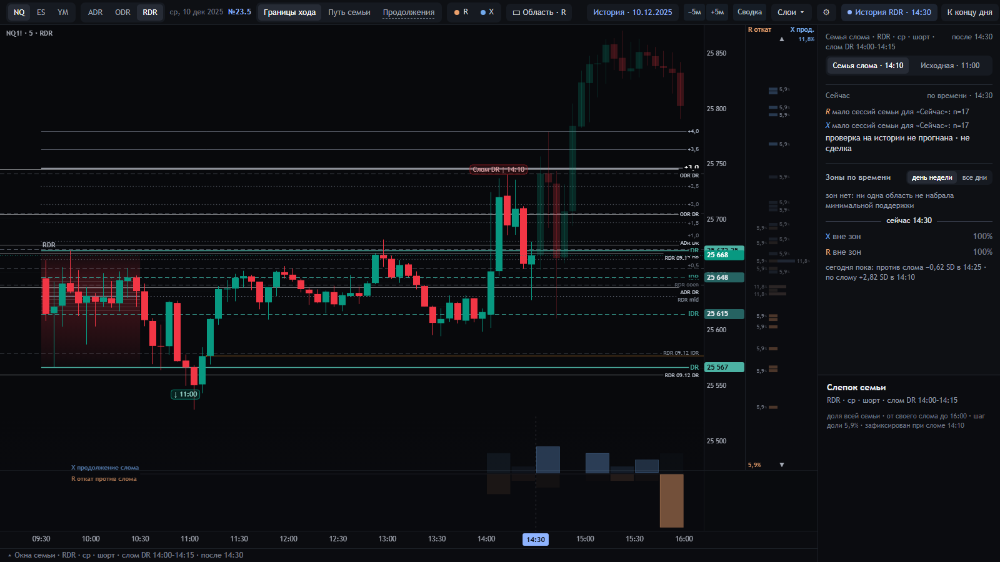

- **Видно.** После слома DR в 14:10 экран переходит к семье слома: вкладки «Семья слома · 14:10» и «Исходная · 11:00».
  Семья: RDR · ср · шорт · слом DR 14:00–14:15, N = 17, шаг доли 5,9 %.
- **Координаты.** Перевёрнуты: ноль — противоположный край IDR, плюс — по слому.
- **«Сейчас».** Мало сессий семьи (n = 17), числа нет.
- **Зоны.** Зон нет: ни одна область не набрала минимальной поддержки.

## 4. Где историческую долю легко принять за прогноз

| Место | Как можно ошибиться | Что на экране не даёт ошибиться |
|---|---|---|
| DR до 16:00 | шанс, что сегодня DR устоит | «доля всей семьи»; число не меняется за день |
| Зона «R1 21,2 %» | шанс отката в R1 | «семьи в этой зоне»; статус отдельно, словом; кегль — масса истории |
| Статус «возможна» | «скорее всего будет» | статус — логика по сегодняшнему экстремуму и времени, «не вероятность» |
| «Сейчас» 80,1–80,8 % | откат сегодня углубится | «В истории:», «опора 156 из 156», «не сделка»; пересчёт на каждой M5 |
| «До подтверждения» 65,6 % шорт | направление сегодня | «похожие сессии», метка «кандидат» |
| «Продолжения» 40 → 59 → 75 → 51 % | одна растущая вероятность | опора у каждого ответа, вошли/вышли, «новый остаточный вопрос», «Ход вопроса» как квитанции |
| «✓ Посещение установлено» | 100 % | знак вместо числа |
| «сегодня пока» | окончательные R/X | «пока»; в подсказке «не окончательные значения» |
| Зона ниже разделителя «сейчас» | она ещё впереди | порядок зон по началу окна не меняется со срезом, поэтому X1 10:30–11:00 стоит ниже «сейчас» до 12:15; читать окно и статус «невозможна» |

## 5. Принятые функции и кандидаты

| Функция | Статус | Где видно |
|---|---|---|
| Семья и слепок, DR до 16:00, зоны по времени и их статусы, «сегодня пока», созвездия, колонка R/X, лента времени, «Путь семьи», семья слома | принято (BASE-24, SC-1.1) | без метки |
| «Сейчас» (по времени) | принято (NOW-1.0) | без метки |
| «До подтверждения · похожие сессии» | кандидат | метка в заголовке; ⚙ |
| «Отсюда до места» | кандидат | метка в заголовке; ⚙ |
| «Связанные пути в нижнем окне» | кандидат | ⚙ |
| «Продолжения · закреплённое окно» | кандидат, включён по умолчанию | пунктир у вкладки, метка в заголовке, последняя строка инспектора |
| «Фаза по вашему правилу» (08.10) | кандидат | метка в заголовке; ⚙ |
| «Сейчас»: откат числом и отметками (08.10) | кандидат | метка у строки R; ⚙ |

## 6. Что проверено

**Версия кода.** Ветка `ekran-23-5`, коммит `4f9d542`; ниже него `5173290`, база — main `f35faae`. Сервер 23.5
на 8735 загрузил исходники `lab/*.py` ревизии `19fe76e2…`. Экран 24 на 8767 отдаёт `d24.js` из main байт в байт.

**Автоматические проверки** — все на коде `4f9d542`, по очереди, браузерные — против сервера 8735.

| Проверка | Что проверяет | Результат |
|---|---|---|
| `tests/smoke.py` | история, данные экранов, состояние контракта, синтаксис JS | ALL GOOD |
| `tests/semantic_links.py` | слова реестра — исполняемые определения; слова «Сейчас» 08.10 без стороны | ALL GOOD |
| `tests/sem24.py`, `tests/now24.py` | семья, R/X, зоны (BASE-24); «Сейчас» (NOW-1.0) | ALL GOOD |
| `tests/contract_sc11.py` | машинный контракт SC-1.1, 53 величины | ALL GOOD |
| `tests/continuity24.py`, `continuations24.py`, `continuations_transfer.py` | «Продолжения»: выпуск, причины исключений, независимый перенос смысла | ALL GOOD |
| `tests/integration24.py`, `integration_baseline.py` | кандидаты не меняют принятое: main и 23.5 совпадают на пяти сценах, включая слом и ES | ALL GOOD |
| `tests/run_candidate_checks.py` | «Отсюда до места» в кандидатном реестре | ALL GOOD |
| `tests/q1_pilot.py`, `q1_prefix_metadata.py`, `q1_reveal.py` | механизм Q1 под «Отсюда» | ALL GOOD |
| `tests/swpc11.py` | рабочий контракт экрана SWPC-1.1 | ALL GOOD |
| `tests/base24_page.mjs` | экран в браузере: паспорта = эталон сервера, срезы, зоны | ALL GOOD |
| `tests/continuations_page.mjs` | 58 проверок на 1600×900 и 1920×1000: закреплённая цель не двигается, остаток 39 из 81, порядок строк, факт «✓», метка кандидата, «Ход вопроса», возврат к исходной F, подмены путей и выпусков отвергаются | ALL GOOD 58 |
| `tests/integration_page.mjs` | «Отсюда до места»; метка «кандидат» у PRE, ARRIVE, фазы и строки «Сейчас»; в принятом виде меток нет | PASS |
| `tests/integration_flow.mjs` | путь сцены на двух размерах: подтверждение, новые M5, слом, малая семья, возврат к исходной | ALL GOOD, 27 проверок |
| `tests/integration_faults.mjs` | отказы: подменённый ответ кандидата снимает его процент с видимой причиной, а базовая карта остаётся; снятый кандидат не держит линию и пути; слова кандидатов не расширяют словарь принятого «Сейчас» | ALL GOOD |
| `tests/swpc11_browser.mjs` | рабочий контракт экрана в браузере: базовая карта не меняется со срезом и кандидатами, порядок блоков, панель инструментов в окне на 1600 и 1920, `ui_check24` на пяти сценах | ALL GOOD, 74 проверки |

**Проверенные визуальные состояния** — реальный экран 23.5, не макет:

- 16 кадров прохода выше, 1600×900;
- «Продолжения» на 1600×900 и 1920×1000 (`img/continuations/`): исходный выпуск, свидетель, остаток, факт, «Ход
  вопроса», возврат к границам хода.

Нарушений контракта на кадрах прохода нет. Все числа проверены эталоном сервера.

**Ограничения.**

- Машинные проверки не заменяют вашу приёмку.
- Проход — на истории 2025. Живые свечи дня в этом прогоне не проверялись: TradingView не трогался.
- Не доказано, что закреплённые и остаточные окна «Продолжений» годятся для следующего случая: калибровка, POS_GEO
  против расстояния и оставшегося времени, объём опоры. Эти исследования отложены вашим решением 19.10.
- 2026 год закрыт.

## 7. Что решить вам

1. Какие кандидаты принять в экран, какие оставить на испытании, какие убрать:
   - «До подтверждения»;
   - «Отсюда до места» (на «день недели» почти всегда «мало сессий»);
   - «Связанные пути»;
   - «Продолжения»;
   - «Фаза по вашему правилу»;
   - «Сейчас: откат числом и отметками».
2. Заменяет ли 23.5 экран 24 после вашего прохода (тогда ветка объединяется с main) или остаётся рядом.
