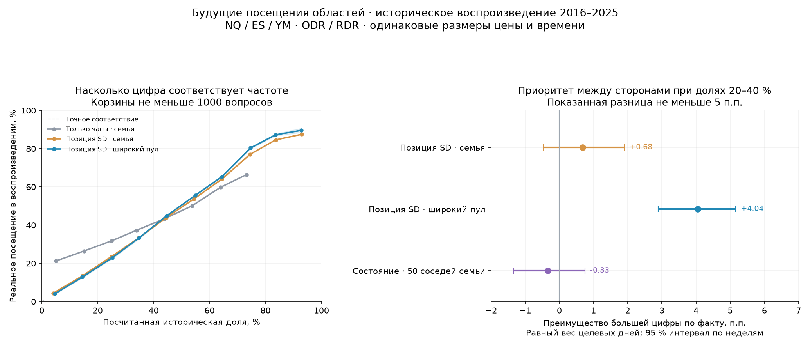

# Динамические созвездия: что подтвердилось и что означает процент

15.10.2026. **Проверка выполнена; UI не изменён.** Исследовательский результат на уже виденной истории,
не принятие нового оценивателя, прогнозного профиля или торговой политики. Протокол до подсчёта — [README](README.md),
полные агрегаты — [results.json](results.json), отдельная диагностика приоритета — [ranking-results.json](ranking-results.json).

## Вывод для следующей конструкции

Для вопроса «где цена бывала в будущем окне после выбранной свечи» лучшим из объявленных вариантов оказался
**общий час + близкая текущая позиция в SD на широкой истории того же инструмента/блока** (`POS_GEO`).
Жёсткая привязка к семье подтверждения дала меньше доступных ответов и большую ошибку. Добавление проверенных
сделанных R/X, последних закрытий и расстояний до экстремумов не улучшило результат.

Это поддерживает разделение, найденное реконструкцией: **семья DR задаёт исходный исторический объект;
набор для конкретного динамического вопроса может быть другим.** Исходная BASE-семья не должна незаметно
переподбираться. Новый набор имеет собственное условие, состав, знаменатель и статус.

`POS_GEO` здесь не является BASE_D. Никакое решение Q1 этим исследованием не принято: здесь другое событие,
нет фильтра «никогда ещё не достигали L», а повторное посещение после cut допускается. Подробности алгоритма — протокол.

## Что именно проверено

* Источник 2006–2025; воспроизведение 2016–2025, NQ/ES/YM × ODR/RDR.
* Выбрано 3128 подтверждённых сессий, по одной на ISO-неделю в каждой связке, по hash идентичности без просмотра исхода.
  У 3100 были пригодные срезы с полным будущим окном; 126 595 закрытых M5-срезов.
* 4 202 664 вопроса: по 2 101 332 о посещении и о закрытии. Это связанные вопросы, не миллионы независимых дней.
* Одинаковые полосы шириной 0,2 SD; смещения клетки от текущей позиции ±0,2/±0,5/±1,0 SD.
  Одинаковые будущие окна по 15 минут: t+5…15, t+20…30, t+50…60. Только полностью помещающиеся в блок окна.
* На каждом историческом «сегодня» аналоги строго из более ранних дат; активированы, имеют полный префикс и целый
  DR на общем часу. Их будущий слом не использован для исключения. Пути сохранены в собственных SD-координатах.
* Отбор один для всех областей и сторон одного среза. Будущий результат не определяет состав или границы области.

`WINDOW_VISIT`: хотя бы одна M5 своим диапазоном задевала полосу в данном окне. `END_CLOSE`: в полосе лежало
закрытие последней M5 окна. Эти события не смешивались. Для посещения нельзя соединить min-low и max-high
разных свечей через гэп: проверяется объединение реальных диапазонов.

## Отбор: общие вопросы, ошибка и доступность

Brier ниже — лучше. В таблице **парные** разницы на одинаковых отвеченных вопросах; это не сравнение ошибок
на разных областях. Покрытие — доля всех вопросов посещения, для которых метод и target имели нужную известность
и исследовательскую опору. Числа относятся к WINDOW_VISIT.

| Вариант | Покрытие | Парная разница Brier | С чем сравнен |
|---|---:|---:|---|
| Позиция SD внутри weekday-семьи | 21,3 % | −0,02107 | Часы той же weekday-семьи |
| Позиция SD внутри all-weekdays-семьи | 73,7 % | −0,04203 | Часы той же семьи |
| Позиция SD, широкий пул | 98,2 % | −0,05930 | Часы широкого пула |
| Позиция SD, широкий пул | 98,2 % | −0,00373 | Позиция SD внутри семьи; общая область 73,7 % |
| Позиция + сделанные R/X, внутри семьи | 29,5 % | +0,00225 | Позиция SD внутри семьи |
| Исходный NOW M3: R/X + короткий путь | 15,8 % | +0,00899 | Позиция SD внутри семьи |
| Два расстояния от сделанных экстремумов | 11,9 % | +0,01797 | Позиция SD внутри семьи |
| 50 соседей по состоянию (close,R,X) | 91,1 % | +0,00449 | 50 соседей только по close, та же опора |

Основные эффекты посещений:

* POS_ALL−CLOCK_ALL: −0,04203; CI 95 % [−0,04321; −0,04086]. Это около 20,2 % уменьшения ошибки относительно
  базы по времени **на общем отвеченном наборе**, не разница двух общих ошибок с разным покрытием.
* POS_GEO−POS_ALL: −0,00373; [−0,00416; −0,00332]. Более широкий пул лучше на общем наборе и даёт больше ответов.
* STATE_K50_ALL−POS_K50_ALL: +0,00449; [+0,00410; +0,00489]. Добавление R/X ухудшило ошибку и при одинаковых 50 соседях.

Знак всех трёх эффектов сохранился в каждой из шести связок инструмент/блок и в эпохах 2016–2019 / 2020–2025.
Для END_CLOSE направления те же, величины меньше: POS_ALL−CLOCK_ALL −0,00225;
POS_GEO−POS_ALL −0,00165; STATE_K50−POS_K50 +0,000249. По этому набору нельзя объявлять любое знание пути
бесполезным: отвергнуты конкретные зафиксированные варианты и метрика близости, а не все будущие способы его учёта.

В широком POS_GEO медиана опоры 545 случаев, внутри POS_ALL — 63 (среди отвеченных вопросов посещения).
K50 не означает «близкие достаточно»: у него измерена фактическая дальность, доступная в агрегатах.

CI пересэмплирует целые ISO-недели, включая связанные инструменты и срезы. Ошибка сначала усреднена внутри
целевой сессии, затем по сессиям. Это 95 % интервалы отдельных сравнений; поправка на множественность не заявляется.

## Становится ли большая цифра действительно более весомой

Общей ошибки мало: меньший Brier сам по себе не устанавливает лучшую калибровку — он отражает также способность
различать исходы. Поэтому выполнены отдельные проверки частот и ранжирования; смысл этого различия описан в
[официальной документации по калибровке](https://scikit-learn.org/stable/modules/calibration.html).

Для POS_GEO, будущие посещения:

| Диапазон посчитанной доли | Средняя цифра | Реально происходило | CI наблюдаемой частоты |
|---|---:|---:|---:|
| 20–30 % | 25,27 % | 22,98 % | 22,47…23,53 % |
| 30–40 % | 34,72 % | 33,23 % | 32,75…33,72 % |
| 40–50 % | 44,66 % | 44,88 % | 44,50…45,26 % |
| 50–60 % | 54,87 % | 55,56 % | 55,19…55,95 % |

Это поддерживает чтение «большая доля — более частое событие» в этой проверенной области, но не обещает точного
соответствия каждому отдельному проценту или конкретному сегодняшнему дню. Автоматическая подкрутка цифр
или обучение калибратора здесь не выполнялись.

Точечная калибровка оценена по известным target-исходам; 6190 вопросов посещения с неизвестным исходом target
сохранены в знаменателе покрытия, но не получили NO или Brier. У POS_GEO средняя доля неизвестных меток аналогов
среди всех использованных меток около 0,31 %; в отдельных отвеченных вопросах размах missing-data границ достигает
11,54 п.п. При такой неизвестности будущий экран должен сохранять диапазон, а не выдавать точку за полностью
известную долю. Это неизвестность данных, отдельно от статистической неопределённости малой выборки.

Дополнительная диагностика объявлена после начала сбора, до просмотра сравнительных итогов (`ranking.py`).
Взяты пары областей одного среза, одного метода, одинакового размера; показанная разница ≥5 п.п.
Отдельный важный случай — обе цифры 20–40 %, разные стороны, одно окно. Равный вес целевых дней:

| Метод | Какой фактический перевес дала большая цифра | CI 95 % |
|---|---:|---:|
| Позиция SD внутри семьи | +0,68 п.п. | −0,47…+1,91 |
| Позиция SD, широкий пул | +4,04 п.п. | +2,90…+5,16 |
| Состояние (50 соседей семьи) | −0,33 п.п. | −1,34…+0,75 |

Для широкого пула показанная разница в этих парах в среднем 9,04 п.п.: её фактический размер полностью
не воспроизвёлся. Положительный приоритет установлен на уровне этого разведочного сравнения; гарантия величины
и приоритет каждой сделки из него не следуют.

Вес единицы имеет значение. При простом весе каждой строки вместо каждого дня у POS_ALL большая цифра дала
29,13 % против 25,04 % (перевес 4,09 п.п.), у POS_GEO 30,09 % против 24,12 % (5,97 п.п.). Это другой способ
усреднения; выше заранее выбран равный вес дней, чтобы длинные/многократно отвеченные дни не определяли вывод.

Для одной ценовой области в разные будущие окна при POS_GEO, обе цифры 20–40 %, большая цифра дала
перевес +9,12 п.п. при сравнении первых двух окон и +11,08 п.п. при сравнении первого и третьего.
Это разные времена одного события, а не утверждение о первом ходе или порядке достижения.

## Откуда 100 %, 60/40 и суммы больше 100 %

История вопроса сохранена в [meaning/09](../../meaning/09-chisla-ekrana.md) и
[переходе к экрану 24](../../meaning/10-dizajn-24.md). В 22 под близким оформлением соседствовали доля посещений,
первые приходы, плотность звёзд/контур от собственного пика и исход DR. Это были разные объекты.
24 ввёл отдельные распределения окончательных R и X и собственную сотню каждого.

| Что считаем | Что означает 100 % | Можно ли складывать доли |
|---|---|---|
| Где окончательный R | Все случаи данного набора; по одной R-точке | Непересекающиеся зоны + остаток/неизвестность дают 100 % |
| Где окончательный X | Те же случаи; по одной X-точке | Своя сотня, отдельно от R |
| Где закрылась цена на одной будущей M5 | Все случаи на одном общем часу | Полное разбиение цены + пропуск дают 100 % |
| Бывала ли цена в области в будущем окне | Те же случаи, отдельное событие для каждой области | Один случай может посетить несколько областей; сумма может быть >100 % |

Условный пример: из 100 дней 60 посетили A, 70 посетили B, 30 были и там и там. Это 130 % в сумме, но только
100 разных дней. Обе доли корректны; это не конкурирующие сегменты одного исхода. При выбранных в исследовании
шести полосах в **209 034 из 349 065 полных будущих окон (59,9 %)** целевая сессия посетила больше одной полосы.
Закрытие последней M5 одновременно в двух этих непересекающихся полосах не оказалось ни разу.

Если на экране 22 % отката и 33 % продолжения, цифры сравнимы как частоты **явно названных событий одного типа,
на одном наборе с понятными областями/горизонтами**. Оба могут произойти в одном дне. Ни одна цифра не означает
«это произойдёт первым». Большая область или более длинное окно сами по себе делают событие более широким;
частота такого события не является плотностью или качеством точки входа. В проверке размеры были уравнены.

### Почему 14/22 не даёт «после ближнего скорее дальше»

* Если это достижение вложенных уровней на одном остаточном горизонте, в одной рамке и на одном наборе,
  дальнее событие не может быть чаще ближнего. Это отдельный предикат «на уровне или дальше».
* Если это ценово-временные области, дальняя в более позднем окне может иметь 22 %, а ближняя в раннем — 14 %:
  большинство дней могли пройти ближнюю цену вне её заданного окна. Противоречия нет.
* Из этих двух маргинальных долей нельзя получить последующее условие. Синтетическая проверка на 100 случаях:
  A=14 и B=22 совместимы как с нулём общих случаев, так и с 14 общими. Частота B среди A получается 0 % или 100 %
  при одних и тех же крупных цифрах. Это доказательство недостаточности двух чисел, не рыночная оценка.
* Для «ближняя уже достигнута, что после этого» нужны факт и время доступности достижения, новый префикс
  и исходы после него. Порядок внутри одной M5 нельзя восстановить по цвету свечи или финальным экстремумам.

## Какое инженерное решение теперь обосновано

1. Для первого кандидата динамического поля взять POS_GEO, сохранить общую SD-рамку, час и один набор для
   сравниваемых областей. Его область и статус явно отличаются от BASE-семьи. Не переопределять Q1/BASE_D/NOW.
2. В качестве основной величины поля использовать частоту **посещения заданной области в заданном будущем окне**.
   Закрытия M5 — отдельное представление с иной суммой процентов. Исходная карта финальных R/X сохраняется.
3. Процент — счёт событий, не сумма весов признаков и не нормировка на самое яркое созвездие. Новые вводные
   должны улучшать соответствие событиям, а не обязательно повышать число: оно вправе вырасти или снизиться.
4. Большая цифра и более сильный визуальный акцент допустимы только при одинаково понятном событии/наборе.
   Нельзя сделать малую опору незаметной, выдать будущий хвост за состояние или переносить её долю в другую зону.
5. «После достигнутого места» — новый датированный вопрос; не показывать его как следствие двух старых долей.

Это предложение к следующему проверяемому кандидату. Человеческое принятие определения нового слоя и его рисунка
не выполнено; основная сборка продолжает работать с прежними смыслами. Проверять восприятие нужно на реальных сценах,
включая уже пройденный ценой кластер, оба посещённых направления, малую опору и различие между раньше/позже.

## Проверки и пределы

Смысловые контрпримеры прошли: SD/зеркальная рамка, масштабирование, date boundary, оба вида подмены будущего,
UNKNOWN/YES, гэп/диапазон, закрытие/посещение, перекрытие событий, недостаточность маргинальных долей, положительный
контроль известного признака. Первичные эффекты NQ/ODR отдельно пересчитаны pandas; совпали до <1e−7.
`tests/smoke.py` — ALL GOOD; реальная live-лента не участвовала, её проверка пропущена из-за отсутствующего cache.

Ограничения: повторное исследование виденной истории; недельная выборка, не все целевые дни; только ODR/RDR
и исходная целая фаза; смещения до ±1 SD, окна до 60 минут; фиксированные области, а не автоматически найденные
«лучшие созвездия». ADR, семья слома, более дальние/поздние области и минутный торговый сигнал этим прогоном
не проверены. Нельзя переносить проценты на области другого размера или превращать лучший результат среди этих
вариантов в доказательство универсальной рыночной закономерности.

2026 не открывался; main, принятый контракт, рабочие данные и UI не изменены. Локальные строки/идентичности/исходные
пути находятся только в `lab/.runtime/dynamic-field-2026-10-15`; в репозитории — код, протокол, хеши и агрегаты.
