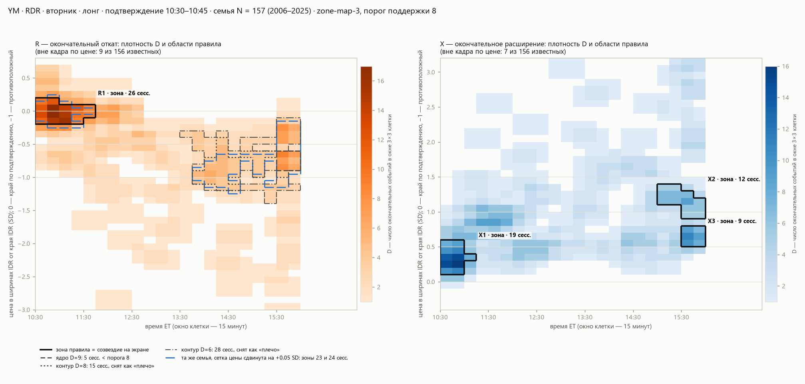

# YM · RDR · 20.10.2026: почему у семьи одно созвездие R

**Вопрос.** 20.10 на живой сессии YM RDR оператор увидел одно созвездие отката R1 у края коробки и ни одного ниже
цены. Есть ли в истории этой семьи плотность окончательных откатов там, где созвездия не нарисовано, и почему правило
`zone-map-3` её не выделило?

**Что это.** Разбор одного случая с описательными агрегатами. Он служит поводом и проверочным примером для
исследования созвездий ([бриф](../../meaning/lens/2026-10-20-sozvezdiya-issledovanie/BRIEF.md)). Это не новая
проверка метода и не подбор параметров: случай уже просмотрен людьми и агентами.

**Семья.** YM · RDR · вторник · лонг · подтверждение 10:30–10:45 (по подписи свечи), все сессии 2006–2025 с тем же
ключом. N = 157; у 156 окончательные R и X известны, у одной нет свечи M5. `family_id 94ff135d851522ab`,
`snapshot_id 5e45094fe4034c9f`.

**Данные и код.**
- Слепок семьи сохранён с локального сервера (`/api/d24/family`, стенд 23.5 на 8735). Алгоритм на стенде совпадает с
  `main` построчно (`lab/scene24.py`, `lab/zonemap24.py`).
- Слепок содержит записи отдельных сессий. Он остаётся локально, в `lab/.runtime/` (жёсткое правило 1).
- [`check.py`](check.py) пересчитывает зоны и их диагностики функцией продукта `zonemap24.evaluate`, а области
  вершин и сдвиги сетки — её же `map_of` и `cell_of`. Затем сверяет результат двумя способами:
  - с опубликованным снимком, поле за полем: маски клеток, составы сессий, границы, якорь, остаток и все диагностики;
  - с эталоном контракта `lab/contract.py::ref_zone_map`. Это независимая реализация правила на чистом Python,
    написанная по его тексту, без scipy и без кода `zonemap24`. Сверяются маски, составы и остаток.

  Пишет только агрегаты: [`results.json`](results.json) с итогом сверки и рисунок.
- Независимо от этого скрипта случай раньше проверил другой агент: отбор семьи по закрытиям M5 совпал у 157 из 157,
  окончательные R сверены с M5 базы — 0 расхождений. Его записи по сессиям тоже лежат локально.

```bash
python -B studies/ym_rdr_2026_10_20/check.py <snapshot.json>
```

## Что получилось



На рисунке нет звёзд. Цвет клетки — плотность D: число окончательных событий семьи в окне 3 × 3 клетки (0,3 SD ×
45 минут) вокруг неё. Чёрный контур — зона правила, то есть созвездие на экране. Серые пунктиры — области, которые
правило отвергло. Синий пунктир — зоны той же семьи на сетке цены, сдвинутой на 0,05 SD.

### R — окончательный откат

| Что | Цена, SD | Время ET | Сессий | Решение правила |
|---|---|---|---|---|
| Вершина D = 17 | −0,2…+0,2 | 10:30–11:45 | 26 (16,6 % N) | **зона R1** |
| Вершина D = 7, её половина высоты | −0,4…+0,6 | 10:30–12:45 | 47 | снята: внутри есть вершина выше (17) |
| Вершина D = 9 (−0,7 SD, 15:30) | −0,9…−0,6 | 15:30–16:00 | 5 | меньше порога поддержки 8 |
| Вершина D = 8 (−0,9 SD, 15:30) | −1,2…−0,4 | 13:45–16:00 | 15 | снята как «плечо»: внутри вершина 9 |
| Вершина D = 6 (−1,0 SD, 14:00) | −1,4…−0,1 | 13:30–16:00 | 28 | снята как «плечо» |
| Вершина D = 4 | −1,4…+0,7 | 10:30–16:00 | 115 | всё сливается в один гребень |

Числа разных строк не складываются: это вложенные области на разных уровнях плотности.

- **Порог поддержки:** max(4; ⌈0,05 · 157⌉) = 8. Отдельной константы «8» в правиле нет.
- **R1 неустойчива к составу семьи:** при 50 пересэмплированиях сессий её состав в среднем восстанавливается на 0,48
  (Жаккар), не меньше половины — в 40 % повторов. Против путей без направления у R1 избытка нет: −0,013.
- **Сдвиги сетки:**
  - цена +0,05 SD — две зоны: 23 сессии (−0,25…+0,25 SD, 10:30–11:45) и **24 сессии (−1,25…−0,15 SD, 13:45–16:00)**;
  - время +5 минут — одна зона из 26;
  - время +10 минут — две зоны: 21 и **15 сессий (−1,2…−0,4 SD, 13:40–16:10)**.

### X — окончательное расширение

| Зона | Цена, SD | Время ET | Сессий | Устойчивость |
|---|---|---|---|---|
| X1 | +0,1…+0,6 | 10:30–11:15 | 19 (12,1 %) | сетка: Жаккар ≥ 0,9; пересэмплирование 0,48; против путей без направления −0,064 |
| X2 | +0,9…+1,4 | 15:00–16:00 | 12 (7,6 %) | при сдвиге цены на 0,05 SD исчезает (Жаккар 0); пересэмплирование 0,24 |
| X3 | +0,5…+0,8 | 15:30–16:00 | 9 (5,7 %) | пересэмплирование 0,11 |

Отвергнуты как «плечи»: ранняя область 0…+1,1 SD, 10:30–12:15, 40 сессий; поздняя +0,4…+1,4 SD, 14:45–16:00,
25 сессий. На рисунке у X видна полоса умеренной плотности около +0,4…+0,6 SD через весь день: цена у неё
сосредоточена, время — нет. Зоной стала только её ранняя часть X1.

### Распределения целиком — для сравнения с прочтением автора

Это не созвездия, а квантили всех известных окончательных событий семьи, за весь горизонт.

| | 10 % | 30 % | 50 % | 70 % | 90 % |
|---|---|---|---|---|---|
| R, SD | −2,26 | −1,03 | −0,55 | −0,19 | +0,10 |
| R, время | 10:45 | 11:35 | 13:00 | 14:40 | 15:55 |
| X, SD | +0,32 | +0,59 | +0,92 | +1,30 | +2,72 |
| X, время | 10:40 | 11:40 | 13:30 | 15:05 | 15:55 |

## Как это читать

1. **Реализация соответствует объявленному правилу.** Для R и X три источника дают одно и то же: пересчёт функцией
   продукта, опубликованный сервером снимок (вместе с диагностиками) и независимый эталон контракта. Эта сверка ничего
   не говорит о том, хорошо ли само правило.
2. **Под R1 есть плотность, которую правило не признало.** Это не одиночные звёзды. Есть сгущение на 15–28 сессий
   в 13:30–16:00 около −0,4…−1,4 SD. Его узкая вершина на половине своей высоты держит 5 сессий. Широкие контуры
   вокруг неё сняты как «плечи», потому что в них лежит эта вершина. Небольшой сдвиг сетки делает это сгущение зоной
   из 24 сессий. Значит, отсутствие созвездия здесь зависит от дискретизации и от одноуровневого правила.
3. **Это не доказывает, что там «настоящее» созвездие.** Сгущение позднее, у конца сессии. По аудиту 18.10 поздние
   окончательные R почти всегда случаются после вершины сессии. Метод мог бы назвать его отдельной зоной, но его
   смысл для трейдера — другой вопрос.
4. **Показанные зоны сами неустойчивы.** Пересэмплирование восстанавливает их на 0,11–0,48. Ранние R1 и X1 не
   превышают путей без направления.
5. **Ту же историю метод автора прочитал бы иначе.** У автора зоны отката — 1–2 самые плотные ячейки цены,
   покрывающие медиану и 70-й перцентиль. Медиана окончательного R здесь −0,55 SD, а 30 % сессий ушли глубже
   −1,03 SD. Единственное наше созвездие R лежит у мелкого края (−0,2…+0,2). Сравнение неточное: автор берёт только
   сессии с удержанным DR и откаты до своей отсечки по времени.

## Пределы

- Один семейный слепок; вывод о правиле в целом отсюда не следует.
- История 2006–2025 уже просмотрена линией разработки; это не проверка на новых данных. 2026 в историю не входит:
  сегодняшний день — только повод.
- Записи по сессиям, слепок и снимок API не публикуются.
